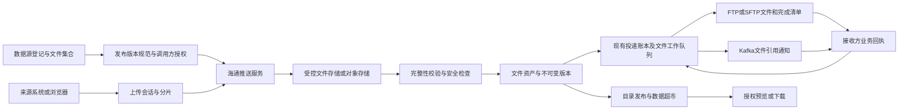

# 海通数据推送服务（haitong-data-pull）

本文件是本工程唯一的持续维护说明。功能、接口、配置、部署和验证边界在对应章节原位更新；版本差异通过 Git 查看，不再新增按日期、版本或阶段命名的增量文档。仓库仅保留根目录 README 总入口。

仓库规则以 [AGENTS.md](../AGENTS.md) 为准；数据库现行完整结构见 [db/](data-elements.md#database-schema)。文中保留的设计背景与既往验证只说明当时范围，不代表新环境已验收，也不能覆盖现行租户与身份边界。历史截图、JSON 报告和旧版本评审材料不作为当前文档依赖。

当前 MySQL `haitong` 完整结构统一维护在 [`db/haitong/init.sql`](../db/haitong/init.sql)，当前实库为 15 张表（含文件上传、分片、配额、业务回执四张运行表）。达梦原有适配定义保存在 [`compatibility/dameng.sql`](../db/haitong/compatibility/dameng.sql)，为未核验的 9 表兼容模板；本次文件功能仅支持 MySQL/H2，达梦启用时明确拒绝。H2 资源仍随应用打包，供本地运行与测试。已有库升级需审查差异，不能直接重跑完整初始化文件。

只读更新 MySQL 完整基线：在仓库根目录执行 `python tools/export-db.py --project haitong-data-pull`。连接配置保存在仓库外私有配置的 `project_databases` 中，详见[结构维护](data-elements.md#resource-versioning)。

## 目录

- [Magic API 统一入口与业务实现](#magic-first)
- [业务推送校验开关](#push-validation-switch)
- [非结构化数据接入：当前实现与平台扩展设计](#unstructured-design)
- [工程概览与使用](#overview)
- [Linux / Windows 原生部署包](#native-release-packages)
- [统一数据推送接口文档](#guide-38565d24)
- [FTP / SFTP 投递诊断说明](#guide-ee01ab21)
- [Magic-API：02.零信任网关对接](#guide-89fdbceb)
- [haitong（海通）详细设计](#guide-81a7266f)
- [海通：三个场景快速使用](#guide-a185e7e4)
- [从V1.0升级到haitong V1.1](#guide-be3d02f6)
- [推送密钥与独立登记同步说明](#guide-a25caa3b)
- [独立登记配置同步接口](#guide-f5f5b5dd)
- [独立运行模式](#guide-985aca91)
- [海通与数据源登记推送规范接入说明](#guide-a3391486)
- [haitong-data-pull（海通数据推送服务）V1.1 配置与部署](#guide-3e6991f8)
- [Linux 部署](#linux-deployment)
- [Windows 独立部署](#windows-deployment)
- [只读对账查询](#reconciliation-queries)

<a id="push-validation-switch"></a>

## 业务推送校验开关

`relay.security.push-validation-enabled` 同时控制标准业务推送的密钥认证与登记契约校验。省略该项时默认 `true`，保留已有部署行为；原生分发包显式设为 `false`，便于按部署方要求接收未登记数据。修改 YAML 后重启生效，和仅控制编辑器示例执行的 `haitong.validation.enabled` 无关。

```yaml
relay:
  security:
    push-validation-enabled: false
  files:
    unregistered-targets: [ftp]
```

| 状态 | 业务身份 | 数据源、表、字段 | 附件 |
| --- | --- | --- | --- |
| `true` | `X-Api-Key` 或 Bearer 验证本地静态调用方/数据库签发凭据，随后校验通道权限 | 海通独立库登记镜像为权威；没有镜像时兼容 YAML 契约，检查有效状态、调用方授权、表白名单、字段白名单及必填值 | 本机 `files.collections` 约束来源、集合、调用方、格式/大小及目标 |
| `false` | 标准推送可省略或传入任意 `X-Api-Key`，统一使用非管理员身份 `unvalidated-publisher` | 不查询登记镜像、不校验登记状态、表字段白名单和必填字段；`datasourceId/tableName/records` 等基础参数仍须正确 | 不要求预先登记集合；固定本地隔离域 `unvalidated-push`，按 `files.unregistered-targets` 和全局传输配置生成运行契约；不接受请求中的租户或目标地址 |

开关适用于 `/api/v1/data-push`、FTP/Kafka/LOG 兼容入口、`/push-operations` 的推送/状态测试入口，以及分片和兼容整文件上传、完成、提交、取消、状态与内容读取。未认证的请求不能访问历史已认证调用方的消息/文件。关闭时不同匿名发送方共享一个身份，须为每个业务批次使用全局唯一 `Idempotency-Key`；同一键及同一原始正文重试返回原消息，正文改变仍返回冲突。重新开启后，匿名模式创建的对象不会自动转授给其他业务密钥。

Magic 编辑器登录、`/internal/**` 运维及签发、`REGISTRY_SYNC` 服务间鉴权、下游业务回执和通用动作入口继续单独保护。可选 `X-Gateway-Key` 网关限制、路径格式、请求大小、记录数、幂等、配额、文件签名、SHA-256 和分片状态校验不因开关关闭而取消。未登记附件只支持既有 `jpg/jpeg/png/pdf/docx` 技术格式；若配置了 `scanner-command` 则继续执行扫描，无扫描器时记录 `HEADER_VERIFIED_NOT_SCANNED`。本地 FTP/Kafka 连接和目标仍必须启用并配置正确，接收结构化数据不等于平台已经知道如何物化该表，后续平台接入仍需自己的表结构。

已有环境升级须部署新 JAR 并更新独立库中的表契约 Magic 函数。JAR 启动不会覆盖编辑器已有脚本。原生包提供 `magic-update/` 中的两项选定资源及 `scripts/update-push-resources.py`，在服务根目录执行 `python3 scripts/update-push-resources.py --username <编辑器账号> --apply`（Windows 用 `python`），按提示输入编辑器密码。工具先核对资源身份、已知旧脚本/当前脚本及并发变动，再只更新表契约脚本和模板测试的可选密钥头，通过编辑器保存并回读；自定义脚本冲突时停止并要求人工合并。备份仅保存于部署方受限 `config/secrets/magic-resource-backups/`，不进入 Git 或发布包。无 Python 时可在编辑器手动更新包内同名表契约函数。全新资源库自动加载当前版本。

`PushValidationSwitchTest` 覆盖关闭后的未登记推送、非法密钥忽略、幂等冲突、重新开启后的拒绝、管理和同步边界、匿名/原有身份隔离及未登记分片上传完成投递。20/100 条记录分别为 1 次请求、6 次 SELECT，登记镜像 SELECT 均为 0；既有开启模式的授权和固定查询数由 `MagicBusinessHttpTest` 回归。仅新增配置和逻辑，没有数据库结构升级。

原生包还通过隔离 H2、真实 HTTP 18083 和本地 FTP 的整链路验证：模拟旧 Magic 函数后，经包内更新工具保存并回读，新规范下 50 条未登记记录成功投递且重试复用原消息；160014 字节文件分 3 片上传并成功投递，FTP 原文字节及完成清单核对通过。此结果不代表生产环境网络、账号或 FTP 已验证。

`400/INVALID_PATH` 发生在身份与登记校验之前。现行检查拒绝原始路径中的百分号、分号、反斜杠、重复斜杠及点路径段，URL 末尾的 `%20` 空格、`%0A` 换行可复现该响应。直连默认端口使用 `/api/v1/data-push`；只有实际配置 `server.servlet.context-path: /data`，或代理提供且正确转发该前缀时才使用 `/data/api/v1/data-push`。过滤器现按服务器可信 Servlet context 去掉前缀后识别业务、编辑器及管理路径，仍对原始 URI 检查异常字符；不信任客户端传入的 `X-Forwarded-Prefix` 来扩大匿名接口。仅 `/data` 本身不会导致 `INVALID_PATH`，截图无法证明具体隐藏字符，须通过 Postman Console 或服务器的实际请求 URI 核对；不应靠关闭业务密钥校验来修复路径错误。

<a id="magic-first"></a>

## Magic API 统一入口与业务实现

海通推送服务的 **37 个原 Java Controller 方法/路径组合均由 Magic API 注册**，原 `/api/v1/**`、`/internal/v1/**` 和 `/internal/push-credentials/issue` 地址继续使用。5 个业务 Controller 和将全部推送业务转给 Controller 的 `PushOperationsApi` 已移除。编辑器、Actuator 健康检查等框架管理入口仍由框架提供，不属于这 37 个业务接口。

文件资源模式默认读取 `./data/magic-api`，与内置资源初始化目录一致；正式原生部署模板使用独立数据库资源，不受此文件目录影响。批量文件导入通过 Servlet `Part` 读取原始 multipart 文件；表批次的缺失类型、空记录数组及已取消字段等基础契约错误返回 422，与本文件接口规范一致。集成测试的文件资源隔离在测试工作目录内，避免把上一次保留的脚本当成本次构建版本。

本机独立海通服务与原生部署模板统一使用 **18083**：服务为 `http://localhost:18083`，编辑器为 `http://localhost:18083/api/web/index.html`。共享元数据平台后端仍使用 8088；登记页面推送地址来自当前网络的推送节点配置，节点根地址与平台海通同步目标均应使用 18083。

唯一可维护源码位于 [`magic/haitong/`](../magic/haitong)，独立索引为该目录 `.manifest.json`。Maven 将它打包到 JAR 的 `magic-api-bootstrap/`；该目录只是类路径资源名称，工程内不再维护第二份脚本。运行源仍是独立 MySQL `haitong.ht_magic_api_file`，不会写入共享控制库 `baseline.api_file_t`。启动只补缺失目录和资源，不覆盖编辑器已有内容。

| 编辑器分组 | 方法/路径数量 | 职责 |
| --- | ---: | --- |
| 05.数据接收入口 | 9 | 统一推送、FTP/Kafka/日志兼容入口、通道接收、消息状态、文件批量导入与操作执行 |
| 06.运维管理 | 14 | 概览、配置摘要、任务分页、失败重试、UNKNOWN 核实、文件扫描、协议探测、隔离消息、原文、OpenAPI、日志与对账 |
| 07.推送密钥 | 1 | 平台服务签发和显式轮换数据源业务密钥 |
| 08.附件传输 | 13 | 单次上传、初始化、分片、完成、提交、取消、状态、分页、批量状态、回执及 GET/HEAD 内容读取 |

原 02.零信任网关对接、03.FTP诊断和04.数据推送调试仍保留。04 分组与正式入口共用脚本业务函数；旧调试入口保留 Magic 成功信封和原有 JSON 规范化幂等语义，正式入口保留原始 JSON 字节幂等语义及原生 HTTP/JSON 响应。

`09.数据推送验证` 是可直接运行的 Postman 请求示例。01～06 分别向正式 `POST /api/v1/data-push` 发送状态字典、机构字典、人员、车辆、事件和事件操作日志各两行合成数据；07～09 对正式附件接口发送内嵌 PNG 的原始字节；10 提交附件；11、12 各执行一次附件或业务消息状态查询。每条脚本按 URL、Headers、Body、一次 HTTP 调用、响应的顺序格式化，逐项说明数据源 ID、登记表名、字段、幂等键及返回 ID 的获取位置。脚本不直接调用内部业务函数，也不隐藏同步、查询数据库或轮询流程。

本机登录编辑器后打开示例并点击“运行”，无需填写下方接口信息页。脚本中的 `X-Api-Key` 从仓库外 YAML 的 `haitong.validation.api-key` 读取，并经通用密钥解析器支持 `env:` 引用；本机绑定已获授权的测试客户端及测试源，响应只显示脱敏请求头。复制到 Postman 时使用脚本中的正式 URL、对应请求头和 Body，并在本机填入该源业务密钥。部署到其他环境须先登记自己的测试源，替换源 ID、表名与返回 ID，再配置专属测试密钥。

`/validation/**` 仅供已登录的海通编辑器执行示例：需显式启用 `haitong.validation.enabled`，校验编辑器令牌、资源 ID、实际路由和 HTTP 方法。普通业务密钥不能调用这些持有服务器测试密钥的示例；正式 `/api/v1/**` 仍只接受其原业务认证。原生包默认停用示例执行，已有正常业务接口不受影响。Java 过滤器只补齐编辑器会话与 HTTP 示例执行入口的认证适配，HTTP 参数及调用保留在 Magic 源码中。

本机示例还预填已验证的附件、消息标识及各接口独立的幂等键，填写本数据源的 `X-Api-Key` 即可重放并查询原结果；修改请求正文时须同步更换 `Idempotency-Key`。状态查询只要求业务密钥，不要求幂等键。编辑器登录口令与业务密钥分别维护在仓库外受限配置中，不能放进脚本、工作簿或发布包。

附件测试按以下顺序进行：在 `07.人员附件上传`、`08.车辆附件上传` 或 `09.事件附件上传` 中填写本数据源密钥并执行，查询 `11.附件状态查询` 至 `state=READY`；再执行 `10.附件提交投递`，查询至 `deliveryStatus=SUCCEEDED`；把返回的 `fileId` 写入相应业务记录的 `attachment_file_id`，执行业务数据接口后用 `12.业务消息状态查询` 确认完成。上传测试入口仅接受 1～65536 字节的 Base64 原文，正常大附件继续使用正式二进制流或分片接口。附件大小、扩展名、所属表字段、调用方和目标均由服务端集合契约校验；上传完成不能代替目标投递完成。

配套工作簿的登记工作表为 `数据表信息` 和 `数据字段`，附带 `填写说明`、`业务数据示例`、`附件清单`。附件字段须声明 `是否关联附件`、`附件大小上限(MB)` 和 `附件格式`；示例为三个字符串附件字段、每文件上限 10MB、PNG 格式。六张表共 45 个字段、36 条业务示例、六个实际附件。示例不包含任何密钥；业务密钥从登记第五步获取，节点管理同步当前已完成登记的配置后再测试。

平台接入与海通投递分别配置同一文件通道：海通 `relay.ftp.output-dir` 为业务根目录，平台 ODS/FJGHCC 绑定到相同协议、服务器和根目录，平台任务再拼接 `datasourceId/tableName/`。任务按 `.json.done` 发现已完成批次，数据库成功提交后删除 JSON 和标记；下载或处理失败不删除，字段校验按整份文件失败。后续库通过接入链路读取首个落地库，并继承登记的时间戳字段。`SUCCEEDED` 是海通已投递的历史证据；平台成功接入后源文件会被删除。重放同一幂等键只返回原受理结果，不重新生成文件，验证新数据须更换批次和幂等键。附件原文位于独立集合目录，不由结构化 JSON 接入任务删除。

通用 JSON 回放过滤器适用于所有动态业务路由，仅排除 Magic 编辑器资源接口。新增分组不再要求修改 Java 路径白名单；重复读取仍受消息体大小和压缩限制保护，正式接口继续以原始字节核验幂等。Magic 发布工具向编辑器提交统一 LF，并在回读时规范化换行和编辑器补充的空 `properties`，避免 Windows CRLF 被重复扩展；数据库并发摘要校验仍比较实际运行内容。

`function/01.海通业务/` 的九个函数分别维护公共请求边界、表批次契约、消息与文件统计、登记同步、密钥签发、推送编排、运维状态处理、交换台账与对账、附件请求与传输编排。以下规则与 SQL 已实际迁入 MagicScript，而非通过脚本转发 Java Controller：

- 登记完整快照的规模、重复项及字段合法性验证，同一事务内批量停用/写入数据源、调用方、表与字段；幂等账本与镜像一起提交或回滚。
- 独立表模式的服务器授权、表/字段白名单、必填字段及服务端规范版本检查；数据库镜像已有记录时不回退 YAML。每批固定四次规范读取，不逐记录查询。
- 密钥首次签发、重复获取不泄露明文、显式轮换和摘要持久化；Java 认证适配器只按摘要查找调用方。
- 推送通道选择、登记规范与幂等前置、同步/异步操作编排、消息归属与结果脱敏。
- 运维列表 SQL、失败安全重试、UNKNOWN 人工核实与审计上限，状态更新和审计在同一事务；对账窗口与汇总 SQL。
- 附件请求字段、分页与批量规模、状态呈现、授权批量查询和下载就绪判断。

Java 保留通用 HTTP 安全与字节流适配、数据库连接与方言、认证/审计、协议客户端、持久队列、执行租约，以及文件上传传输内核。文件内核目前仍负责会话初始化、分片写入、配额账本、完成/提交/取消/回执的原子状态操作和后台合并/签名/安全校验；这些是本次未继续拆出的边界，不能声称全部 Java 业务规则已清空。改变文件集合权限模型、上传持久状态协议或后台执行算法仍需修改相应 Java 并部署 JAR。日常登记字段、推送编排、查询、密钥生命周期和运维规则调整可只发布所选 Magic 函数。

`MagicHttp` 只提供组件查找、受限正文、随机数、标准 HTTP 响应与受控路径流式读取，不包含业务表 SQL。JSON 在进入 Magic 转换器前受限读取并保存原始字节，防止破坏幂等或无界解析；octet-stream 不经过 JSON 缓存，上传/下载使用 64KiB 缓冲，保留 Range、If-Range、HEAD、ETag 和并发流预算。

维护命令均在仓库根目录运行：

```powershell
python tools/resource-sync.py status --project haitong-data-pull --kind magic
python tools/resource-sync.py plan --project haitong-data-pull --file "magic/haitong/function/01.海通业务/06.数据推送编排.ms"
python tools/resource-sync.py publish --project haitong-data-pull --file "magic/haitong/function/01.海通业务/06.数据推送编排.ms" --apply
```

首次接管使用 `pull --project haitong-data-pull` 只读核对并登记当前基准，不覆盖本地源。发布前比较资源 ID、路径及基准摘要，备份到仓库外私有目录；编辑器保存后核对运行脚本和数据库正文。分组元数据通过有条件更新保存后要求冷加载，不能将持久化成功当作运行已刷新。日常脚本发布不需要重启；新增 Java、依赖或目录变更须重新打包部署并回读。此迁移没有增加或修改数据库结构。

`MagicBusinessHttpTest` 通过实际 Magic HTTP 处理器覆盖登记 20/100 项固定 4 次读取 SQL（含两次 HTTP 审计时钟读取）、批次授权收紧、故障事务回滚、原始字节幂等、运维查询与原文下载；`PushOperationsMagicTest` 编译全部脚本并核对 37 路由无重复及没有业务 `@RestController`。`FileUploadHttpTest` 的阻塞 HTTP 用例覆盖附件完整生命周期、回执、Range/HEAD 与单次流式上传，需显式启用 `-Dhaitong.loopback.tests=true`。3GiB 压力用例与真实 MySQL专用用例另有独立开关，未启用时不计为通过。

<a id="unstructured-design"></a>

## 非结构化数据接入：当前实现与平台扩展设计

**当前已实现海通服务自身的完整文件链路：服务端集合规范 → 初始化并预留配额 → 分片上传/续传 → 异步合并、SHA-256、格式及可选外部安全检查 → 原有投递台账 → LOCAL/FTP/SFTP 原文投递或 Kafka 引用通知 → 鉴权回读及业务回执。** 默认关闭，通过 `relay.files.enabled=true` 和明确的集合、调用方、目标配置启用；原表批次接口继续共用同一 JAR、认证和投递账本。

按当前开发范围，**FILE 域运行策略同步、行业 FILE 资产/不可变版本、目录/超市与 ES、平台 FJGHCC 异步复制及对象存储直传仍待后续实施**。当前 `fileId` 是海通服务内固定内容的文件标识，不等同于行业平台的 `assetVersionId`。第 4 节是已实现的接口规范；涉及平台的其余设计仍表示后续目标，不能据此调用尚未实现的接口。

可维护配置示例为 [`application-files.yml.example`](../haitong-data-pull/config/application-files.yml.example)，默认整文件、可选分片续传的标准库流式客户端为 [`upload_file.py`](../haitong-data-pull/scripts/upload_file.py)，机器接口定义在 [`openapi.yaml`](../haitong-data-pull/src/main/resources/openapi.yaml)。配置只声明服务端可信租户、集合和目标，API 请求不接受 tenantId、路径、Topic、存储地址或回调 URL。

平台数据源登记通过“推送数据类型”区分结构化与非结构化，默认结构化。第一步的地址和第五步规范均取所选网络在节点管理中的启用默认推送节点。结构化继续使用原表/字段模板、五步流程和 `/api/v1/data-push` JSON 协议。非结构化使用“填写说明＋文件登记”Excel，文件名称、说明、格式、单文件大小上限（MB）必填，可选关联表/字段；保存后跳过中间三步直接进入原第五步内容审查。文件定义复用平台既有表/字段快照，以 `table_type=FILE` 区分，格式/上限/可选关联保存在现有治理配置；不新增登记表，不按结构化表发布合同或物化。第五步突出 `PUT /api/v1/file-uploads/{id}/parts/{part}` 主接口，其他五项操作默认折叠展示，并说明先初始化，再分片上传、合并、等待 READY、提交、确认投递成功。

登记得到的稳定 `collectionId` 须由部署方对应配置到海通 YAML 的 `relay.files.collections.<key>.collection-id`，同时匹配 `datasource-id`、`clients`、格式和大小限制。当前登记只保存平台定义，不会自动创建海通运行集合或放宽权限；FILE 域运行策略同步仍为后续范围。海通目标存储继续仅由自己的 YAML 决定，独立部署不依赖平台在线。现有整文件兼容 API 及命令行客户端参数仍保留，登记页面统一以分片接口作为非结构化标准。

当前使用单节点持久卷，目录加进程锁；相同本地卷不能同时运行两个文件实例，也不能将各自拥有本地卷的多个实例直接置于随机负载均衡后。正式多实例需完成共享对象存储适配及跨节点校验。普通文件 API 与旧表批次共用 HTTP 服务，分片流量仍会占用该进程的网络和数据库；文件校验池、FILE_LOCAL/FILE_FTP/FILE_KAFKA 投递池分别有界，不承诺物理资源完全隔离。

### 1. 总体决策与现状依据

**沿用同一个海通推送应用、统一认证、登记规范与投递账本，增加文件专用入口、可恢复上传会话和文件版本能力。** 原 `/api/v1/data-push` 继续接收表批次 JSON；新文件接口传文件原始字节或已上传文件的引用，文件内容不进入表批次 JSON、MySQL 大字段或 Kafka 消息。

| 现有基础 | 源码中已具备的行为 | 本设计要补充的部分 |
| --- | --- | --- |
| [Magic 数据接收入口](../magic/haitong/api/05.数据接收入口) | `POST /api/v1/files/{channel}` 接收 multipart，`GET /api/v1/files/{id}` 查询状态；依通道授权 | 数据源、文件集合、规范版本、业务元数据、分片及续传；旧通道入口不能绕过新登记权限 |
| [PayloadFiles](../haitong-data-pull/src/main/java/com/haitong/core/PayloadFiles.java) | 64KiB 缓冲流式写本地持久卷、计算 SHA-256、同步文件并原子改名 | 存储适配器、分片会话、多实例可访问的持久化位置、存储对象与数据库之间的恢复 |
| [FileService](../haitong-data-pull/src/main/java/com/haitong/core/FileService.java) | JSONL、CSV 与 BINARY；BINARY 只保存文件引用；文件处理 `runOne()` 串行，接收容量检查会 `Files.walk` 全工作目录 | 受控并发文件处理、配额账本、异步整文件校验和隔离检查，去掉每次上传的目录遍历 |
| [DeliveryWorker](../haitong-data-pull/src/main/java/com/haitong/core/DeliveryWorker.java) | 已按协议建立可配置线程池，带租约、续租、重试及不确定结果处理 | 同一协议内进一步区分大文件和表批次的资源预算；文件目标的就绪条件及远端异步复制状态 |
| [FtpConnector](../haitong-data-pull/src/main/java/com/haitong/connector/FtpConnector.java) | 文件流上传、临时名、远端读回校验、改名、`.done` 完成清单；FTP、FTPS、SFTP | 大文件的带宽预算、能力明确的续传、固定目标路径和接收端业务回执；读回校验成本不能忽略 |
| [RouteCatalog](../haitong-data-pull/src/main/java/com/haitong/config/RouteCatalog.java) | 当前 BINARY 只允许 FTP 或 LOCAL；现有 Kafka 发送的是消息字节 | 文件引用通知适配器、存储适配器；不能直接给旧 BINARY 路由增加 Kafka 然后发送整个文件 |
| 平台 [DataPushSchemaService](../data-elements-parent/src/main/java/com/linewell/dataelement/dataservice/push/DataPushSchemaService.java) | 现有推送发布和校验基于数据表、字段，不能发布无表的文件集合 | 文件集合的独立规范；复用既有发布、客户端绑定及服务间校验入口的组织方式 |
| [资源目录发布服务](../data-elements-parent/src/main/java/com/linewell/dataelement/feature/assetcenter/application/AssetCenterPublicationService.java) | 已定义 `FILE` 资源类型，但会拒绝没有可锁定版本服务的文件挂接 | 文件版本解析器、固定版本快照、目录与订阅的文件交付；不能只放开类型枚举 |
| `file_upload_t` | 通用附件记录，`file_size` 为 INT，缺少文件集合、不可变版本和投递规范 | 保留附件用途；非结构化业务文件使用专门的版本模型，长度与配额用 BIGINT |

当前应用内配置为 multipart 单文件 100MB、请求 101MB、落盘阈值 0，`RelayProperties` 默认单文件限制为 100MiB。外部配置、网关和部署可能覆盖这些值，真实有效上限取各层限制中的最小值。Spring 的落盘阈值只控制 multipart 临时存储，并不提供业务续传；属性语义见 [Spring Boot 3.3 MultipartProperties](https://docs.spring.io/spring-boot/3.3/api/java/org/springframework/boot/autoconfigure/web/servlet/MultipartProperties.html)。

### 2. 服务边界与部署方式

一期继续一个 `haitong-data-pull` JAR。登记平台与共享后端负责数据源、组织权限、文件集合及规范发布；海通负责上传和传输任务；受控存储保存原始字节。管理页面请求元数据，不通过低代码或 Magic 转发 GB 级文件正文。登记与权限仍使用现有权威业务表和服务，不另建一套数据源主表。



| 资源 | 必须采用的隔离方式 |
| --- | --- |
| HTTP | 文件流、表批次、管理查询分别限并发及请求预算；同一 JVM 仅拆线程池不能隔离 Tomcat 连接、堆、磁盘和网卡，所有层都要设总预算 |
| 工作线程 | 文件校验、恶意内容检查、文件投递、表批次投递分池，全部有界；文件任务不能借用表批次的全部协议线程 |
| 数据库连接 | 事务短且有连接预算；网络传输、文件哈希及扫描不持有事务或数据库行锁 |
| 存储与网络 | 按租户、数据源及服务实例限制并发流、每秒字节数、在途字节、待投递字节；对慢目标设置独立并发上限 |
| 扩展 | 同一代码产物可按 `api`、`file-worker`、`table-worker` 运行角色扩容。需要进程隔离时仍复用同一协议与账本，避免重新建设第二套业务服务 |

多实例前必须有可共享访问的文件存储，或经过明确验证的持久卷所有权和故障接管机制。不能把实例 A 的本地绝对路径保存后交给实例 B 执行，也不能只靠粘性会话声称支持故障切换。

### 3. 数据源登记与文件集合

数据的结构类型、接入方式、连接协议是三个不同维度。增加数据源内容类型 `STRUCTURED / UNSTRUCTURED / MIXED`，保留现有接入方式及其兼容映射；FTP、SFTP、对象存储是连接协议，既可能保存 CSV，也可能保存照片，不能单凭 `sourceType=ftp/minio` 判断为结构化表。

非结构化登记沿用现有五步向导和入口，按内容类型切换中间步骤：

| 步骤 | 文件类登记行为 | 核心校验 |
| --- | --- | --- |
| 1. 登记数据源 | 选内容类型、所属应用/机构、数据推送或数据抓取；推送不要求来源方提供数据库连接；抓取支持已有 FTP/SFTP/对象存储连接 | 当前租户、组织与应用范围；连接密钥受限保存，不进入公开规范 |
| 2. 定义或探查文件集合 | 建立“现场照片”“案件卷宗”等逻辑集合；抓取模式按目录/前缀分页探查文件元数据；推送模式填写集合定义和元数据模板 | 不伪造 JDBC 表，不将 JPEG、PDF 送入结构化表解析器；一次探查限制条数、目录深度、文件头采样字节 |
| 3. 登记元数据规范 | 维护 `businessKey`、业务编号、采集时间、文件类别、说明等字段、类型、必填、枚举和字典 | 标准与字典复用现有治理能力；受约束业务引用要验证归属，元数据最多 64KiB、字段数有界 |
| 4. 设置存储与交付 | 选择受控存储、允许格式、最大文件、保留策略、隔离检查和已登记的投递方案；需要时关联已存在业务表的逻辑业务键 | 调用方只能选择获授权的方案编号，不能提交实际 FTP 地址、目录、Bucket、Topic、回调 URL 或 SQL |
| 5. 审查并发布 | 展示文件规范、上传/续传示例、限额、接收进度、投递及回执状态；沿用现有数据源密钥签发与轮换 | 草稿与已发布版本明确区分；未发布集合不得正式推送；配置和密钥齐备时在当前入口完成启动准备 |

集合示例：`case_materials`，允许 JPEG/PNG/PDF/DOCX，元数据要求业务编号和材料类别，按业务键形成同一文件资产的后续版本。格式、上限、必填项、字典版本及交付规则冻结为 `contractVersion + contractHash`。修改草稿不改变已受理文件；旧版本能否继续接收由明确的有效期和吊销状态决定。

混合数据源同时展示“数据表”和“文件集合”，统计分开展示表数量、文件数量、文件总字节。文件数量和大小使用可重建的汇总字段，不塞入 `pool_cfg`，也不把文件数填写到现有表数量。`pool_cfg` 继续只保存连接与策略扩展，常用筛选维度用真实列和索引。

抓取现有目录时，每次只处理有界分页或增量清单。源文件采用完成标记、对象版本或读取前后指纹判断稳定性；路径、修改时间和对象 ETag 只能作候选变更线索，不能代替完整内容摘要。文件正在被修改时延后接收，不能登记一个半写入文件。抓取和主动推送最终进入同一文件版本及交付流程。

### 4. 当前文件接口与原接口兼容

源数据管理平台第一步模板可声明字段关联附件、大小上限和格式；第五步在表数据推送接口旁统一展示非结构化上传地址、规范及字段附件限制，已移除独立照片文档页签。先上传附件并校验就绪，业务表的关联字段保存返回的fileId。平台字段限制已纳入登记规范版本，但文件集合仍须在推送服务配置相应大小、格式、目标及调用方权限；现有表配置同步不会自动维护FILE集合，页面接入说明不代表节点已启用文件功能。

以下接口已在根目录 `magic/haitong/api/08.附件传输/` 定义，统一使用 `X-Api-Key`。初始化、业务提交和回执各自需要 `Idempotency-Key`，仅提供 `uploadId` 不代表有权访问。创建会话时按服务端集合确定租户、目标、内容格式和规范快照，快照不含连接凭据。

| 已实现接口 | 行为与边界 |
| --- | --- |
| `POST /api/v1/file-uploads/single` | 默认整文件入口：查询参数 datasourceId、tableName、fieldName、fileName，application/octet-stream 正文直接发送完整文件；携带 X-Api-Key、Idempotency-Key；返回202和fileId/statusUrl，自动进入异步校验 |
| `POST /api/v1/file-uploads` | 大文件分片模式：JSON 初始化会话并预留容量；返回 uploadId/fileId、partSize、partCount、状态、到期时间和查询入口 |
| `PUT /api/v1/file-uploads/{uploadId}/parts/{part}` | `application/octet-stream` 原始字节；片号从 1 开始；必填 `X-Part-SHA256`；服务端逐字节校验长度和 SHA-256，64KiB 缓冲写盘 |
| `GET /api/v1/file-uploads/{uploadId}/parts?after=0&limit=100` | 返回已确认片的 partNumber/size/sha256；按片号游标分页，最多 100 片 |
| `POST /api/v1/file-uploads/{uploadId}/complete` | 无正文；检查片数和实际字节总数，置 FINALIZING 返回 202；后台合并、校验、检查格式及运行配置的扫描器 |
| `POST /api/v1/file-uploads/{uploadId}/submit` | JSON 业务意图；可在上传结束前调用；预先持久化 messageId，READY 后原子建立消息、检查点和所有目标任务 |
| `GET /api/v1/file-uploads/{uploadId}` | 文件状态、confirmedBytes/completedParts、逐目标投递状态及独立 businessStatus/businessRef；不返回物理路径和凭据 |
| `GET /api/v1/file-uploads?limit=20&offset=0` | 服务端分页，limit 为 1～100，offset 不超过 1000000；当前服务端授权范围内计数与查询 |
| `POST /api/v1/file-uploads/status-batch` | JSON `{"uploadIds":["..."]}`；1～100 个不重复 ID，一次验证全部归属；任一 ID 不可访问即整批 404 |
| `DELETE /api/v1/file-uploads/{uploadId}` | 取消未提交且尚未进入 FINALIZING/READY 的上传；物理清理后释放配额，不直接删除已被业务引用的原文 |
| `GET/HEAD /api/v1/file-uploads/{uploadId}/content` | 就绪文件鉴权回读，支持单 Range、后缀 Range、ETag 和 If-Range；无权限 404，非法范围 416，附件方式返回 |
| `POST /api/v1/file-uploads/{uploadId}/receipts` | 已指定接收方身份回执；校验 deliveryId、目标、传输 SUCCEEDED、文件摘要和幂等键；业务状态为 ACCEPTED/REJECTED |

整文件默认上限20MiB，由 `relay.files.single-upload-max-bytes` 配置，并同时满足字段绑定集合的大小和格式限制；超限返回413 `SINGLE_UPLOAD_TOO_LARGE`。调用方只传 `datasourceId、tableName、fieldName、fileName` 和原始文件正文，不再传 `collectionId、size、sha256`，旧参数会被拒绝。文件名须URL编码，不接受租户或目标地址。服务端先按可信配置校验数据源、表、字段和调用方授权，再以64KiB缓冲有界暂存、统计实际字节数并计算SHA-256，支持没有Content-Length的流；空文件、超限、断线和长度不符会清理暂存。接收阶段不占用长数据库事务，暂存并发受max-streams限制，额外临时磁盘上界为max-streams × single-upload-max-bytes，并预留磁盘安全余量；启动持有节点锁后清理断电遗留的incoming文件。测得大小后才创建持久会话和两倍大小的配额预留，复用原有分片落盘、异步格式/扫描、下载和业务提交机制。该方案增加一次有界磁盘拷贝，以避免整文件占用堆内存；大文件仍走原分片续传协议。重复请求比较服务端计算的实际正文摘要，同键不同文件409；中断后使用相同幂等键重发整文件，两种模式不能混用同一初始化幂等键。

整文件附件绑定在服务端集合配置中声明 `table-name` 和 `field-name`，数据源与表字段组合唯一；现有显式配置为 `表名.字段名` 的集合可按同样命名解析，不创建新集合、不扩大租户或密钥权限。未配置或无权的表字段返回404。内部文件长度、摘要、配额与分片完整性字段继续由服务端维护；大文件分片初始化仍保留其独立协议所需的size及可选sha256。

分片初始化正文（字段名与实际接口一致；不接收 tenantId、contractVersion、mediaType 或目标地址）：

```json
{
  "datasourceId": "case-source",
  "collectionId": "case-documents",
  "fileName": "material.pdf",
  "size": 3221225472,
  "sha256": "填写原始文件实际计算得到的64位十六进制SHA-256"
}
```

`sha256` 可省略；服务端始终计算完整摘要，有声明时必须一致。`size` 是正整数字节数。默认 16MiB 分片，3GiB 为 192 片，初始化拒绝超过 10000 片的组合。媒体类型按允许扩展名和内容检查确定，不接受客户端覆盖。

业务提交正文：

```json
{
  "businessKey": "DEMO-CASE-001",
  "metadata": {
    "caseNo": "DEMO-CASE-001",
    "documentType": "DOCUMENT"
  }
}
```

元数据按冻结集合规范限制字段、类型和必填项，单次控制正文最多 64KiB；目前类型为 STRING/NUMBER/BOOLEAN，尚未接入行业字典和业务表外键解析。相同会话只能提交一个业务意图；同键同内容返回同一标识，不同内容 409。`complete` 根据会话状态幂等，无需额外幂等键。重复片也重新核对实际正文，不能仅凭声明摘要返回成功。

受理前 `/messages/{messageId}` 返回 WAITING_FILE 或明确的终态；READY 并正式建任务后兼容原消息查询。状态页首选会话 statusUrl，能同时看到文件校验、各目标传输及业务回执。Kafka 消息包含 schemaVersion、messageId、deliveryId、fileId、集合、大小、摘要、元数据和相对 contentUrl；接收方使用约定的海通 base URL 与其自身只读凭据获取文件，通知中没有密钥、私有磁盘路径或 Base64 原文。

原 `/api/v1/data-push`、旧 `/files/{channel}` 和原通道路由保持原有语义。旧 BINARY 通道不会自动成为新的文件集合。平台 FILE_VERSION_REF、短时下载授权、`/file-push` 快捷入口、multipart 表单入口、批量业务提交和内部 FJGHCC 复制回调目前均未开放；默认使用 `/api/v1/file-uploads/single` 原始字节整文件接口；大文件保留原分片协议。

### 5. 大文件上传与存储

以下是待压测调整的初始策略，不是已经验证的容量承诺：

| 文件规模 | 上传策略 | 初始参数 |
| --- | --- | --- |
| 不超过 20MiB | 默认整文件接口，流式落地；需要续传可显式选分片 | 不在业务堆中整文件缓存；扫描和投递仍异步 |
| 20MiB 至 1GiB | 标准分片，失败只重传缺失片 | 默认 16MiB/片，单文件 2～4 个并发片 |
| 1GiB 至 10GiB | 强制分片和续传，显式预留容量 | 初始单文件上限 10GiB；单调用方在途大文件数、总字节受限 |
| 超过 10GiB | 通过集合策略和压测放开，优先存储直传及受控复制 | 不通过简单放大一个 HTTP 超时宣称支持任意大文件；每种存储验证自身分片限制 |

整文件与raw分片接口都流式写入受控存储；浏览器只使用 `Blob.slice` 等有界分片，禁止整文件 `arrayBuffer`、整文件 Base64 或每片再复制成多份大数组。对象存储直传作为同一会话协议的可选模式，后续可避免文件正文经过应用节点；存储的 multipart 与业务 `complete` 状态必须对应并可恢复。

生产多实例优先复用现网受控的对象存储；初期小规模单节点可用已有持久卷，存储适配接口至少提供创建会话、写片、列片、完成、读取、取消和删除能力。对象定位保存存储编号、对象键和原生版本，不能保存会过期的下载 URL。存储扩展不改变业务文件 ID。

分片规则由服务器返回，校验片号、预期长度、总字节及已确认片摘要。只有最后一片可以小于标准片长。相同片并发上传使用短事务领取和 fencing token；网络写入放到事务外，提交时以 CAS 检查领取版本，过期执行者不能覆盖已确认片。存储对象采用不可预测的暂存键和受限命名空间，重复片内容冲突返回 409。

使用 S3 类 multipart 时，适配器须验证服务端的片数、片大小、完成列表和校验语义；不能因为接口名称兼容就假设行为完全相同。16MiB 是本系统初始选择，实际边界参考所用产品。S3 原生支持失败片独立重传，其限制见 [S3 multipart 约束](https://docs.aws.amazon.com/AmazonS3/latest/userguide/qfacts.html)，流程见 [multipart 上传说明](https://docs.aws.amazon.com/AmazonS3/latest/userguide/mpuoverview.html)。

完整 SHA-256 必须针对按片号拼接后的原始字节计算。片摘要拼接后的摘要、multipart ETag、存储复合校验值不能冒充整文件 SHA-256。若存储没有提供满足本规范的完整 SHA-256，后台流式读一次计算并与客户端可选声明比对；该读流量必须计入容量与时间预算。校验类型差异见 [S3 完整对象与复合校验说明](https://docs.aws.amazon.com/AmazonS3/latest/userguide/checking-object-integrity-upload.html)。

本地合并模式通常需要分片与最终文件同时存在的空间，容量按接近两份原文及在途写入预留；对象存储原生合并也要计入未完成 multipart 的占用。不能把“合并不占堆”理解为“不占额外存储”。

### 6. 当前上传、恢复与正式受理

1. 初始化在一个事务中预留全局和集合容量，插入带服务端租户、owner 和冻结规范的会话。配额任一步失败，事务回滚；不会只扣全局额度。每会话按两倍声明文件大小预留，为分片和合并原文同时存在留空间。
2. 单片短事务锁父会话，检查状态、长度及旧片摘要，领取 attempt_token；正文在事务外用 64KiB 缓冲写盘、计算摘要并 force。完成时再次锁父会话，以 token 条件更新 COMPLETE。重复片也读取并验证实际正文；错误正文不能替换已确认片。
3. `complete` 锁会话并一次聚合核对已确认片数和字节，置 FINALIZING。后台有界线程池领取带租约的会话，一次读取片清单；按顺序流式合并，同时复核每片摘要并计算整文件 SHA-256。格式或扫描不通过则 REJECTED，不建投递任务。
4. 业务 `submit` 可先持久化唯一意图和稳定 messageId；此时意图保存在上传会话，`ht_message` 尚未建立，`/messages/{id}` 回退查询并显示 WAITING_FILE。拒绝/过期时回退查询展示明确终态。
5. READY 后清理分片，按原文实际大小将 RESERVED 转为 COMMITTED；失败保留预留并重试。随后持父会话锁，在同一海通事务内建立 INGESTED 文件检查点、ACCEPTED 消息、接收账本及全部目标任务，并标记 published_at。旧文件解析器无法领取该检查点；文件工作者只会处理已就绪原文。
6. LOCAL/FTP/SFTP 传原文，Kafka 传固定文件引用。文件 FTP 路径为受控根目录/数据源/文件集合/消息ID.扩展名，不再要求伪造 tableName；LOCAL/FTP 完成清单包含固定 fileId、messageId、deliveryId、集合、规范版本及业务元数据。目标任务沿用租约、重试和 UNKNOWN 处理；传输状态与接收方 ACCEPTED/REJECTED 回执分开。原文不写入 MySQL 消息正文。
7. 取消和过期清理要等活动片租约结束。只删除该 UUID 会话私有目录内的对象，不跟随链接；物理清理成功后再幂等释放配额。READY 且已提交的原文不会按未完成会话超时删除。

进程在写片/合并期间中断时，未确认尝试不会被视为可恢复进度；客户端按服务端已确认片清单只补缺片。新工作者等旧租约失效后接管；合并前清理无数据库确认的孤立尝试，保留已确认片；发布事务失败则整体回滚，从持久化 READY/提交意图再次建立任务。过期持有者的数据库落账都检查领取 token。Windows 使用 force 与目录约束验证了进程级持久化，断电保证仍需结合部署磁盘和系统验证。

未来接入行业 FILE 资产版本时，跨海通库和行业库不能共用一个本地事务。届时增加 outbox、平台幂等登记及版本确认前置条件；在平台版本未可解析前不发布对应行业 FILE 通知。当前独立 fileId 和 contentUrl 由海通解析，因此不依赖尚未完成的平台登记服务，也不冒充其资产版本。

### 7. 投递方式与业务闭环

文件原文和文件通知分开定义，发布规范的 `deliveryProfileId` 决定必需目标及其依赖。调用方不能删除方案中的必需目标，也不能以临时输入修改目标地址。

| 方案 | 发送内容 | 成功证据 |
| --- | --- | --- |
| 受控存储归档 | 原文及不可变版本；可作为只归档方案 | 存储持久化、完整摘要、安全检查通过、平台版本登记完成 |
| FTP/FTPS/SFTP | 原始文件 + 小型 manifest/`.done` | 文件及完成标记核验；继续复用既有连接、受限根目录和路径规则 |
| Kafka 文件引用通知 | `eventId`、文件及版本 ID、大小、SHA-256、业务元数据和受控获取入口；消息体建议最多 256KiB | broker ACK 仅证明消息到达代理；业务完成须另有接收回执 |
| 平台 FJGHCC 文件落地 | 新的异步文件复制命令引用固定文件版本，由持有目标连接权限的工作者流式复制 | 远端复制任务完成并反馈核验结果；提交复制作业得到 202 不算投递完成 |

平台代写的 `PLATFORM_FTP` 已停止支持。结构化记录与原始附件均由海通按自身 YAML 的 FTP/SFTP 目标投递；平台独立配置 ODS/FJGHCC 文件来源并运行接入任务，不承担海通的运行时校验或文件代写。大文件仍采用原始字节流和专用文件队列，不能放进业务表记录的 Base64 字段。

内部复制结果通过独立内部接口推进传输任务；工作者回报失败或结果丢失时，按已保存的远端作业 ID 做有界状态核对。远端作业超过截止时间仍不能确认时进入 UNKNOWN 待核实，不能把没有响应解释为未执行。对方业务 ACCEPTED/REJECTED 回执则只推进业务确认层，不替代文件传输证据。

普通 FTP/SFTP 直投复用 `FtpConnector` 的流式能力，但任务分到文件专用队列。路径由服务器组合，例如 `授权根目录/数据源/集合/assetId/versionId/content.ext`，原始文件名只用于显示和下载名称，不能决定目录。先写唯一临时文件并核验，再发布最终文件，最后发布 `.done`；接收方只消费有完成标记的文件。同名版本内容不一致要报冲突，不能覆盖历史版本。

Kafka 只发文件描述和引用。当前生产者与代理都有消息大小约束，增大 `max.request.size` 还会影响缓冲、复制与消费；机制见 [Kafka 生产者配置](https://kafka.apache.org/38/configuration/producer-configs/#max.request.size)。如果消费者拿不到对象存储，使用已登记的受控文件获取方式或先投递到可达目标，不能发布一个只有应用服务器能访问的本地路径。通知不包含长期下载链接、API Key、存储密钥或原文。

通知引用最终 FTP 文件时，必须等该文件和 `.done` 核验后才释放通知任务；引用权威存储时，先确认该消费者拥有获取权限及网络路径。初期只支持固定方案中的单一前置目标，持久化前置 deliveryId，并在任务领取查询中检查前置成功；不能依赖“先插入谁就先执行谁”。远端异步复制增加 WAITING_REMOTE 等显式状态及恢复逻辑，不能长期占住 HTTP 或工作线程。

文件上传的分片续传不等于目标 FTP/SFTP 一定支持续传。现有实现主要重传到临时文件并读回核验；目标端续传必须验证服务端及协议能力，并保存偏移、临时文件身份和前缀完整性。能力不满足时明确整文件重试及其成本，保留原文，不能假报断点续传成功。

业务接收方使用独立身份回报 `receiptId`、`deliveryId`、`assetId/versionId`、实际 SHA-256、`ACCEPTED/REJECTED`、业务落库编号及时间。服务校验其与目标及版本的绑定，重复同内容幂等，矛盾回执报冲突并保留证据。没有接收端回执能力的目标只显示“传输完成，业务未确认”，不根据 FTP 完成或 Kafka ACK 推断对方入库成功。

### 8. 文件资产、目录、超市与关联数据

文件集合、逻辑文件资产、不可变文件版本、物理对象、投递任务是不同对象。一个业务键可以更新为新版本，旧版本仍可被既有目录、订阅或业务记录引用；修改“当前版本”指针不能改写已发布交付内容。禁止按文件名覆盖原文后继续保留旧版本 ID。

文件通过完整性和隔离检查后，平台在当前真实租户库登记资产与版本。接收到文件不等于对外发布：沿用现有目录、资源挂接、审批与发布流程，由文件版本解析器为 `FILE` 返回可锁定的资产版本、元数据摘要、权利约束和安全获取能力。只有版本状态允许且发布检查通过时才解除当前代码的 FILE 挂接拒绝；已有审批与订阅权限不能绕过。

一期 `FILE` 的资源 ID 指向单个逻辑文件资产，版本 ID 指向该文件的不可变版本；文件集合是登记和管理单位，不混用为数据表 ID 或 FILE 资源 ID。页面按集合批量管理文件，目录批量挂接保持现有最多 100 项边界。超大文件集合整体发布时另加冻结清单能力：异步生成固定成员版本的 manifest 和可分页成员索引，校验完成后才发布，不能用会持续变化的“当前目录所有文件”冒充固定版本。未实现清单能力前不开放整集合固定快照交付。

数据超市的 ES 文档只投影文件名称、类别、所属数据源/集合、业务标签、大小、固定版本、摘要和发布状态；原文及存储凭据不入 ES。初期不默认抽取卷宗正文或照片人像信息。文本提取、OCR、缩略图作为可选衍生任务，有独立版本、限额与权限，失败不损坏原始文件版本。

通过现有 `da_asset_outbox_t` 等资产事件机制扩展文件投影，以 `tenantId + assetId + versionId + eventRevision` 幂等更新并处理下架墓碑。原始资产权限始终以业务库为准，ES 中的租户及发布过滤不能替代下载授权。索引延迟显示为“待索引”，不能回滚已持久受理的文件，也不能因查到旧索引而下载已下架资源。

结构化业务关联使用已登记的元数据引用或表字段 `FILE_VERSION_REF`。查询 100 条业务记录时，一次批量解析所涉及文件版本，逐 ID 校验当前租户及角色范围；文件无法访问时返回受限状态，不透露其他租户是否存在该文件。不得在表格每行再请求一次文件详情。

下载授权明确锁定租户、资产版本、允许操作、有效期和调用身份；传输时检查版本未删除且权限仍有效。默认通过专用文件入口流式读取，支持限定的 Range，校验 If-Range/ETag，拒绝超量多范围请求，不将 HTTP Range 的下载语义当作上传续传。来源系统能查本人推送状态，不因此获得其他机构已登记文件的下载权限。

### 9. 数据模型与索引设计

以下表名、列和约束为拟议模型，实施前要按源码调用、实际方言和现行约束审查。行业库继续物理分库并保留 `tenant_id`；独立海通库中的文件业务也必须有明确租户边界。MySQL/达梦采用各自原生类型，文件大小、配额、计数使用 BIGINT/等价原生类型，不使用现有附件表的 INT 大小字段。

**行业业务库新增四类权威结构，原有数据源、目录、审批和资产事件结构继续复用：**

| 拟议表 | 关键字段及用途 | 关键约束/索引 |
| --- | --- | --- |
| `db_file_collection_t` | `tid, tenant_id, datasource_id, collection_code, name, metadata_schema_json, policy_json, current_contract_version, status, revision`；保存集合草稿和当前发布指针 | 租户+数据源+集合编码唯一；租户+数据源+状态分页索引；关联数据源显式校验同租户 |
| `data_push_file_contract_t` | `tenant_id, datasource_id, collection_id, version, contract_hash, schema_json, policy_json, delivery_snapshot, status, valid_until`；不可变内容快照，状态仅控制生命周期 | 租户+集合+版本唯一；租户+数据源+集合+状态索引；版本内容不可原位覆盖 |
| `data_file_asset_t` | `tid, tenant_id, datasource_id, collection_id, business_key, current_version_id, status, org_id, created_by, revision`；逻辑文件与业务归属 | 租户+集合+业务键唯一；租户+数据源/集合+状态+创建时间+tid 索引；业务键大小写语义明确 |
| `data_file_version_t` | `tid, tenant_id, asset_id, version_no, source_relay_id, source_message_id, contract_id, storage_id, object_key, storage_object_version, size_bytes, sha256, media_type, metadata_json, security_result, state` | 租户+资产+版本号唯一；租户+来源服务+messageId 唯一；以租户参与的父子关联保证跨租户无法引用；对象位置及内容就绪后不可改写 |

数据源主表增加内容类型及必要的文件汇总列；现有 `da_catalog_resource_binding_t`、发布快照及交付服务扩展 FILE 版本解析，`da_asset_outbox_t` 扩展文件事件，避免另建等价目录主表和第二套 ES 同步器。整集合冻结清单属于后续独立能力，不能在一期四表模型尚无固定成员证据时声称支持。

**海通库已新增四张运行表，复用原有 message/delivery/checkpoint/exchange log：**

| 现用表 | 用途 | 主要约束 |
| --- | --- | --- |
| `ht_file_upload` | 服务端租户/调用方/集合、冻结规范、初始化和提交指纹、文件大小和摘要、状态、配额状态、租约、到期时间及预分配 messageId | 租户+owner+数据源+集合+init_key/submission_key 唯一；messageId 唯一；状态、租约、下次执行时间、创建时间索引 |
| `ht_file_upload_part` | 分片长度、实际摘要、服务端生成路径、WRITING/COMPLETE、attempt_token 和租约 | uploadId+片号主键；tenantId+uploadId 外键，防止跨租户挂片 |
| `ht_storage_quota` | 全局与集合范围的 limit/reserved/committed 字节、活动会话计数 | quota_key 主键；条件更新原子预留、转换和释放，事务同时更新两个范围 |
| `ht_file_receipt` | 接收方身份、幂等键、deliveryId、文件摘要、业务状态/编号、载荷指纹及收到时间 | 租户+sender_id+receipt_key 唯一；deliveryId 唯一；租户+uploadId 及 deliveryId 外键 |

已在实际 MySQL `haitong` 执行新增空结构并重新导出完整基线；当前为 15 表、51 个索引、5 个外键。H2 随应用测试资源同步维护，达梦未实现该四表能力。独立海通库不属于四行业同构结构，此次没有给行业租户新增文件资产表。

集合暂由服务端 YAML 配置提供，完整快照写入会话。尚未新增 `ht_standalone_file_contract` 镜像主档；平台文件资产发布尚未开始，因此也不建立空转的 `ht_relay_outbox`。当前 READY 发布在同一个海通事务中原子写入检查点、消息、交换账本、全部目标任务及 published_at，重试以锁和唯一键保证一次建立。未来跨行业平台登记时，再按该跨库事务边界引入 outbox 及明确的 FILE 版本绑定。

### 10. 租户、规范同步与权限

托管模式复用控制库 `data_push_relay_client_t` 及 `RelayClientRegistry` 的客户端到租户/数据源映射。外部 `datasourceId` 只是被校验的资源选择项，不能决定租户；行业页面从认证租户上下文解析，内部调用通过已认证服务身份和绑定解析，客户端不得自行设置可信 `X-Relay-Client-Id`。

新会话、业务提交、平台版本登记和下载授权必须有当前有效的登记权限。上传分片绑定服务器签发的短期会话授权及本地吊销版本，不逐片远程查询整份规范；授权到期后重新校验才能继续。提交和正式放行前再核对吊销状态，停用数据源可以阻止发布及交付，不必删除用户已经上传的字节。

托管服务不可用时停止新的受理授权和过期授权续期，已确认片保留用于恢复，不回退到未受控的独立模式。独立模式必须显式部署并维护其可信的本地规范镜像，功能和权限边界与托管模式相同。

登记同步扩展为显式声明版本和完整域范围的快照，例如 `snapshotFormat=2, domains=[TABLE,FILE]`。旧版只同步表的请求中缺少 `fileCollections`，不能解释为删除所有文件集合；只有明确声明覆盖 FILE 域的完整快照才可停用缺失集合。规范内容哈希包含格式、元数据、目标方案、有效期规则和策略版本；快照与运行任务都不包含连接口令。

对象直传的短时签名仅限某个会话、对象、片号、大小和期限，作为受限凭据在客户端内存中使用，不写日志或持久页面存储。普通 API Key、平台会话 token 不进入 URL。环境禁止签名直传时使用同域分片中转。直接存储访问授予的有效期与撤销窗口必须被接受并测试，不能假设发布停用会立即撤销已经发出的所有存储签名。

### 11. 状态、计数与查询规范

| 层次 | 建议状态/含义 | 页面不能混淆的边界 |
| --- | --- | --- |
| 上传会话 | CREATED、UPLOADING、FINALIZING、READY、REJECTED、ABORTED、EXPIRED | 上传字节完成后仍可能在哈希或扫描；READY 不是已对外发布 |
| 业务消息 | WAITING_FILE、ACCEPTED、REJECTED/QUARANTINED | 202 只表示对应请求已经持久保存；目标任务只在前置条件齐备后执行 |
| 文件资产版本 | REGISTERING、AVAILABLE、QUARANTINED、RETIRED、DELETING | AVAILABLE 表示可按授权获取，不表示全部下游已接收 |
| 目标投递 | 保留 PENDING、RUNNING、RETRY_WAIT、SUCCEEDED、FAILED、UNKNOWN，扩展 WAITING_REMOTE/前置阻塞的明确语义 | 每个目标分别计数，所有必需目标完成才汇总为传输完成 |
| 对方业务结果 | PENDING、ACKNOWLEDGED、BUSINESS_REJECTED、OVERDUE | 无回执显示未确认；不重写传输层历史证据 |
| 发布/检索 | 复用既有审批、发布、下架状态，并显示索引进度 | 文件受理、安全通过、目录发布、ES 可检索是不同阶段 |

统计至少区分文件数、原始字节、版本数、上传失败、隔离、待投递字节、各目标已传字节和业务确认数。同一文件投递两个目标产生两项传输，不增加原始文件接收数；重试不增加应投数量。原文保留和失败待处理空间分别计量，避免“交换日志条数”冒充文件数。

页面默认服务器分页 20 项，最大 100 项，大历史列表采用稳定游标和 `(tenant_id, created_at, id)` 等索引；昂贵总数可使用明确口径的汇总，不无界扫描。文件列表不自动加载 100 个缩略图或原文，预览由用户点击或可见区域有界懒加载，避免界面打开就读出大量敏感文件。

实施必须提供以下实际证据；下列数字是设计上限而非已经测得的结果：

| 场景 | 20/100 项请求数和业务 SQL 目标 | 逐 ID 权限检查 |
| --- | --- | --- |
| 文件集合或文件资产分页 | 浏览器 1 次主查询；分页与总数/有界汇总、当前页版本/目标摘要批量读取，业务 SQL 固定不超过 4 条；共同认证开销另列 | SQL 带当前租户和角色数据范围；ID 在集合内查交集，不从客户端声明扩权 |
| 文件版本详情批量解析 | 一次批量请求，最多 100 ID；一次带范围的关联读取及必要固定授权查询，不在辅助方法按文件 selectOne | 未授权 ID 与不存在 ID 均返回统一受限结果，不泄露跨租户存在性 |
| 上传会话批量初始化 | 一次元数据请求；绑定、规范、数据范围批量预取，按有界配额组处理；记录写入使用批量语句，不能先逐项读再写 | 每个数据源/集合都必须在允许交集中，不因多个 ID 放宽校验 |
| 文件列表上的投递状态 | 页面主查询聚合或后端到海通的一次有界批量状态请求；按实际服务分组且严格限制分组数 | 海通再按已验证租户与调用范围筛选，不能相信上游任意 ID 列表 |
| 上传分片 | 每片独立写入和校验，属于主动数据传输；片状态分页或批量查询，禁止逐片自动补读 | 每个请求锁定同一会话、调用方、片号和租户，不可串用其他会话 |

跨真实租户数据库的控制面批量操作按不同租户分组并限制规模，不将普通行业页面做成跨租户查询。写入、哈希和传输会随真实文件/分片数量增长；需要杜绝的是列表补查和批量前置读取的 N+1，不应把必要的二进制写入伪装成固定次数。

### 12. 性能预算、背压与大文件成本

现有 BINARY 路径已经流式处理，大文件的首要问题包括磁盘和网络放大、串行解析、同协议资源争抢、重试成本、暂存盘容量，而非必然发生整文件堆内存溢出。新实现仍应禁止任何会把原文变成 `byte[]`、Base64 字符串或 MySQL LONGTEXT 的退化路径。

| 位置 | 具体风险 | 设计措施 |
| --- | --- | --- |
| multipart 临时文件 + spool | 同一文件先落框架临时目录再写 spool；还可能有网关缓冲和合并临时副本 | 大文件用 raw 分片；统一持久暂存目录和配额；有能力的存储直传，核算真实写放大 |
| `FileService.reserve` | 每次 `Files.walk` 工作目录，耗时随历史文件数增长且持有同步锁；JVM 预留计数不能覆盖多实例 | 初始化时数据库原子预留声明字节，完成/取消幂等转账；后台做有界盘账核对，不在上传热路径扫描磁盘 |
| 文件校验 | 单线程大文件会堵住后续小文件；哈希、扫描重复读原文 | 校验池有界并按大小公平调度，流式读取、可复用已验证证据，限制每存储并发和读带宽 |
| FTP/SFTP | 原实现整文件上传并读回校验，至少增加一份远端回读流量；重试可能再次整传 | 专用大文件队列，连接/带宽上限；验证后才启用目标续传；不能单凭大小相同替代摘要核验 |
| JVM 与客户端 | SDK 预取、分片 byte[]、浏览器整文件加载会将分片大小乘并发数放大 | 显式 Content-Length、流式 SDK、预取上限；只持有有界缓冲；压测含堆外内存、连接缓冲和缓存 |
| 内部 HTTP | 原规范客户端部分响应读取为 `readAllBytes()`，不能用于拉取原文 | 规范响应做有界读取，原文走独立流式存储能力；超长异常响应也要截断 |
| 目标长时间不可用 | 未投递原文持续堆积，仍接收会耗尽盘 | 按待投字节和最老任务等待时间背压，配额预留失败返回 429/503 与重试信息，不无限排队 |
| 查询与通知 | 状态逐文件轮询和全量目录扫描随规模线性放大 | 当前页批量状态、退避轮询或有界事件流、索引分页和增量清单；ES 走既有资产事件重试 |

并发可从单文件 2～4 片、单调用方 2 个活动大文件、单实例 16 条活跃传输流、2 个校验工作者和 2～4 个文件投递工作者开始压测。最终限额要同时服从存储、网络、CPU、连接数和原接口响应时间；不把这个初值写成所有机器的默认吞吐承诺。

例如 16 条流各自使用 256KiB 用户缓冲，仅该缓冲约 4MiB；实际进程仍有 TLS、Servlet、SDK 预取、扫描器和堆外开销。若改成每条流缓存 16MiB 片，则仅片数组就约 256MiB，额外拷贝会继续放大。大文件不会因为分片就天然不占内存。

文件大小与网络下限用 MiB/GiB（2 的幂）计算：`单阶段最短秒数 = 原始字节 / 有效字节速率`。10GiB 文件在 20MiB/s 有效速率下，单次传输约 512 秒，即 8 分 32 秒；再做一次同速远端读回核验又约 512 秒，尚未计首次上传、哈希、扫描和排队。它能通过分片恢复降低重传损失，不能通过接口设计消除这些物理耗时。

容量计算至少包含：`待投递天数 × 每日原文字节 + 已保留版本 + 未完成分片/合并空间 + 待核实任务 + 删除宽限空间`，再增加运营余量。若每天 20 万张、平均 5MiB，则每天约 0.954TiB；仅保留 7 天未投原文约 6.68TiB，加 30% 余量约 8.69TiB，仍不含副本、衍生图和临时合并空间。物理副本数按所用存储另算，不能把可用容量和裸盘容量混用。

分片、会话、租户配额和并发数分别限额，采用带抖动的指数退避。600 次/分钟的旧请求限流不能替代字节限流，且应区分分片、状态和管理请求，防止正常续传被小请求配额误伤。系统过载应尽早拒绝新会话，不在已经收到绝大部分文件后才发现无空间。

网关对新分片路径单独配置请求体上限、连接并发、缓冲和空闲超时；不能全站设置无限请求体。若关闭 Nginx 请求缓冲，正文会边收边发，开始发向上游后不能依赖网关自动改投另一实例重放；由客户端按原会话和片号重试。超时需区分读写空闲时间与完整业务截止时间，依据见 [Nginx 请求缓冲](https://nginx.org/en/docs/http/ngx_http_proxy_module.html#proxy_request_buffering) 和 [客户端正文超时](https://nginx.org/en/docs/http/ngx_http_core_module.html#client_body_timeout)。

### 13. 文件安全、保留与清理

格式策略联合验证登记白名单、规范化文件名、媒体类型与文件签名；不信任浏览器 `Content-Type`。照片、PDF、DOCX 按各自可识别特征处理；DOCX 是容器格式，不能仅因 ZIP 文件头相同就放行任意压缩包。默认不在 API 进程解压或执行文档，不加载宏和主动脚本，预览及转换在有资源限额的独立执行环境完成。相关验证原则见 [OWASP 文件上传指南](https://cheatsheetseries.owasp.org/cheatsheets/File_Upload_Cheat_Sheet.html)。

文件初始处于隔离区。登记策略要求的恶意内容检查不可用或超时时维持等待/隔离，不能自动视为通过；失败给出可定位的阶段及错误码，不输出文档正文。扫描器、预览器和 OCR 的最大输入、耗时、输出及压缩包展开量单独设上限。

原文位置采用系统生成标识，存储目录不可执行，不拼接调用方提供的相对路径；下载设置合适的 Content-Disposition、nosniff，SVG/HTML 等主动内容不在门户同源直接执行。日志不记录 API Key、签名 URL、连接口令或全文；业务标识和文件名也按登记等级控制展示。

初始建议：未完成会话 24 小时后过期，实际期限由集合策略限定；过期后异步清理确认无正式引用的分片并幂等释放预留。正式原文使用业务保留策略，只有在无待执行/失败/UNKNOWN 投递、无有效目录及订阅引用、无保留冻结、删除宽限结束时才能物理删除。删除数据库行、修改当前版本指针或 ES 下架本身不满足原文清理条件。

去重一期限定同租户、同集合/权利范围并优先只做同业务请求幂等；不开放任意摘要“秒传”查询。物理去重需要可靠引用计数、恢复和删除规则后再启用，避免通过文件哈希判断其他机构是否持有某材料。

### 14. 实施顺序与验收

当前实现的运行参数与验证边界：

- 默认 16MiB/片，最多 10000 片，文件配置上限 10GiB；全局活动会话 32、每集合 8、上传/下载合计最多 16 条活跃流、2 个校验工作者。可配置范围在启动时验证。10GiB 是配置上限，本次没有完成 10GiB 实传验收。
- 全局及集合配额计量分片、合并空间和最终原文。LOCAL 目标副本、远端副本、日志和客户端源文件需要额外磁盘预算；目标复制按物理可用空间继续背压。正式原文尚无自动到期删除入口，需在行业引用/保留策略接入后设计受审计的删除流程。
- 默认 require-malware-scan=true，必须提供含独立 `{file}` 参数的 scanner-command；通过 ProcessBuilder 参数数组启动，输出不写业务日志，超时终止，只有退出码 0 通过。明确设 false 才跳过，状态为 HEADER_VERIFIED_NOT_SCANNED；本次演示未安装或验收真实杀毒引擎。
- 真实 HTTP 的 3GiB 合成 PDF 头/填充字节文件、192 个分片，在 256MiB 最大 Java 堆下完成上传、合并、SHA-256 和 LOCAL 投递，最终字节数 3221225472，源、合并文件及目标摘要一致；本机该次约 182 秒。该结果不代表真实文档解析、病毒检查、并发吞吐、现网网络或 10GiB 的验收结果。
- `UnstructuredFileTest` 验证实际生成的 JPEG/PNG、DOCX、宏容器拒绝、提交响应丢失后保留已确认片、断流后重传、重复片正文检查、内容损坏、缺片、同片并发互斥、过期/取消清理、配额两范围事务回滚、READY/租约恢复、唯一消息/任务、租户混入批量查询及来源方伪造回执。
- 批量 20/100 项均固定 3 次业务 SQL 读取；分页 20/100 行均固定 4 次。任一非法范围 ID 直接整批 404；已授权 ID 才用于后续聚合，不扩大其他租户、集合或其他上传者范围。HTTP 鉴权和审计的固定开销另计，客户端一次发批量或分页请求。
- `FileUploadHttpTest` 通过真实 HTTP/H2 和真实 HTTP/MySQL 验证接收、投递、Range/HEAD/If-Range、接收方回读及业务回执；MySQL 集成只使用独立 haitong 的明确演示文件，不清空原表。测试凭据/运行材料在私有配置或忽略的 logs 内。
- 四行业真实库各 156 表，同构检查通过；控制库、四行业及独立 haitong 共六库已读取并重新导出完整结构。此功能没有修改共享 Magic/低代码，不涉及其发布。

示例客户端 `haitong-data-pull/scripts/upload_file.py` 默认整文件上传；改用 `--chunked --collection <已登记集合编号>` 使用原分片续传。两者都从 `HAITONG_API_KEY` 读取密钥，保持原有元数据提交和状态查询。

启用与调用：复制配置示例的文件段到受限部署配置，明确配置调用方密钥、集合及目标；为现有库按本次四张新增表的审阅差异升级，再运行当前构建。密钥用环境变量或受限文件引用，不能写进示例/命令参数。

```text
python haitong-data-pull/scripts/upload_file.py material.pdf --datasource case-source --table police_case_record --field document_file_id --business-key DEMO-CASE-001 --idempotency-key DEMO-MATERIAL-001 --metadata '{"caseNo":"DEMO-CASE-001","documentType":"DOCUMENT"}'
```

Windows 或自动化调用可用 --metadata-file metadata.json 从 UTF-8 文件读取元数据，避免命令行引号差异。调用前在当前终端环境设置 HAITONG_API_KEY；同文件、同业务意图用原幂等键重跑：默认整文件重新发送，--chunked模式分页读取已确认片后只补缺片。客户端哈希和发送均以小缓冲读取文件，查询退避至最多每 5 秒一次。

可重复验证命令（工作目录 haitong-data-pull）：

```text
mvn test
mvn -Dhaitong.loopback.tests=true -Dtest=UnstructuredFileTest,FileUploadHttpTest -Dhaitong.test.jvm-args=-Xmx256m test
mvn -Dhaitong.loopback.tests=true -Dhaitong.large-file.tests=true -Dtest=FileUploadHttpTest -Dhaitong.test.jvm-args=-Xmx256m test
```

大文件测试默认关闭；额外 Python 客户端联调用 -Dhaitong.example-client.tests=true。可选真实 MySQL 测试用 haitong.mysql.config 指定仓库外 properties（db.url/db.username/db.password），haitong.mysql.work-dir 指向日志工作目录；不要对未授权环境运行。现有旧 HttpClient/FTP 可选测试依赖操作系统 loopback/selector，本机 JDK selector pipe 存在问题；新增 HTTP 测试采用可用的阻塞套接字验证，原有默认回归仍正常通过。FTP 测试可用 haitong.ftp.python-module-path 指定仅安装在 logs 内的 pyftpdlib 测试依赖；这不增加服务运行依赖。本机通过该阻塞 FTP 服务完成原表批次回归及文件集合原文、业务 manifest、摘要、完成标记和同身份重试收敛测试；生产 FTPS 证书、SFTP 主机指纹及真实 Kafka 集群仍需目标环境联调。

当前先完成海通独立服务，登记与行业平台接入按用户要求后置。已实施的服务范围为第 4 节接口、四张运行表、单节点持久化文件、独立文件工作池及业务回执；下表保留完整平台路线，A/C 的平台部分和 D/E 尚未实施：

| 阶段 | 需要交付 | 通过条件 |
| --- | --- | --- |
| A. 登记与模型 | 文件集合、不可变规范、租户绑定、资产版本基础、海通会话和配额结构；各库完整 DDL | 四行业同构检查和实际完整结构导出通过；发布无文件集合不再错误要求伪造数据表；旧表规范保持兼容 |
| B. 上传与恢复 | 专用接口、raw 分片、完整摘要、隔离检查、状态与崩溃恢复；单文件原文受控保存 | 小文件与 3/10GiB 文件真实传输；断网重启后只补缺失片；同键冲突可验证；没有整文件堆内缓存 |
| C. 资产与投递 | 平台文件登记、outbox、FTP/SFTP、Kafka 引用和 FJGHCC 异步复制适配；独立业务回执 | 文件与版本 ID 可解析；目标字节摘要一致；各阶段响应丢失均可幂等恢复；业务失败不会误报成功 |
| D. 页面与发布 | 五步登记分支、文件管理、固定版本 FILE 挂接、既有审批/订阅、ES 文件投影及授权下载 | 用真实租户从登记到可授权获取和回执走通；未授权机构/租户无法获取文件；ES 下架与下载权限一致 |
| E. 容量扩展 | 按压测启用对象直传、多实例文件 worker、超大集合冻结清单或衍生处理 | 在共享存储上跨实例接管；混合负载不饿死旧接口；每项扩展有对应恢复与权限证据 |

完整行业平台闭环仍须完成 A～D；当前完成的是海通独立文件接收、交付与回执闭环。E 中的整集合固定快照等能力在对应版本服务未完成前保持关闭。

验收使用明确测试数据及隔离目标，至少覆盖：

1. JPEG/PNG/PDF/DOCX、零长度、格式伪装、大小边界及超限；不能只测空文件或生成一条元数据记录。
2. 同一片重复、并发冲突、片摘要错误、整文件摘要错误、缺片提交、过期授权、断网、应用重启、存储不可用和磁盘配额耗尽。
3. 3GiB、10GiB 的真实传输与恢复，验证合并、实际字节数和最终 SHA-256；是否支持 10GiB 以该结果确认，不凭配置值宣布。
4. FTP/SFTP 在最终文件发布、完成标记发布及任务落账之间断连；Kafka ACK 后接收方业务失败；FJGHCC 作业 202 后复制失败；任务不确定结果的人工核实。
5. 上传者越权选择集合、租户混入批量 ID、来源方伪造回执、下载范围越权、旧密钥轮换、停用数据源、规范升级和旧同步请求遗漏 FILE 域。
6. 页面 20/100 项的浏览器请求、内部 HTTP 和 SQL 计数，缺少任意 ID 权限时仍逐项受限；批量前置读取不能藏在循环辅助方法中。
7. 单节点基准和混合负载，观测堆/堆外、GC、磁盘、临时空间、每目标带宽、队列字节及原 JSON 接口延迟。初始验收目标可设为限额内上传时原接口 p95 不劣于同条件基准的 1.2 倍、元数据查询 p95 不超过 500ms；这些是待实测目标，硬件、并发、速率和样本必须一起记录。
8. 目录发布固定版本后上传新版本，旧订阅仍获取旧版本；下架与拒绝下载、索引延迟、备份恢复及原文清理条件均可验证。

运维指标至少包括活动会话/片数、已预留字节、待投递字节与最老等待时间、每租户吞吐、完整校验/扫描耗时、投递与回执延迟、UNKNOWN 数、outbox 重试和 ES 投影积压。所有验证日志、截图和运行材料仍放根 `logs/`，不生成新日期文档或把业务文件提交 Git。

<a id="overview"></a>

## 工程概览与使用

一个 Java 21 / Spring Boot 3.3.8 单模块后端工程。HTTP 接入和受控后端操作，Kafka 双向、FTP/FTPS 双向与 SFTP 投递，MySQL 默认数据库、DM8 适配，提供运行账本、交换日志与登记规范持久化。

如果你的需求只是“3～4 张表推到一个接口，再写 FTP、Kafka 或打印日志”，优先阅读 [三个场景快速使用](#guide-a185e7e4)。它提供了三个固定接口，调用方不需要理解通道或目标配置。

`mvn install` 会执行测试并生成 JAR；真实 MySQL/DM/Kafka/FTP 联调需在目标环境单独验收。依赖本机回环网络的 HTTP/FTP 协议测试默认不运行，只有在测试主机具备可用回环网络时才显式开启，见第 8 节。


<a id="overview--1-文件与配置"></a>

### 1. 文件与配置

```
haitong-data-pull/
  pom.xml
  config/application.yml           日常只改这里
  config/application-local.yml     显式本地开发配置
  src/main/java/com/haitong/       真实后端源码
  src/main/resources/openapi.yaml
  src/test/                        Maven 自动化测试
  scripts/                         构建、原生启停与文件工具
```

源码和部署模板保存在 Git。`target/`、日志、验收报告、`data/` 中的运行数据库和自动生成密钥均不提交；不要删除有效运行数据库或用空密钥覆盖已有密钥。配置文件中的密码使用环境变量或 `config/secrets/` 下的受限文件提供，数据库密码默认读取 `DB_PASSWORD`。已填写口令的私人配置使用被忽略的 `config/application-private.yml`，不要提交实际凭据。

使用私人配置时可运行 `scripts\run.cmd --spring.profiles.active=private`。使用基础 MySQL 配置时，先在启动进程设置 `DB_PASSWORD` 和 `HAITONG_MAGIC_EDITOR_PASSWORD`；本地 H2 的 `local` profile 不需要数据库口令，但仍需提供编辑器密码。


<a id="native-release-packages"></a>

### Linux / Windows 原生部署包

部署包由同一次 Java 21 干净构建产生，Linux 为 `haitong-data-pull-<版本>-<构建号>-linux.tar.gz`，Windows 为同名 `windows.zip`。两者的 JAR 校验值一致，运行时无需 Maven、源码或 Docker；不捆绑 JRE。产物统一放忽略的 `logs/haitong-data-pull/releases/`，包内 `release.json` 记录版本、JAR 和结构摘要，`SHA256SUMS.txt` 校验文件。

维护入口为 `python tools/package-haitong.py --jar <已完成 clean verify 的 JAR>`。工具逐文件核对 JAR 内的独立 Magic 资源与根 `magic/haitong/`，确认运行依赖及已删除的平台注册回调客户端没有混入，再按明确清单生成两种系统的包。发布配置由通用模板生成，不复制开发机已填写的 `config/`、仓库外私有配置、密钥、业务数据库、登记镜像或运行文件。Linux 脚本使用 LF 和可执行权限，Windows CMD 使用 CRLF，PowerShell 脚本使用 UTF-8 BOM。

两种包的目录均为 `haitong-data-pull/`，含 `target/haitong-data-pull.jar`、`config/application.yml`、附件集合示例、`db/init.sql`、`openapi.yaml`、本系统启动脚本、文件工具和 `部署说明.txt`。`data/`、`logs/` 首次运行时创建；升级保留旧数据库、`config/` 与 `data/`。新空 MySQL 库执行包内 15 表完整结构；已有库不能直接重跑初始化文件。

通用部署模板默认监听 `0.0.0.0:18083`，启用本地 FTP 目标和独立登记配置接收，Kafka 默认停用，不访问元数据平台。先填写 MySQL 主机及账号、文件服务器协议/主机/端口/账号/目录，再配置以下五项。可以直接把引用替换为部署机自己的值；保留引用时须在实际启动进程中提供环境变量。

原生包的 MySQL JDBC URL 引用 `db.host`、`db.port` 和 `db.name`，默认连接超时 5 秒、网络读取超时 30 秒并启用 TCP keepalive。连接池默认 20，每类投递线程默认 1，减少高延迟数据库环境下后台轮询对接口请求连接的争用；MySQL 仍校验证书和主机名。

| 配置项 | 模板引用 |
| --- | --- |
| 数据库密码 | `db.password: env:DB_PASSWORD` |
| Magic API 编辑器密码 | `magic-api.security.password: ${HAITONG_MAGIC_EDITOR_PASSWORD}` |
| FTP / SFTP 密码 | `relay.ftp.password: env:HAITONG_FTP_PASSWORD` |
| 静态业务调用方密钥 | `relay.security.clients.standalone-publisher.api-key: env:HAITONG_STANDALONE_PUSH_KEY` |
| 登记配置同步密钥 | `relay.standalone-registry.sync-key: env:HAITONG_STANDALONE_REGISTRY_SYNC_KEY` |

编辑器账号默认为 `admin`，包内不提供默认密码。业务密钥与同步密钥使用不同随机值，至少 24 字符。附件功能还须按真实登记的表和字段配置集合、格式、大小及调用方权限；集合示例不会自动启用或导入业务数据。表批次目的地只取海通自己的 YAML；与平台联调时，ODS 非结构化数据配置指向同一个文件服务器。

Linux 解压后执行 `bash scripts/start-background.sh`，再用 `bash scripts/status.sh` 检查进程和所配置端口的健康状态，停止用 `bash scripts/stop-background.sh`。长期运行可用 `scripts/install-systemd.sh`，提前按服务账号准备 `data/`、`logs/` 的访问权限。Windows 在命令提示符中进入解压目录后执行 `scripts\run.cmd`，保持窗口打开，Ctrl+C 停止。

Linux 启动器依次检查 `HAITONG_JAVA_BIN`、有效的 `JAVA_HOME`、部署目录旁（含上一层）的 `jdk-21*` / `java-21*` 和 PATH，只接受 Java 21。显式指定的路径无效时直接报错；旧版 `JAVA_HOME` 或 PATH 不会遮住旁边可用的 JDK 21。版本检查使用兼容旧版 Java 的 `-version`。例如服务在 `/home/soft/backend/haitong-data-pull`、JDK 在 `/home/soft/backend/jdk-21.0.9` 时，启动前可执行 `export HAITONG_JAVA_BIN=/home/soft/backend/jdk-21.0.9/bin/java`；安装 systemd 则用 `sudo bash scripts/install-systemd.sh --app-dir /home/soft/backend/haitong-data-pull --java-bin /home/soft/backend/jdk-21.0.9/bin/java`，服务文件保存解析后的绝对路径。`scripts/java-env.sh` 是三个 Linux 启动入口共同加载的内部辅助文件，无需单独执行，升级启动脚本时须一起复制。前台和后台启动均固定到部署根目录，保证从 `scripts/` 内执行时数据及日志仍写入部署根目录。

Windows 启动脚本为 Java 21 的 HTTP 回环连接设置短临时目录，默认 `%SystemDrive%\Temp\haitong-uds`；如当前账号无法创建该目录，先把 `HAITONG_UDS_DIR` 指向自己可写的短绝对路径。示例业务时间显式使用北京时间，避免启动器的 UTC 时区影响增量水位。

启动成功后检查 `http://<服务器IP>:18083/actuator/health`，编辑器为 `/api/web/index.html`，统一表推送入口为 `POST /api/v1/data-push`。本机私有配置、推送节点和部署包均使用 18083。

<a id="local-startup"></a>

### 本机启动与 IDE 配置

在仓库根目录直接运行 `com.haitong.HaitongApplication` 时，Spring Boot 不会自动读取子工程的 `haitong-data-pull/config/`。未指定数据库配置会使用 `127.0.0.1:3306/haitong` 默认值；`Connection refused` 表示该地址没有可连接的数据库服务，随后出现的 Tomcat、认证过滤器和连接池错误是同一失败的上层依赖链。

本机入口为根目录 `start-haitong-data-pull.cmd`，实现位于 `tools/start-local-haitong.ps1`，默认加载用户目录 `.codex/private/data-elements/haitong-registry-service.yml`。可以通过 `-ConfigPath` 指定另一份仓库外配置，通过 `-JavaPath` 指定 Java 21；端口从该 YAML 的 `server.port` 读取，表达式端口可用 `-Port` 指定健康检查端口，不覆盖应用端口。入口复用已有数据库、密钥及工作目录，不初始化生产结构、不停止其他进程；只有健康检查返回 `UP` 才报告成功。

IDE 启动使用主类 `com.haitong.HaitongApplication`、工作目录 `haitong-data-pull`，并在 Program arguments 填写 `--spring.config.location=classpath:/application.yml,file:<仓库外私有YAML的绝对路径>`。这里必须使用当前环境真实路径；不要把数据库口令、访问密钥写到启动参数或版本库。若只使用公开的 `config/application.yml` 模板，则按其配置设置 `DB_PASSWORD`、编辑器密码等环境变量；模板本身不代表已经配置好运行凭据。

日志统一查看根目录 `logs/haitong-data-pull/local-runtime/`；本机私有配置与工程通用模板均使用 18083，启动器会核对实际健康检查地址。

远程 MySQL 的显式 `db.url` 应设置有限的 `connectTimeout` 与 `socketTimeout`，连接池的借用等待超时不能代替网络读取超时。本机私有连接使用 `connectTimeout=5000`、`socketTimeout=30000`（单位毫秒）及 `tcpKeepAlive=true`；连接池为 20，每类投递线程为 1，为编辑器与业务请求保留连接余量。其他环境按网络延迟和负载调整，连接参数及账号仍保存在各自的受限配置中。

<a id="configuration-layout"></a>

### 外置配置、默认资源与运行目录

`src/main/resources/application.yml` 随 JAR 打包，保存应用默认监听、框架、管理与默认路由设置。`scripts/run.cmd` 和 `scripts/run.sh` 在此基础上加载 `config/`；部署时的数据库、FTP、Kafka、路由与认证参数在 JAR 外覆盖，修改后重启，无需重新编译。当前正在运行的服务也可以通过启动参数指定仓库外私有配置，不能用公开模板覆盖它。

| 路径 | 用途与维护方式 |
| --- | --- |
| `config/application.yml` | 原生部署的完整配置模板，真实地址和密钥在部署环境填写 |
| `config/application-local.yml` | 显式 `local` profile，使用 H2 的本地开发配置 |
| `config/application-standalone.yml` | 独立登记镜像和授权的可选 profile |
| `config/application-demo.yml` | 显式演示部署覆盖，不能当成本机或生产配置 |
| `config/application-files.yml.example` | 文件传输功能配置示例，复制并明确选用后才生效 |
| `config/secrets/` | 受限秘密文件，不提交 Git |
| `data/` | 运行数据库、自动生成密钥和文件暂存，保留并备份，不提交 Git |
| `src/test/` | Maven 唯一自动化测试目录，覆盖核心规则、方言及协议集成 |
| `scripts/` | 构建、原生启停、systemd、登记同步、文件上传及完成标记工具 |

不再维护 Docker 部署文件、`deploy/`、`examples/`、独立 `tests/` 或空的驱动说明目录。可复用的文件工具已经归入 `scripts/upload_file.py`、`scripts/make_done.py`，协议测试同步使用新路径。

<a id="external-jdbc-driver"></a>

### 可选外置 JDBC 驱动

MySQL 与 H2 驱动通过 Maven 打进 JAR，当前 MySQL 部署无需 `lib/`。达梦 JDBC 驱动不随工程分发；明确采用达梦时，在部署目录自行创建 `lib/` 并放入与 DM8 / Java 21 匹配的驱动，原生启动脚本的 `loader.path` 会加载它。该运行目录不提交 Git；达梦结构兼容范围仍以数据库基线说明为准。

<a id="overview--2-mysql部署"></a>

### 2. MySQL部署

准备 JDK 21、Maven 3.9+、可访问的 Maven 仓库。DBA 在 MySQL 8 环境执行 `../db/haitong/init.sql`。这是新库脚本，不是迁移脚本。

修改 `config/application.yml`：

```yaml
db:
  type: mysql
  host: 192.168.1.10
  port: 3306
  name: haitong
  username: haitong
  password: "env:DB_PASSWORD"
  url: ""
  init-schema: false
```

默认 JDBC 连接验证 TLS 证书和主机名，需配置受信证书。仅隔离本机测试没有TLS时，可显式填入包含 `sslMode=DISABLED` 的测试URL；不能将其直接用于生产。具体见配置说明。

Windows：

```bat
scripts\build.cmd
scripts\run.cmd
```

Linux/macOS：

```bash
bash scripts/build.sh
bash scripts/run.sh
```

构建命令是 `mvn install`，成功后生成并安装 `target/haitong-data-pull.jar`；它会运行不依赖网络的配置测试。脚本设置UTC并通过PropertiesLauncher加载 `lib` 内的驱动。


<a id="overview--linux-生产服务systemd"></a>

#### Linux 生产服务（systemd）

`scripts/run.sh` 是前台运行脚本，适合联调；关闭终端或按 `Ctrl+C` 即会停止。生产环境请使用新增的 `scripts/install-systemd.sh` 安装为 systemd 服务。部署目录可以自行选择，但应使用不含空格的绝对路径，并保持以下结构：

```text
/opt/haitong-data-pull/
  target/haitong-data-pull.jar
  config/application.yml
  data/                   # 必须持久化
  logs/                   # 必须保留
  scripts/install-systemd.sh
```

以专用运行用户安装并立即启动的示例：

```bash
sudo useradd --system --home-dir /opt/haitong-data-pull --shell /sbin/nologin haitong
sudo bash /opt/haitong-data-pull/scripts/install-systemd.sh \
  --app-dir /opt/haitong-data-pull --user haitong --enable --start
```

日常管理命令：

```bash
sudo systemctl status haitong-data-pull
sudo systemctl start haitong-data-pull
sudo systemctl stop haitong-data-pull
sudo systemctl restart haitong-data-pull
sudo journalctl -u haitong-data-pull -f
```

升级时先停服务，备份并保留 `config/`、`data/`、`logs/`，替换 JAR 后再启动；不要覆盖运行配置或工作目录。更换部署目录、运行用户或 Java 路径时，以 `--replace` 重新执行安装脚本，然后执行 `systemctl daemon-reload` 和重启服务。


<a id="overview--3-达梦部署"></a>

### 3. 达梦部署

由DBA准备用户/schema，以该用户执行 `../db/haitong/compatibility/dameng.sql`；将与实际DM8/JDK匹配的JDBC驱动JAR放进 `lib/`，本包不分发达梦驱动。配置 `db.type: dm`、`db.port: 5236`、地址、登录用户和密码，清空 `db.url` 自动生成连接地址；复杂参数时填写明确的 `jdbc:dm:` URL。

达梦默认使用登录用户的schema，`db.name` 不是自动CREATE SCHEMA命令。DM字符集、区分大小写、时区、CLOB读写和并发领取需要现网验证。本包未宣称通过达梦兼容认证。


<a id="overview--4-没有数据库时先跑本地开发"></a>

### 4. 没有数据库时先跑本地开发

构建成功后明确选择local配置：

```bat
scripts\run.cmd --spring.profiles.active=local
```

本地H2和LOCAL输出是真实文件持久化，不会伪造Kafka/FTP成功。默认监听 `127.0.0.1:18083`，首次启动生成 `data/keys/client.key` 和 `data/keys/admin.key`。不要把管理员密钥给厂家。


<a id="overview--5-kafkaftp和网关配置"></a>

### 5. Kafka、FTP和网关配置

所有参数在 `config/application.yml`。修改后重启，不需要重新编译，不支持热加载。

| 配置区 | 内容 |
|---|---|
| relay.kafka | 地址、生产Topic、安全协议、认证与消费开关 |
| relay.ftp | FTP/FTPS地址、用户、输出目录及扫描开关 |
| relay.gateway | 生成外部状态URL及可选网关附加密钥 |
| relay.routes | 按通道决定目标、格式、必填字段和对账业务编号 |
| relay.actions | 明确登记的后端操作，禁止请求携带任意目标URL |

`relay` 是配置前缀，为继承基础工程保留；应用名称和构建产物为 haitong。

路由 `demo.targets: [kafka, ftp]` 表示两个必需目标，需同时开启并配置对应连接。只写Kafka用 `[kafka]`，只写FTP用 `[ftp]`。不自动创建Topic或改变已有消费组。

FTP读取需要数据文件及 `<文件名>.done` 清单，可用 `scripts/make_done.py` 生成。清单含文件ID、大小、SHA256、格式及可选逻辑记录数；BINARY不把“一个文件”等同“一条业务记录”。SFTP 投递配置见部署说明。

网关中仅发布 `/api/**`，不公开 `/internal/**`。网关注册和网络放通仍需在已有网关上设置，`public-base-url` 不会替你修改网关。


<a id="overview--6-接口"></a>

### 6. 接口

厂家身份：`X-Api-Key`。管理身份：`X-Admin-Key`。每厂家可配置不同密钥和通道范围。数据请求必须带 `Idempotency-Key`，重试使用相同键和相同原始字节。

```
POST /api/v1/ingest/{channel}
POST /api/v1/data-push
GET  /api/v1/messages/{messageId}
POST /api/v1/files/{channel}
GET  /api/v1/files/{fileId}
POST /api/v1/actions/{code}
GET  /internal/v1/exchange-logs?from=<UTC毫秒>&to=<UTC毫秒>&protocol=HTTP
GET  /internal/v1/reconciliation/summary?from=<UTC毫秒>&to=<UTC毫秒>
GET  /internal/v1/openapi
```

`POST /api/v1/data-push` 是表批次数据推送的统一入口。请求体以
`deliveryType: "FTP"` 或 `deliveryType: "KAFKA"` 选择登记好的投递通道；
调用方不能传入 FTP 目录、FTP 主机或 Kafka Topic。`LOG` 仅用于不输出原文的
运行验证。原 `/api/v1/simple/ftp`、`/api/v1/simple/kafka` 和
`/api/v1/simple/log` 暂作为兼容别名保留，新接入不得再使用它们。

日志查询最多200条/页；单次时间窗最长31天、左闭右开。数据库中的业务时间字段保留来源原始时间文本，不擅自推定时区。


<a id="overview--7-日志和对账边界"></a>

### 7. 日志和对账边界

四张核心账本表：`ht_message` 收到了什么；`ht_delivery` 每目标现在如何；`ht_file_checkpoint` 文件进度；`ht_exchange_log` 追加写每次事件。

接收消息、目标任务和MESSAGE_RECEIVE日志同事务；Kafka确认在提交后。投递领取/START同事务；最终状态/FINISH同事务。网络I/O在数据库事务外。相同消息两个目标就是两个投递，重试不增加应投量。

访问日志包括HTTP成功、拒绝和错误；数据库不可用时访问审计只能尽力写入并输出 `HTTP_ACCESS_AUDIT_UNAVAILABLE` 告警。**可靠受理的业务日志仍为强事务要求，不会因访问审计降级而变成不落账受理。** 数据库不可用期间无法保证所有失败请求都入库。

Kafka ACK、FTP文件核验、HTTP响应不是对方业务成功回执。原表批次统计仍为 `LOCAL_TRANSPORT_LEDGER` 实时临时视图，`businessReceiptCompared=false`；文件会话接口另外提供显式接收方业务回执，但尚未实现完整双边对账批次及差异自动处理。

日志默认不自动删除；成功原文清理默认关闭。备份、容量告警、归档及保留期限需按实际回放/重发窗口制定。只有START没有FINISH的尝试需核实，不能推断远端未执行。


<a id="overview--8-检查与现网验收"></a>

### 8. 检查与现网验收

`mvn verify` 统一解析依赖、编译正式代码、执行 `src/test/` 下的配置、核心规则、CSV、文件落地和数据库方言测试，并生成部署包。原独立 JDK 检查已并入 `CoreInvariantsTest`、`DatabaseDialectTest`，不再保留第二套测试目录或仅解析语法的构建入口。测试报告保存在相邻的 `logs/haitong-data-pull/` 下，不提交 Git。`ApplicationIntegrationTest` 和 `FtpProtocolTest` 会启动本机 HTTP/FTP 服务，依赖操作系统可用的回环网络；在测试机上用 `mvn install -Dhaitong.loopback.tests=true` 显式运行它们。实际MySQL/DM数据库、Kafka生产消费、FTP/FTPS证书/被动端口、网关认证、主机重启恢复必须另行联调。

详细设计见 `haitong-data-pull.md#guide-81a7266f`，当前接口见 `src/main/resources/openapi.yaml` 和 `haitong-data-pull.md#guide-38565d24`。保留构建、运行、测试脚本与示例源码；历史交付状态、验收输出、固定业务 ID 的演示数据和旧压缩包不作为源码维护。

<a id="guide-38565d24"></a>

## 统一数据推送接口文档

> **适用服务**：`haitong-data-pull`（数据推送服务）  
> **统一入口**：`POST /api/v1/data-push`  
> **数据格式**：JSON 表批次（一次请求提交一张登记表的一批记录）  
> **面向对象**：默认面向已在源数据管理平台完成“数据推送方式”登记的系统调用方；也支持由部署方在服务本地维护数据源和表规范的独立运行场景。

本文档定义外部系统向平台推送结构化数据的统一协议。调用方只需要指定本次投递类型 `deliveryType`；FTP 的实际文件存储位置、Kafka 的业务 Topic、目标数据源和权限范围，均由受控配置决定，**不得也不能由请求参数覆盖**。受控配置有两种模式：登记托管模式由数据元素平台提供，独立运行模式由本服务的受版本管理配置提供。

---


<a id="guide-38565d24--1-接口概览"></a>

### 1. 接口概览


<a id="guide-38565d24--11-统一入口"></a>

#### 1.1 统一入口

| 项目 | 内容 |
| --- | --- |
| 请求方法 | `POST` |
| 请求路径 | `/api/v1/data-push` |
| 本地开发基地址（示例） | `http://127.0.0.1:18083` |
| 完整示例地址 | `http://127.0.0.1:18083/api/v1/data-push` |
| Content-Type | `application/json` |
| 请求体编码 | UTF-8 JSON |
| 处理模式 | 异步、可查询、幂等 |
| 单次推送范围 | **一张表**的一批记录 |

成功返回 `202 Accepted` 的含义是：服务已经通过基础校验、登记规范校验并将投递任务可靠受理。它**不等同于**文件已写入 FTP 或消息已写入 Kafka。请使用返回的 `statusUrl` 或消息查询接口确认最终投递状态。


<a id="guide-38565d24--12-支持的投递类型"></a>

#### 1.2 支持的投递类型

| `deliveryType` | 对应内部通道 | 适用场景 | 实际目的地 |
| --- | --- | --- | --- |
| `FTP` | `table-to-ftp` | 推送表批次后落为 JSON 数据文件，供后续 FTP→目标表任务消费 | 登记托管：当前租户资源中心 ODS/FJGHCC 关联文件存储；独立运行：服务本地 FTP/FTPS/SFTP 目标配置 |
| `KAFKA` | `table-to-kafka` | 推送表批次到已授权的 Kafka 业务 Topic | 登记托管：登记数据源配置的 Topic；独立运行：服务本地静态 Topic 配置 |
| `LOG` | `table-to-log` | 开发、联调或诊断日志通道 | 仅限服务端显式配置并授权；不是登记数据源的常规对外投递类型 |

对正常业务接入，使用 `FTP` 或 `KAFKA`。`LOG` 仅供运维/开发场景，数据源登记自动签发的密钥通常只包含 FTP 与 Kafka 权限。


<a id="guide-38565d24--13-为什么统一为一个接口"></a>

#### 1.3 为什么统一为一个接口

历史接口曾按照目的端拆分为 `/api/v1/simple/ftp`、`/api/v1/simple/kafka` 等。统一入口的优势是：

- 调用方固定对接一个 URL，靠 `deliveryType` 明确业务意图；
- 认证、幂等、表结构校验、审计、状态查询的行为保持一致；
- FTP 主机、目录、Kafka Broker、Topic 不暴露给调用方，也不会因环境差异写死在业务系统里；
- 后续可新增由平台托管的投递类型，而不必为每一种目的端重新定义一套表批次协议。

旧接口在当前版本仍保留兼容，但已经标记为废弃；新系统和改造系统应只使用本统一接口。

---


<a id="guide-38565d24--2-调用前置条件与职责边界"></a>

### 2. 调用前置条件与职责边界


<a id="guide-38565d24--20-先确认部署模式"></a>

#### 2.0 先确认部署模式

| 部署模式 | 路由配置 | 规范和权限来源 | 是否需要数据元素平台 |
| --- | --- | --- | --- |
| 独立运行模式 | `registration-managed: false`，显式配置本地 `targets` | 海通库登记镜像及调用方授权；没有数据库记录时才使用 `relay.standalone.datasources` | 否；校验和投递均不调用平台，FTP/Kafka 连接及目标只来自本地 YAML |

业务表推送请求已取消 `schemaVersion` 和 `occurredAt`。对外参数为 deliveryType、datasourceId、tableName、可选batchId、records；带已取消参数的新请求返回422并提示移除。登记同步快照、内部审计及投递清单中的规范版本由服务端维护，与调用方请求参数分开。

海通与源数据平台可分别部署在互不连通的网络。旧 `registration-managed: true` 已停止支持，启动时明确拒绝，不保留平台反向校验或代写 FTP 的业务分支。节点同步是可选的配置准备通道；也可在隔离网络导入等效登记快照，不构成运行时依赖。具体配置请参阅 [独立运行模式](#guide-985aca91)。


<a id="guide-38565d24--21-调用前必须满足的条件"></a>

#### 2.1 调用前必须满足的条件

1. 海通本地已准备数据源、表及字段规范，可使用海通数据库镜像或 YAML 回退定义。
2. 当前调用方在海通本地具有该数据源和表的授权；平台租户数据库不参与业务推送校验。
3. 调用方使用海通签发或本地配置的 `X-Api-Key`；编辑器口令和配置同步密钥不能替代业务密钥。
4. 推送请求中的 `datasourceId` 与 `tableName` 只标识已授权数据集，不能指定租户、连接或目标地址。
5. `FTP` 使用海通 YAML 的 `relay.ftp` 及路由目标；平台若需接入这些文件，须独立将 ODS/FJGHCC 绑定到同一协议、服务器和业务根目录。
6. `KAFKA` 使用海通 YAML 的连接及目标 Topic，不查询平台登记表中的 Topic；对应连接和路由须同时启用。


<a id="guide-38565d24--22-调用方需要提供什么"></a>

#### 2.2 调用方需要提供什么

- 已签发的 `X-Api-Key`；
- 每次逻辑批次唯一的 `Idempotency-Key`；
- 当前登记数据源 ID、登记表英文名和符合表结构的记录数组；
- 本次投递类型（`FTP` 或 `KAFKA`）。


<a id="guide-38565d24--23-调用方不需要也不应提供什么"></a>

#### 2.3 调用方不需要、也不应提供什么

- FTP/FTPS/SFTP 的主机、端口、账号、密码、根目录；
- Kafka Broker、Topic、用户名、密码；
- 目标数据库 JDBC URL、账号、密码、目标表物理连接参数；
- 文件保存路径、服务器本地路径、任意路由名称。

这些参数均由平台登记配置控制。尤其是 FTP 投递，服务会按资源中心的 `FJGHCC` 关联关系解析当前环境的目标文件数据源；请不要把“解压工具”等开发环境数据源名称或其连接参数写进调用程序。


<a id="guide-38565d24--24-从调用到落地的处理链"></a>

#### 2.4 从调用到落地的处理链

```text
调用方
  │  POST /api/v1/data-push
  │  X-Api-Key + Idempotency-Key + 表批次 JSON
  ▼
haitong-data-pull
  ├─ 验证访问密钥、通道权限、限流、请求体大小、幂等键
  ├─ 按 deliveryType 分流：FTP / KAFKA
  ├─ 登记托管：向源数据管理平台核验数据源、表、字段、发布状态、投递权限
  ├─ 独立运行：按本地受控规范核验数据源、表、字段和调用方权限
  ├─ 持久化接收消息与投递任务（返回 202）
  ▼
异步投递执行器
  ├─ FTP：按当前环境资源中心 ODS/FJGHCC 配置写入文件存储
  └─ KAFKA：按登记数据源已授权 Topic 写入消息
  ▼
调用方轮询 GET /api/v1/messages/{messageId}
```

---


<a id="guide-38565d24--3-鉴权与通用请求头"></a>

### 3. 鉴权与通用请求头


<a id="guide-38565d24--31-必填请求头"></a>

#### 3.1 必填请求头

| Header | 是否必填 | 示例 | 说明 |
| --- | --- | --- | --- |
| `Content-Type` | 是 | `application/json` | 请求体必须是 JSON。 |
| `X-Api-Key` | 是 | `推送密钥明文` | 调用方身份和数据源权限校验。可在必要时用 `Authorization: Bearer <key>` 代替。 |
| `Idempotency-Key` | 是 | `person-20260915-000001` | 本次逻辑批次的唯一标识。网络超时重试时必须原样复用。 |

如部署启用了网关二次校验，还必须由授权网关附加 `X-Gateway-Key`。普通业务调用方无需自行保存或构造该内部网关密钥。


<a id="guide-38565d24--32-x-api-key-的签发与权限逻辑"></a>

#### 3.2 `X-Api-Key` 的签发与权限逻辑

推送密钥不是调用方自行生成的随机字符串，而是由平台与 `haitong-data-pull` 协同签发：

1. 数据源以“数据推送方式”完成登记并进入第五步；
2. 平台为该数据源创建一个推送调用方身份（逻辑名称通常为 `push-<datasourceId>`）；
3. 服务端生成高强度随机密钥，仅在**首次签发响应**中以明文返回；服务端持久化的是不可逆摘要，不保存可回显的明文；
4. 平台记录此调用方与数据源的授权关联，并授予该数据源下已发布数据表的 `table-to-ftp`、`table-to-kafka` 推送通道；
5. 每一次请求均以该密钥定位调用方，再以 `datasourceId`、`tableName` 和登记规范校验其访问范围。

因此，一个数据源的密钥可以推送该数据源下已发布的多张表，但不能用来推送别的数据源或未发布的表。密钥轮换后旧密钥会失效；请将新密钥更新到调用系统的受控密钥库，而不是写入前端代码、接口文档、日志或 Git 仓库。


<a id="guide-38565d24--33-idempotency-key-的使用规则"></a>

#### 3.3 `Idempotency-Key` 的使用规则

`Idempotency-Key` 是防止网络重试造成重复写入的核心字段。

| 场景 | 正确做法 | 服务行为 |
| --- | --- | --- |
| 首次提交一个业务批次 | 生成新键，例如 `police_person_info-20260915-000001` | 创建新消息，通常返回 `202`。 |
| 请求超时、网络中断、未收到响应后重试 | **请求体和键均保持完全不变** | 返回原消息，`duplicate: true`，不会重复投递。 |
| 新的数据批次 | 使用新的键 | 创建新的消息。 |
| 相同键但请求内容不同 | 不允许 | 返回 `409 IDEMPOTENCY_CONFLICT`。 |

建议键格式为 `<tableName>-<业务批次号>` 或 UUID，最大长度为 200 个字符。幂等的作用域是“调用方 + 实际投递通道 + 幂等键”，所以 FTP 与 Kafka 的同名业务批次在必要时可以各自使用相同键；为减少排查歧义，仍建议在业务侧保持全局唯一。

---


<a id="guide-38565d24--4-请求体定义"></a>

### 4. 请求体定义


<a id="guide-38565d24--41-json-schema-概览"></a>

#### 4.1 JSON Schema 概览

```json
{
  "deliveryType": "FTP",
  "datasourceId": "2097976748808962048",
  "tableName": "police_person_info",
  "batchId": "police_person_info-20260915-000001",
  "records": [
    {
      "person_id": "P000001",
      "person_name": "张三"
    }
  ]
}
```


<a id="guide-38565d24--42-顶层字段说明"></a>

#### 4.2 顶层字段说明

| 字段 | 类型 | 必填 | 约束/示例 | 说明 |
| --- | --- | --- | --- | --- |
| `deliveryType` | string | 是 | `FTP` / `KAFKA`；大小写不敏感 | 选择本次的受管投递类型。建议始终使用大写。 |
| `datasourceId` | string | FTP、Kafka 时是 | 已登记数据源标识，1–64 位，允许字母、数字、`_`、`-` | 必须是本 `X-Api-Key` 绑定的数据源。不要传数据源展示名称。 |
| `tableName` | string | 是 | 1–200 字符，例如 `police_person_info` | 必须是该数据源下已登记并发布的表英文名。一次请求只能有一个表名。 |
| `batchId` | string | 否，强烈建议 | 例如 `police_person_info-20260915-000001` | 调用方业务批次号。建议与 `Idempotency-Key` 一一对应或可相互追溯。 |
| `records` | array<object> | 是 | 1–10,000 条 | 当前表的记录集合；数组不能为空，数组内每项必须为 JSON 对象。 |


<a id="guide-38565d24--43-records-字段规则"></a>

#### 4.3 `records` 字段规则

1. `records` 中每个对象的字段应与已发布登记表的字段定义一致；字段名、必填性、类型和约束由平台数据源登记规范校验。
2. 一次请求只能包含同一张表的数据。不要把 `police_person_info` 和 `police_vehicle_info` 混入同一个 `records`。
3. 单次最多 10,000 条；超过时按业务批次拆分，并为每个分片使用不同的 `Idempotency-Key`。
4. 请求体默认上限为 1 MiB。即使记录数未超过 10,000，JSON 体积过大也应拆分。
5. 不支持压缩请求体；不要设置 `Content-Encoding: gzip`、`br` 等。需要压缩的场景应使用平台规定的文件上传接口，而不是本表批次接口。
6. 字符串请按 UTF-8 发送。服务端会以 JSON 字符串规范处理中文；不要在业务侧进行二次 Unicode 转义或以本地编码重新保存。


<a id="guide-38565d24--44-字段映射示例"></a>

#### 4.4 字段映射示例

若登记表 `police_person_info` 已发布如下字段：

| 登记字段 | 类型示例 | 说明 |
| --- | --- | --- |
| `person_id` | varchar | 人员唯一标识 |
| `person_name` | varchar | 人员姓名 |
| `id_card_no` | varchar | 证件号码 |
| `gender` | varchar | 性别代码 |
| `updated_at` | datetime/varchar | 业务更新时间 |

则一条记录可写为：

```json
{
  "person_id": "P350200000001",
  "person_name": "张三",
  "id_card_no": "3502********0012",
  "gender": "1",
  "updated_at": "2026-09-15T09:25:18+08:00"
}
```

实际字段以数据源登记平台发布的 `police_person_info` 表结构为准；上例仅说明格式，不应据此增加未登记字段或绕开字段脱敏规则。

---


<a id="guide-38565d24--5-ftp-投递"></a>

### 5. FTP 投递


<a id="guide-38565d24--51-请求示例"></a>

#### 5.1 请求示例

```http
POST /api/v1/data-push HTTP/1.1
Host: 127.0.0.1:18083
Content-Type: application/json
X-Api-Key: <平台签发的数据源推送密钥>
Idempotency-Key: police_person_info-20260915-000001

{
  "deliveryType": "FTP",
  "datasourceId": "2097976748808962048",
  "tableName": "police_person_info",
  "batchId": "police_person_info-20260915-000001",
  "records": [
    {
      "person_id": "P350200000001",
      "person_name": "张三",
      "id_card_no": "3502********0012",
      "gender": "1",
      "updated_at": "2026-09-15T09:25:18+08:00"
    },
    {
      "person_id": "P350200000002",
      "person_name": "李四",
      "id_card_no": "3502********0013",
      "gender": "2",
      "updated_at": "2026-09-15T09:26:42+08:00"
    }
  ]
}
```


<a id="guide-38565d24--52-curl-示例"></a>

#### 5.2 cURL 示例

```bash
curl --request POST "http://127.0.0.1:18083/api/v1/data-push" \
  --header "Content-Type: application/json" \
  --header "X-Api-Key: <平台签发的数据源推送密钥>" \
  --header "Idempotency-Key: police_person_info-20260915-000001" \
  --data '{
    "deliveryType":"FTP",
    "datasourceId":"2097976748808962048",
    "tableName":"police_person_info",
    "batchId":"police_person_info-20260915-000001",
    "records":[{"person_id":"P350200000001","person_name":"张三"}]
  }'
```


<a id="guide-38565d24--53-ftp-处理规则"></a>

#### 5.3 FTP 处理规则

- 调用方无需知道、更不能指定落盘 FTP 的连接参数。
- 平台以当前租户、当前环境的资源中心配置为准，读取 ODS 层分域编码为 `FJGHCC` 的关联文件存储数据源。
- 例如开发环境当前关联数据源可能显示为“解压工具”，生产环境会按生产资源中心的 `FJGHCC` 关联数据源解析；两者不应通过代码配置互相替代。
- 服务会将本次表批次的 JSON 数据交由平台文件投递能力处理，并由后续已创建的 FTP→目标表同步任务读取、解析和写入目标关系型表。
- 目录规划、临时文件/完成标记和消费策略属于平台受控实现；调用方只以消息投递状态为准，不能依赖某个硬编码物理目录。

若文件存储可连接但目录下没有符合规则的可消费文件，应该提示“未解析到文件”或“目录无匹配文件”，而不是误导为“连接失败”。该容错区分由后续 FTP 文件读取任务处理，和本接口的“文件写入受理”状态是两层不同的事情。

---


<a id="guide-38565d24--6-kafka-投递"></a>

### 6. Kafka 投递


<a id="guide-38565d24--61-请求示例"></a>

#### 6.1 请求示例

```http
POST /api/v1/data-push HTTP/1.1
Host: 127.0.0.1:18083
Content-Type: application/json
X-Api-Key: <平台签发的数据源推送密钥>
Idempotency-Key: police_person_info-20260915-000002

{
  "deliveryType": "KAFKA",
  "datasourceId": "2097976748808962048",
  "tableName": "police_person_info",
  "batchId": "police_person_info-20260915-000002",
  "records": [
    {
      "person_id": "P350200000003",
      "person_name": "王五",
      "gender": "1",
      "updated_at": "2026-09-15T09:58:20+08:00"
    }
  ]
}
```


<a id="guide-38565d24--62-kafka-处理规则"></a>

#### 6.2 Kafka 处理规则

- 调用方只填写 `deliveryType: "KAFKA"`，不能在 JSON 中指定 `topic`、Broker 或消费者组。
- 目标 Topic 由数据源登记配置并经平台授权；未配置 Topic 时服务不会假装投递成功。
- 异步投递成功后，状态详情中可安全返回 `partition`、`offset` 等投递结果；不要据此推断或公开完整 Broker 连接信息。
- 一次请求提交的 `records` 是一个表批次；下游应以 `datasourceId`、`tableName`、`batchId` 等业务信息完成可追溯处理。

---


<a id="guide-38565d24--7-成功响应与状态查询"></a>

### 7. 成功响应与状态查询


<a id="guide-38565d24--71-受理成功202-accepted"></a>

#### 7.1 受理成功：`202 Accepted`

首次提交通常返回：

```json
{
  "messageId": "d0225d20-8c7b-43ac-a6d1-05e32d66dd87",
  "channel": "table-to-ftp",
  "status": "PENDING",
  "completed": false,
  "errorCode": null,
  "deliveries": [
    {
      "deliveryId": "ddc05eb8-9f13-4ebf-a914-1a9e7d6d2c3c",
      "targetCode": "ftp",
      "type": "FTP",
      "status": "PENDING",
      "attempts": 0,
      "errorCode": null,
      "result": null
    }
  ],
  "code": "ACCEPTED",
  "duplicate": false,
  "statusUrl": "http://127.0.0.1:18083/api/v1/messages/d0225d20-8c7b-43ac-a6d1-05e32d66dd87"
}
```

| 字段 | 含义 |
| --- | --- |
| `messageId` | 平台接收消息唯一标识，建议业务系统持久化。 |
| `channel` | 实际选中的内部投递通道，例如 `table-to-ftp`、`table-to-kafka`。 |
| `status` | 聚合投递状态。`PENDING` 表示已排队，尚未完成。 |
| `completed` | 所有投递任务是否已进入终态。`false` 时需要继续查询。 |
| `errorCode` | 消息级错误码；正常受理时为 `null`。 |
| `deliveries` | 一条消息可能关联的目标投递明细。 |
| `code` | 首次受理为 `ACCEPTED`；幂等重复请求为 `ALREADY_ACCEPTED`。 |
| `duplicate` | 是否命中已有相同内容、相同幂等键的请求。 |
| `statusUrl` | 当前调用方可查询该消息状态的完整 URL。 |


<a id="guide-38565d24--72-查询消息投递状态"></a>

#### 7.2 查询消息投递状态

```http
GET /api/v1/messages/{messageId} HTTP/1.1
Host: 127.0.0.1:18083
X-Api-Key: <同一个数据源的推送密钥>
```

示例：

```bash
curl "http://127.0.0.1:18083/api/v1/messages/d0225d20-8c7b-43ac-a6d1-05e32d66dd87" \
  --header "X-Api-Key: <平台签发的数据源推送密钥>"
```

成功完成的响应示例：

```json
{
  "messageId": "d0225d20-8c7b-43ac-a6d1-05e32d66dd87",
  "channel": "table-to-ftp",
  "status": "SUCCEEDED",
  "completed": true,
  "errorCode": null,
  "deliveries": [
    {
      "deliveryId": "ddc05eb8-9f13-4ebf-a914-1a9e7d6d2c3c",
      "targetCode": "ftp",
      "type": "FTP",
      "status": "SUCCEEDED",
      "attempts": 1,
      "errorCode": null,
      "result": {
        "completion": "SUCCEEDED",
        "fileName": "d0225d20-8c7b-43ac-a6d1-05e32d66dd87.json",
        "sha256": "<文件内容摘要>",
        "bytes": 684
      }
    }
  ]
}
```

Kafka 成功投递时，`result` 中可能包含 `partition`、`offset`；FTP 成功投递时，可能包含 `fileName`、`sha256`、`size` 或 `bytes`。服务只返回调用方排查所需的安全结果字段，不返回目标端的账号、密码、完整连接串或物理目录。


<a id="guide-38565d24--73-状态含义与建议动作"></a>

#### 7.3 状态含义与建议动作

| 状态 | 含义 | 调用方建议 |
| --- | --- | --- |
| `PENDING` | 已可靠受理，等待异步执行 | 继续轮询。 |
| `RUNNING` | 正在投递 | 继续轮询，不要重新生成幂等键。 |
| `RETRY_WAIT` | 本次投递失败，服务端将按策略重试 | 等待重试；不要在业务侧盲目重复提交。 |
| `SUCCEEDED` | 所有目标已成功完成 | 记录成功结果。 |
| `FAILED` | 重试耗尽或不可恢复失败 | 记录 `messageId`、`errorCode` 后联系运维/平台管理员。 |
| `UNKNOWN` | 下游未返回可确认结果，无法确认是否完成 | 使用原 `Idempotency-Key` 进行幂等核查，避免新键重复投递。 |
| `QUARANTINED` | 消息被隔离，通常是格式或路由规则不满足 | 根据错误码修正数据后，以**新**业务批次和新幂等键重发。 |

建议轮询间隔：首次受理后 1–3 秒查询一次，随后使用指数退避（例如 3、5、10、20 秒）；不要高频轮询。服务端也会按调用方限流，过于频繁会收到 `429 RATE_LIMITED`。

---


<a id="guide-38565d24--8-错误码与排查"></a>

### 8. 错误码与排查

错误响应统一为 JSON：

```json
{
  "code": "错误码",
  "message": "面向调用方的说明"
}
```

发生未预期服务异常时，响应可能额外带有 `errorId`。请将它与 `messageId`、`Idempotency-Key`、请求时间一并提供给运维人员；不要提交 `X-Api-Key` 或完整敏感业务数据。

| HTTP | 错误码 | 典型原因 | 处理建议 |
| --- | --- | --- | --- |
| 400 | `INVALID_REQUEST` | JSON 不合法、缺少必要请求头、请求参数格式不正确 | 检查 JSON、`Content-Type`、`Idempotency-Key`。 |
| 401 | `UNAUTHENTICATED` | 缺少、使用错误或已轮换失效的 `X-Api-Key` | 使用当前数据源签发的密钥；必要时在平台轮换。 |
| 403 | `FORBIDDEN_CHANNEL` | 密钥不具备所选通道权限，例如以普通推送密钥调用 `LOG` | 使用 `FTP`/`KAFKA`；核对密钥绑定的数据源。 |
| 403 | `GATEWAY_REQUIRED` | 部署启用了网关二次校验但请求未经过授权网关 | 通过平台指定网关调用，不要索取内部网关密钥。 |
| 404 | `RESOURCE_NOT_FOUND` | 消息不存在，或该密钥无权查询此消息 | 核对 `messageId`，使用创建该消息的同一数据源密钥。 |
| 409 | `IDEMPOTENCY_CONFLICT` | 同一调用方、同一通道、同一幂等键对应了不同请求内容 | 原批次重试必须保持正文不变；新数据请使用新键。 |
| 413 | `PAYLOAD_TOO_LARGE` | 请求体超过限制 | 缩小 `records` 分片，默认请求体限制为 1 MiB。 |
| 415 | `UNSUPPORTED_MEDIA_TYPE` | `Content-Type` 不是支持的 JSON 类型 | 使用 `Content-Type: application/json`。 |
| 415 | `ENCODING_NOT_ALLOWED` | 使用了 gzip、br 等压缩请求体 | 不要设置非 `identity` 的 `Content-Encoding`。 |
| 422 | `INVALID_BODY` | 缺少 `deliveryType`、`datasourceId`、`tableName`、`records`，或表批次基础规则不符合 | 对照第 4 章检查字段、表名、记录数组和条数。 |
| 422 | `UNSUPPORTED_DELIVERY_TYPE` | `deliveryType` 不是 `FTP`、`KAFKA` 或 `LOG` | 对业务推送使用 `FTP` 或 `KAFKA`。 |
| 422 | `REGISTRATION_VALIDATION_REJECTED` 或平台业务错误 | 数据源未完成登记、表未发布、字段/类型不匹配、数据源与密钥不匹配、Kafka Topic 未授权等 | 在登记平台核对数据源、表字段、发布状态和投递配置。 |
| 429 | `RATE_LIMITED` | 超出调用方分钟级请求限流 | 读取 `Retry-After`，退避后以原幂等键重试。 |
| 500 | `INTERNAL_ERROR` | 未预期内部异常 | 保留 `errorId`、请求时间和幂等键，联系服务运维。 |
| 502 | 下游投递错误码 | 后端未给出可确认的成功结果 | 查询消息状态；对 `UNKNOWN` 先做幂等核查。 |
| 503 | `SCENE_NOT_READY` | 选择的目的端场景尚未配置或路由未启用 | 由平台管理员完成 FTP/FJGHCC 或 Kafka Topic/路由配置后重试。 |
| 503 | `CAPACITY_EXHAUSTED` | 服务暂时无足够接收容量或存储空间 | 按提示稍后使用**原幂等键**重试。 |
| 503 | `PERSISTENCE_UNAVAILABLE` | 服务暂时无法确认是否已经受理 | 绝不能改键盲发；使用原幂等键重试或查询。 |

对于来自登记平台的校验失败，具体业务错误码可能会随平台策略扩展。处理原则不变：先确认“数据源登记状态 → 表发布状态 → 字段规范 → 目标投递配置 → 密钥授权范围”。

---


<a id="guide-38565d24--9-推荐的调用程序实现"></a>

### 9. 推荐的调用程序实现


<a id="guide-38565d24--91-可靠投递流程"></a>

#### 9.1 可靠投递流程

```text
生成业务批次号与 Idempotency-Key
        │
        ▼
POST /api/v1/data-push
        │
        ├─ 202 / 200：保存 messageId、statusUrl、幂等键
        │              │
        │              └─ 轮询状态至 SUCCEEDED / FAILED / UNKNOWN / QUARANTINED
        │
        ├─ 网络超时 / 5xx 无法确认：使用完全相同的请求体和幂等键重试
        │
        ├─ 409：说明同一幂等键已被用于不同内容，停止重试并排查业务批次生成逻辑
        │
        └─ 4xx 参数/权限错误：修复问题后，以新的业务批次和新的幂等键提交
```


<a id="guide-38565d24--92-业务侧持久化建议"></a>

#### 9.2 业务侧持久化建议

调用系统至少应保存以下信息，形成可审计的推送台账：

| 字段 | 用途 |
| --- | --- |
| `datasourceId`、`tableName`、`deliveryType` | 确认推送对象和投递方式。 |
| `batchId`、`Idempotency-Key` | 实现业务幂等和故障重试。 |
| 请求体摘要（SHA-256） | 不存完整敏感数据的前提下核对是否发生内容变化。 |
| `messageId`、`statusUrl` | 追踪受理与最终投递。 |
| 首次提交时间、最终状态时间、最终错误码 | 运行监控、审计和异常重放。 |


<a id="guide-38565d24--93-密钥安全建议"></a>

#### 9.3 密钥安全建议

- 将 `X-Api-Key` 保存到调用系统的密钥管理服务、部署环境变量或受控配置中心；
- 严禁将密钥提交到 Git、页面代码、接口截图、工单附件或应用日志；
- 日志中只记录密钥掩码，例如前 4 位与后 4 位；
- 密钥疑似泄露时，立刻在登记平台执行轮换，更新调用方配置并验证新密钥；
- 每个数据源使用独立密钥，避免将一个系统的密钥扩散给其他数据源。

---


<a id="guide-38565d24--10-常见问题"></a>

### 10. 常见问题


<a id="guide-38565d24--101-返回-202为什么目标表里还没有数据"></a>

#### 10.1 返回 `202`，为什么目标表里还没有数据？

`202` 只表示表批次已经被可靠接收并入队。FTP 场景还需要完成文件写入，再由 FTP→目标表同步任务读取、解析、映射并写入目标表；Kafka 场景还需要异步生产确认。请查询 `statusUrl`，并在状态 `SUCCEEDED` 后检查后续同步任务和目标表。


<a id="guide-38565d24--102-ftp-为什么不让调用方填写解压工具的-ip账号和目录"></a>

#### 10.2 FTP 为什么不让调用方填写“解压工具”的 IP、账号和目录？

“解压工具”只是当前某环境资源中心中 `FJGHCC` 分域关联的文件数据源展示名称。开发、测试、生产的关联目标可能不同。由平台读取 `FJGHCC` 配置，才能避免把开发 FTP 写死到生产调用程序中，也能保证凭据集中托管和审计。


<a id="guide-38565d24--103-推送到-ftp-后看到-done-文件它是什么"></a>

#### 10.3 推送到 FTP 后看到 `.done` 文件，它是什么？

`.done` 常用于文件落地完成标记：消费者可据此避免读取尚未写完的 JSON 文件。是否生成、命名方式和消费规则由平台文件投递/读取链路控制。调用方不应删除、手工创建或把该标记作为接口受理成功的唯一依据，应以 `/api/v1/messages/{messageId}` 的状态为准。


<a id="guide-38565d24--104-发生请求超时是否重新生成-idempotency-key-再发送"></a>

#### 10.4 发生请求超时，是否重新生成 `Idempotency-Key` 再发送？

不可以。请求超时并不能证明服务未接收到数据。请使用**完全相同的请求体和原幂等键**重试，服务将返回原 `messageId`，从而避免重复投递。


<a id="guide-38565d24--105-为什么已连接但报未解析到文件"></a>

#### 10.5 为什么“已连接”但报“未解析到文件”？

这是两个不同层次的结果：连接成功说明文件服务器可访问；未解析到文件说明指定目录、匹配规则、递归规则或数据文件格式未发现可处理内容。该类错误应该检查目录和文件规则，不应被描述成连接失败。

---


<a id="guide-38565d24--11-历史接口迁移说明"></a>

### 11. 历史接口迁移说明

以下旧接口仍保留用于已有调用方平滑迁移，但不再建议新增使用：

| 旧接口 | 等价的新请求 |
| --- | --- |
| `POST /api/v1/simple/ftp` | `POST /api/v1/data-push`，正文增加 `"deliveryType":"FTP"` |
| `POST /api/v1/simple/kafka` | `POST /api/v1/data-push`，正文增加 `"deliveryType":"KAFKA"` |
| `POST /api/v1/simple/log` | `POST /api/v1/data-push`，正文增加 `"deliveryType":"LOG"`（仅运维/开发授权场景） |

迁移时请保持原有 `X-Api-Key` 和幂等策略不变，并为每个请求体增加 `deliveryType`。不要同时向旧入口和新入口各投递一次同一业务批次，因为二者使用的实际通道一致，重复调用会造成业务上的双写风险。

---


<a id="guide-38565d24--12-与接口配套的管理端能力"></a>

### 12. 与接口配套的管理端能力

| 能力 | 所在系统 | 用途 |
| --- | --- | --- |
| 数据源/数据表/字段登记与发布 | 源数据管理平台 | 定义允许接收的 `datasourceId`、`tableName` 和字段规范。 |
| 推送密钥签发与轮换 | 源数据管理平台 | 为“数据推送方式”的数据源生成、展示一次、轮换 `X-Api-Key`。 |
| 推送规范查询 | 源数据管理平台 | `GET /dws/push/schema/contracts`，供管理端展示接口、表及目的端状态；不返回密钥和目的端凭据。 |
| FTP/FJGHCC 关联配置 | 资源中心/数仓分层分域 | 决定当前环境 FTP 文件投递的实际关联数据源。 |
| Kafka Topic 授权 | 数据源登记配置 | 决定当前数据源可投递的 Kafka Topic。 |
| 消息投递查询 | `haitong-data-pull` | `GET /api/v1/messages/{messageId}`，供调用方确认最终投递结果。 |

---


<a id="guide-38565d24--13-最小可用联调清单"></a>

### 13. 最小可用联调清单

在将调用程序接入生产前，建议依次验证：

1. 在登记平台确认数据源为“数据推送方式”，数据源及目标表均已发布；
2. 签发或轮换 `X-Api-Key`，确认调用方已安全保存明文密钥；
3. 使用一条不敏感的测试记录向 `deliveryType: FTP` 提交；
4. 确认响应返回 `202`、`messageId`、`statusUrl`；
5. 用相同请求体和同一 `Idempotency-Key` 重发，确认得到同一个 `messageId` 且 `duplicate: true`；
6. 查询消息至 `SUCCEEDED`，确认当前环境 FJGHCC 对应的文件投递链路工作正常；
7. 若已配置 Kafka Topic，再用 `deliveryType: KAFKA` 完成同样测试；
8. 验证字段缺失、表名错误、其他数据源 ID 等失败场景，确认调用系统能正确记录错误并不盲目重发；
9. 完成密钥脱敏检查，确保请求头不会出现在日志、监控告警或工单正文中。

---


<a id="guide-38565d24--14-快速参考"></a>

### 14. 快速参考

```text
POST {haitong-base-url}/api/v1/data-push

Headers
  Content-Type: application/json
  X-Api-Key: <平台签发的数据源推送密钥>
  Idempotency-Key: <本次逻辑批次唯一键>

Body 必填
  deliveryType: FTP 或 KAFKA
  datasourceId: 已登记的数据源标识
  tableName: 已登记并发布的英文表名
  records: 至少一条 JSON 对象

受理后
  读取响应中的 messageId、statusUrl
  GET statusUrl 直到 completed=true
  仅 status=SUCCEEDED 才表示投递已成功完成
```

<a id="guide-ee01ab21"></a>

## FTP / SFTP 投递诊断说明

<a id="guide-ee01ab21--适用版本"></a>

### 适用版本

本文适用于包含“分阶段 FTP 诊断日志”的 `haitong-data-pull` 构建包。旧版本只会输出 `errorClass=IOException`，无法据此定位到 FTP 的具体操作阶段。


<a id="guide-ee01ab21--日志安全边界"></a>

### 日志安全边界

日志和数据库交换台账会记录以下内容：

- `deliveryId`、协议、主机与端口；
- FTP/SFTP 登录账号；
- 密码是否已加载及密码字符长度，例如 `[REDACTED,length=16]`；
- 目录、远端文件路径、字节数、`.done` 标记路径；
- 失败阶段；
- FTP 响应码和经脱敏、长度限制后的响应文本；
- Java 异常类别和经脱敏、长度限制后的异常摘要。

不会记录密码明文、API Key、认证头、数据库密码或业务记录正文。密码只会以固定掩码和长度形式出现，不能据此还原密码。


<a id="guide-ee01ab21--管理员-ftp-连接与写入诊断接口"></a>

### 管理员 FTP 连接与写入诊断接口

发行包启动后，Magic-API 会在 `03.FTP诊断` 分组中自动增加以下接口：

```text
POST /ftp-diagnostics/probe
```

这是一个有副作用的运维接口：它可以按需创建目录、上传一个随机命名的文本测试文件、回读校验，并在默认情况下删除该测试文件。因此仅接受管理员密钥，不接受普通 `X-Api-Key`。

管理员密钥应通过请求头传递：

```http
X-Admin-Key: <管理员密钥>
Content-Type: application/json
```

未在 `application.yml` 显式配置 `relay.security.admin-key` 时，服务首次启动会自动生成管理员密钥并保存到运行目录：

```text
data/keys/admin.key
```

该文件是敏感文件，只允许服务器运维人员读取，不要发送到聊天、工单或代码库。

推荐的完整写入验证请求：

```json
{
  "createDirectories": true,
  "uploadTest": true,
  "cleanupTestFile": true
}
```

默认诊断目录为 `relay.ftp.output-dir`。若要测试该目录下的受控子目录，可传入 `directory`；接口拒绝输出目录之外的路径，不允许调用方指定 FTP 主机、端口、账号或密码。

典型返回中的 `steps` 会依次给出 `CWD_ABSOLUTE`、`MKD_ABSOLUTE`、必要时的 `CWD_RELATIVE`、`MKD_RELATIVE`、`STOR`、`RETR_VERIFY`、`DELE` 操作结果及服务端回复码。

部分 FTP 服务采用虚拟根目录：登录后可以执行 `MKD child`，却拒绝 `MKD /child` 并返回 `550 Invalid directory name`。本版本会先按配置尝试绝对路径；若第一级绝对路径被拒绝，会自动从登录后的虚拟根目录逐级使用相对路径创建，例如依次执行 `MKD in`、`CWD in`、`MKD <datasourceId>`、`CWD <datasourceId>`。此时返回值中的 `pathMode` 为 `RELATIVE_VIRTUAL_ROOT`，上传时会在已进入的目标目录中使用文件名上传。


<a id="guide-ee01ab21--成功日志"></a>

### 成功日志

一次成功的普通 FTP 投递至少出现以下关键日志：

```text
FTP delivery begin: deliveryId=..., protocol=FTP, endpoint=<host>:<port>, ...
FTP credentials loaded: deliveryId=..., username=<username>, password=[REDACTED,length=...]
FTP connection begin: deliveryId=..., protocol=FTP, endpoint=<host>:<port>, ...
FTP server reply: deliveryId=..., stage=LOGIN, operation=LOGIN, replyCode=230, ...
FTP connection ready: deliveryId=..., protocol=FTP, endpoint=<host>:<port>, username=<username>, passive=true, ...
FTP delivery verified: deliveryId=..., remotePath=...json, bytes=..., marker=...json.done
Delivery succeeded: id=..., target=ftp
```

最终文件路径固定为：

```text
<output-dir>/<datasourceId>/<tableName>/<messageId>.json
<output-dir>/<datasourceId>/<tableName>/<messageId>.json.done
```


<a id="guide-ee01ab21--失败阶段与排查方向"></a>

### 失败阶段与排查方向

| 失败码或 `stage` | 说明 | 首先检查 |
| --- | --- | --- |
| `FTP_CONNECT_*` | 控制连接建立或服务端欢迎响应失败 | 协议、端口、路由、防火墙、FTP 服务是否启动 |
| `FTP_LOGIN_*` / `FTP_AUTH_FAILED` | 登录失败 | 用户名、密码、账号是否锁定、服务端认证日志 |
| `FTP_DATA_MODE_*` | 主动/被动数据模式切换异常 | `passive` 配置、NAT 和数据端口策略 |
| `FTP_DIRECTORY_*` | 进入或创建目录失败 | `output-dir`、`CWD`、`MKD` 权限 |
| `FTP_CHECK_*` | 查询既有文件失败 | `LIST` 权限、目录路径、FTP 服务端返回码 |
| `FTP_UPLOAD_PAYLOAD_*` | 上传 JSON 临时文件失败 | `STOR` 权限、磁盘空间、被动数据端口 |
| `FTP_VERIFY_*` | 上传后回读 SHA-256 校验失败 | `RETR` 权限、数据端口、传输被中断 |
| `FTP_RENAME_PAYLOAD_*` | 临时 JSON 改名失败 | `RNFR`、`RNTO` 权限、同名冲突 |
| `FTP_UPLOAD_MARKER_*` | `.done` 文件上传失败 | `STOR` 权限、目录权限、磁盘空间 |
| `FTP_RENAME_MARKER_*` | `.done` 临时文件改名失败 | `RNFR`、`RNTO` 权限、同名冲突 |
| `SFTP_*` | SFTP 的 SSH 或 SFTP 通道操作失败 | 协议必须为 SFTP、端口通常为 22、主机密钥、目录权限 |

例如：

```text
Delivery failed: id=..., code=FTP_VERIFY_TEMP_PAYLOAD_FAILED,
diagnostics={stage=VERIFY_TEMP_PAYLOAD, ftpReplyCode=425, ...}
```

表示 JSON 上传临时文件后，服务尝试使用 `RETR` 再读取以校验完整性时失败。此时重点检查 FTP 被动模式的数据端口范围是否已对本服务放通，而不是重复修改 JSON 请求体。


<a id="guide-ee01ab21--通过数据库定位某条失败投递"></a>

### 通过数据库定位某条失败投递

```sql
SELECT
    id AS delivery_id,
    message_id,
    status,
    attempts,
    max_attempts,
    last_error_code,
    last_error_message,
    JSON_UNQUOTE(JSON_EXTRACT(target_plan, '$.ftp.protocol')) AS frozen_protocol,
    JSON_UNQUOTE(JSON_EXTRACT(target_plan, '$.ftp.host')) AS frozen_host,
    JSON_UNQUOTE(JSON_EXTRACT(target_plan, '$.ftp.port')) AS frozen_port,
    JSON_UNQUOTE(JSON_EXTRACT(target_plan, '$.directory')) AS frozen_output_dir,
    FROM_UNIXTIME(updated_at / 1000) AS updated_time
FROM ht_delivery
WHERE target_type = 'FTP'
ORDER BY updated_at DESC
LIMIT 100;
```

每条 `ht_delivery.target_plan` 都是在消息受理时冻结的配置。修改 `application.yml` 或 `application-direct.yml` 后，历史投递不会自动采用新目标地址或新输出目录。验证新配置时必须发送一个从未使用过的 `Idempotency-Key`，从而创建新投递任务。


<a id="guide-ee01ab21--查询交换台账"></a>

### 查询交换台账

```sql
SELECT
    created_at,
    outcome,
    message_id,
    delivery_id,
    destination_ref,
    error_code,
    metadata
FROM ht_exchange_log
WHERE protocol = 'FTP'
ORDER BY created_at DESC
LIMIT 100;
```

`metadata` 中的 `diagnostics` 与控制台 WARN 日志对应，可用于交叉确认失败阶段、远端目录和 FTP 响应码。

<a id="guide-89fdbceb"></a>

## Magic-API：02.零信任网关对接

`haitong-data-pull` 在启动时把下列接口初始化到 `haitong.ht_magic_api_file`。该表是本服务唯一的 Magic-API 资源库，不使用本地 `data/magic-api` 文件夹，也不能与数据元素平台的 `baseline.api_file_t` 共用。若已在编辑器中修改过同名接口，后续升级不会覆盖数据库中的现有记录。

| 编辑器分组 | 方法和路径 | 用途 |
| --- | --- | --- |
| `02.零信任网关对接` | `GET /gateway/config-check` | 只读检查零信任网关部署配置，绝不返回密钥或令牌。 |
| `02.零信任网关对接` | `POST /gateway/token-status` | 检查 OAuth2 `client_credentials` 令牌可用性；`{"dryRun":true}` 只做本地检查。 |
| `02.零信任网关对接` | `POST /gateway/data-push` | 转发表批次至已配置的零信任网关；`dryRun=true` 不会产生外部调用。 |

编辑器地址为 `http://<host>:18083/api/web/index.html#/home`。资源配置固定为：

```yaml
magic-api:
  resource:
    type: database
    table-name: ht_magic_api_file
    prefix: /magic-api
```

新空库使用根目录 `db/haitong/init.sql` 初始化；已有库先对照完整定义检查 `ht_magic_api_file`，只执行经审查的必要差异，不能重跑初始化文件。表与权限就绪后重启服务，内置接口会首次写入该表。


<a id="guide-89fdbceb--认证和安全边界"></a>

### 认证和安全边界

- 编辑器使用 `HAITONG_MAGIC_EDITOR_USERNAME`（默认 `haitong-admin`）和必须设置的 `HAITONG_MAGIC_EDITOR_PASSWORD`。将编辑器限制在运维网络，不能对公网开放。
- 三个业务路由遵循海通服务的访问控制，需要有效 `X-Api-Key`；`POST /gateway/data-push` 另外必须传递 `Idempotency-Key`。
- 外部 OAuth2 地址、client ID、client secret、调用方 IP 都仅取自 `relay.zero-trust-gateway` 配置。`client-secret` 固定通过 `env:HAITONG_ZERO_TRUST_CLIENT_SECRET` 解析，绝不写入 Magic 脚本、日志或接口响应。


<a id="guide-89fdbceb--零信任网关配置"></a>

### 零信任网关配置

```yaml
relay:
  zero-trust-gateway:
    enabled: true
    token-url: "https://<gateway>/oauth/token"
    push-url: "https://<gateway>/data/push"
    client-id: "<OAuth2 client id>"
    client-secret: "env:HAITONG_ZERO_TRUST_CLIENT_SECRET"
    requester-ip: "<已向网关登记的调用 IP>"
    timeout-seconds: 30
    audit-defaults:
      System_Code: "<按网关要求填写>"
```

设置 `enabled=true` 前必须取得网关所有者的授权资料。接口 `config-check` 会显示缺失项；尚未就绪时 `token-status` 和 `data-push` 的 dry run 会返回诊断信息而不访问外部服务。


<a id="guide-89fdbceb--调试示例"></a>

### 调试示例

```http
GET /gateway/config-check
X-Api-Key: <海通调用方密钥>

POST /gateway/token-status
Content-Type: application/json
X-Api-Key: <海通调用方密钥>

{"dryRun": true}

POST /gateway/data-push
Content-Type: application/json
X-Api-Key: <海通调用方密钥>
Idempotency-Key: gateway-push-20260917-001

{
  "deliveryType": "FTP",
  "datasourceId": "<已登记数据源编码>",
  "tableName": "<已登记表英文名>",
  "records": [{"id": "example"}],
  "dryRun": true
}
```

实际发送时移除 `dryRun` 或改为 `false`。服务会先申请 OAuth2 令牌，然后携带访问令牌及审计字段转发；响应仅返回外部状态码，不回显对方正文，避免意外泄露认证或业务内容。

<a id="guide-81a7266f"></a>

## haitong（海通）详细设计

<a id="guide-81a7266f--1-实现范围"></a>

### 1. 实现范围

实现HTTP数据接收、固定白名单后端操作、Kafka生产和消费、FTP/FTPS写入和扫描读取、SFTP投递、JSONL/CSV解析与二进制透传。提供MySQL默认数据库、达梦DM8适配、追加写交换日志、管理查询及本地传输对账汇总。

一个Maven模块，一个进程，一份主配置。不创建Kafka集群、FTP服务器、网关、账号管理平台。配置修改后重启。


<a id="guide-81a7266f--2-四张必需表"></a>

### 2. 四张必需表

| 表 | 职责 | 关键唯一性 |
|---|---|---|
| ht_message | 稳定消息身份、源报文、规范化输出、业务关联与快照 | source_scope + route_code + source_key；file_id + record_no |
| ht_delivery | 每目标的当前状态、租约、重试与协议结果 | message_id + target_code |
| ht_file_checkpoint | 文件身份、源清单、摘要、解析游标与租约 | source_scope + route_code + source_key |
| ht_exchange_log | 追加写每次收发/解析/运维尝试 | UUID主键；不以日志条数计算业务量 |

列定义、中文注释、索引见../db/haitong/init.sql和../db/haitong/compatibility/dameng.sql。MySQL使用LONGTEXT；DM使用CLOB，运行状态布尔字段统一用0/1整数；运行时间统一UTC毫秒。DM长字符串使用字符流绑定，读取使用getString。


<a id="guide-81a7266f--3-三种业务身份与协议坐标"></a>

### 3. 三种业务身份与协议坐标

messageId代表一条海通逻辑消息；deliveryId代表该消息去往某个目标的稳定任务；attemptId代表一次尝试，投递使用本次租约UUID。重复传输使用稳定输入幂等键和deliveryId，不能每重试一次就算新消息。

HTTP来源范围由认证身份确定，键来自Idempotency-Key，摘要按原始字节计算。Kafka来源范围包括sourceEpoch，来源键为topic:partition:offset；记录consumer group与key摘要。文件范围包括文件UUID及逻辑记录号；CSV带引号换行仍是一条记录。

business_key、batch_key、business_time从原始报文按路由点路径提取。配置路径和版本保存在路由快照，重试不改用新目标或新字段解释。业务时间先保存源文本，不补造不存在的时区。


<a id="guide-81a7266f--4-接收与输出事务"></a>

### 4. 接收与输出事务

HTTP/Kafka普通消息：校验→同一事务INSERT消息、业务关联字段、全部目标任务和MESSAGE_RECEIVE日志→COMMIT→HTTP受理响应或Kafka确认。格式错误Kafka数据保存QUARANTINED，不能作为处理成功统计。重复只返回原身份并追加DUPLICATE事件，不建第二组任务。

文件：先流式写完整持久化文件、确认大小摘要→事务写文件检查点与FILE_RECEIVE日志→返回fileId。文件和数据库不是天然两阶段事务，数据库提交异常可留下孤儿工作文件；本版不自动删除孤儿文件，需核实并归档。

投递：短事务CAS领取任务和START日志→提交→网络I/O→短事务按id+leaseToken+未过期租约更新任务并写FINISH。旧执行者不得覆盖新租约的结果。租约回收记录DELIVERY_RECOVERY或FILE_RECOVERY；网络请求已发出不能被数据库租约撤回。


<a id="guide-81a7266f--5-各协议日志"></a>

### 5. 各协议日志

| 协议 | 输入证据 | 输出证据 |
|---|---|---|
| HTTP | 自生成requestId、认证归属、接收消息/文件ID、HTTP响应状态、拒绝/失败 | 固定动作编码、请求摘要、稳定投递ID、每次开始/结束、HTTP状态与确认语义 |
| Kafka | Topic/Partition/Offset、消费组、sourceEpoch、key摘要、持久化接管结果 | 目标Topic、Broker确认的Partition/Offset、实际发送摘要/大小、错误或恢复记录 |
| FTP | 扫描、单条来源异常、下载开始/结束、源路径、清单fileId、文件摘要、解析进度 | 确定文件路径、上传内容摘要/大小、完成标记、每次投递结果 |

FTPS在协议维度归FTP，真实传输协议在冻结连接配置中。LOCAL是独立本地输出类型，不伪装为FTP成功。

HTTP_ACCESS用于所有经过过滤器的请求（健康探测除外），和MESSAGE_RECEIVE分开。数据库不可用时访问审计尽力记录到运行日志并发出告警，不能保证拒绝请求全量入库。业务受理账本仍强制事务，不能在数据库失败时假装受理成功。

交换日志不复制请求正文、认证头、密码或任意后端响应体。message保存原文用于必要核对；delivery保存受控后端结果，管理员可查，外部厂家只见脱敏状态字段。


<a id="guide-81a7266f--6-kafka语义"></a>

### 6. Kafka语义

接管提交完成后在消费者线程确认位点。数据库故障不无条件跳过记录。生产等待Broker ACK，协议回执保留Topic/Partition/Offset。生产者幂等不能消除重启后业务重发，接收方应按messageId或deliveryId去重。

没有提供消费位点任意重置接口。消费者最大分区拉取值不保证超大首条消息一定被Broker拒绝；上线必须与Broker消息上限协调，并测超大隔离消息。没有严格跨消息顺序保证。


<a id="guide-81a7266f--7-ftp语义"></a>

### 7. FTP语义

输出先临时文件、上传确认、内容核验、正式文件、.done标记。同名最终文件重试会比对内容，冲突不覆盖。FTP改名行为需按真实服务器测试，不宣称协议天然原子。源文件不自动删除。

输入只读取.done指向且摘要大小正确的文件。JSONL/CSV记录按批次事务写入消息、任务与last_record_no，失败后跳过已提交逻辑记录。实际记录数与清单expected_records不符则标记失败，而不是全部成功。BINARY只是一份文件单元，不推定业务条数。

INGESTED是文件数据已接管；COMPLETED在状态查询中根据全部关联任务动态计算。解析部分记录已对外发送后发现后部格式错误，不自动回滚已可见数据。


<a id="guide-81a7266f--8-本地传输对账口径"></a>

### 8. 本地传输对账口径

选择消息接收时间[from,to)，按route和target聚合ht_delivery.id。应投量=该窗口实际创建的目标任务数；已确认=SUCCEEDED；待处理=PENDING/RUNNING/RETRY_WAIT；终止失败=FAILED；结果不明=UNKNOWN。隔离输入单独显示，无正常目标任务。

100条消息各去Kafka和FTP，应投目标任务200；不能用199项目标成功与100条输入直接比较。跨天重试归原接收批次，不算新接收量。源文件数量、文件逻辑记录数和目标任务数量分别统计。

日志用于还原各次尝试，不能SUM日志行数作为消息总数。摘要有三层：原始输入、规范化输出、协议实际字节（如JSONL增加换行）。只有约定相同内容口径的摘要才可比较。

管理接口GET /internal/v1/exchange-logs提供最多200条/页查询。GET /internal/v1/reconciliation/summary提供实时汇总；from/to为UTC毫秒，最多31天。多条SQL之间仍可能有任务状态变化，因此provisional=true，不是冻结报表。


<a id="guide-81a7266f--9-完整业务对账的扩展设计本版未实现"></a>

### 9. 完整业务对账的扩展设计（本版未实现）

传输确认不等于对方业务处理成功。将来需要对方返回可信业务回执，可经独立HTTP接口、Kafka回执Topic或FTP结果清单接收，并验证身份、引用deliveryId/businessKey、批次、内容摘要和最终业务状态。

可选ht_receipt保存收到的可信回执和原始证据引用；ht_reconcile_run保存冻结窗口、规则版本、证据截止时间及状态；ht_reconcile_diff保存遗漏、多出、重复、内容不同、结果不明及处理证据。

当前没有自动回执接入、双边键集合比较、冻结报表或差异关闭引擎。上述表属于未来扩展设计，不纳入当前运行库初始化；不能仅凭建立扩展表就声称完整业务对账完成。


<a id="guide-81a7266f--10-安全容量与保留"></a>

### 10. 安全、容量与保留

密钥由环境变量/受限目录文件或本地配置提供。动作URL、Topic和FTP目录由服务端配置，调用者不自由指定。管理接口只供管理员；网关不公开internal和Actuator详细信息。

成功原文清理默认关闭；配置后只清理全部目标成功且非文件的原文字段，保留身份摘要和日志。失败、UNKNOWN、未结束文件必须保留。日志本版不自动删除，需设置分区/归档计划、备份、容量监控和受控删除期限。不能在源文件仍会扫描时删除其检查点。

容量门限是轻量应用的保护检查，不是跨实例严格分布式配额。多实例文件存储必须共享；原FTP扫描下载可能在并发下重复发生，但唯一键避免创建重复文件账本。暂不承诺主机故障无感切换。


<a id="guide-81a7266f--11-升级与验证"></a>

### 11. 升级与验证

不允许仅改db.type就把旧PostgreSQL/H2迁到MySQL/DM。先停止输入和领取、备份数据库及工作目录、迁移原身份与当前任务状态、保持消费组/来源代次、核实文件路径和未完任务，核对数量后再切换。

源工程语法解析、离线规则检查不等于依赖编译或数据库联调。上线前执行mvn verify、真实数据库DDL/并发测试、Kafka/FTP/FTPS端点测试及恢复演练；验收输出保存在运行日志目录，不作为长期业务文档提交。

<a id="guide-a185e7e4"></a>

## 海通：三个场景快速使用

这份说明只面向“对方把 3～4 张业务表推给我”的场景。对方不需要知道 FTP 地址、Kafka Topic、路由或内部任务；每次只把**一张表的一个批次**推送到固定接口。


<a id="guide-a185e7e4--对方统一发送格式"></a>

### 对方统一发送格式

日志场景可只使用 `tableName` 与 `records`。FTP、Kafka 的生产推送场景还必须使用已登记的 `datasourceId`，并会按数据中台发布的字段规范校验；详见 [登记推送规范接入说明](#guide-a3391486)。`records` 是本次批次的记录数组；一张表可分多批发送。每次请求的 `Idempotency-Key` 必须唯一，网络超时重发同一批时必须保持不变。

```json
{
  "datasourceId": "已完成登记的数据源ID",
  "tableName": "customer",
  "batchId": "customer-20260908-001",
  "records": [
    {"customerId": "C001", "name": "示例客户", "status": "ACTIVE"},
    {"customerId": "C002", "name": "示例客户二", "status": "ACTIVE"}
  ]
}
```

规则很简单：

- `datasourceId`：FTP、Kafka 场景必填，必须是已完成“数据推送方式”登记的数据源。
- `tableName`：表名，必填。
- `records`：至少一条记录的 JSON 数组；单次最多 10,000 条，或受 `max-message-bytes` 限制时拆成更小批次。
- `batchId`：建议填写，便于后续按批次查账；不是必填。
- 每条 `records` 元素必须是 JSON 对象。
- 每张表、每个批次使用不同的 `Idempotency-Key`，例如 `customer-20260908-001`。

服务首次启动后会在 `data/keys/client.key` 自动生成一个调用密钥。将这个文件内容通过安全渠道给对方；不要把它放进请求体、程序日志或源码。

以下命令中的 `$base` 为海通数据推送服务地址。本机默认 `http://127.0.0.1:18083`；经过网关时使用网关分配的地址。

```powershell
$base = 'http://127.0.0.1:18083'
$apiKey = (Get-Content .\data\keys\client.key -Raw).Trim()
$body = @'
{
  "deliveryType": "FTP",
  "datasourceId": "已登记的数据源编码",
  "tableName": "customer",
  "batchId": "customer-20260908-001",
  "records": [
    {"customerId": "C001", "name": "示例客户", "status": "ACTIVE"}
  ]
}
'@
```


<a id="guide-a185e7e4--场景一接口收表数据写入-ftp"></a>

### 场景一：接口收表数据，写入 FTP

对方调用统一接口，并使用 `deliveryType=FTP`：

```text
POST /api/v1/data-push
```

```powershell
Invoke-RestMethod "$base/api/v1/data-push" -Method Post `
  -Headers @{ 'X-Api-Key' = $apiKey; 'Idempotency-Key' = 'customer-20260908-001' } `
  -ContentType 'application/json' -Body $body
```

启用前只需在 `config/application.yml` 填真实 FTP/FTPS 信息，然后把该场景打开：

```yaml
relay:
  ftp:
    enabled: true
    protocol: FTP                 # 或 FTPS；本程序当前不支持 SFTP
    host: "你的FTP地址"
    port: 21
    username: "海通专用账号"
    password: "env:FTP_PASSWORD"
    output-dir: /haitong/out
  routes:
    table-to-ftp:
      enabled: true
```

服务把一个批次的业务记录写成一个独立 JSON 文件，目录结构为：

```text
/haitong/out/{数据源ID}/{表名}/{消息号}.json
```

同时生成同名 `.done` 文件，供下游确认文件完整。不要让对方直接指定 FTP 地址或目录。


<a id="guide-a185e7e4--场景二接口收表数据写入-kafka"></a>

### 场景二：接口收表数据，写入 Kafka

对方调用统一接口，并将请求体的 `deliveryType` 改为 `KAFKA`：

```text
POST /api/v1/data-push
```

```powershell
Invoke-RestMethod "$base/api/v1/data-push" -Method Post `
  -Headers @{ 'X-Api-Key' = $apiKey; 'Idempotency-Key' = 'customer-20260908-001' } `
  -ContentType 'application/json' -Body $body
```

先为已登记数据源在 `pool_cfg.pushDelivery.kafka.topic` 填写**已经由 Kafka 管理员创建并授权给海通使用**的 Topic，再打开海通连接。调用方不能在请求中填写 Topic：

```yaml
relay:
  kafka:
    enabled: true
    bootstrap-servers: "Kafka地址1:9092,Kafka地址2:9092"
    producer-topic: ""               # 登记规范动态指定 Topic，不使用全局默认 Topic
    security-protocol: PLAINTEXT
  routes:
    table-to-kafka:
      enabled: true
```

Kafka 中每条消息就是一个“表批次” JSON，包含 `tableName`、`batchId` 和 `records`。海通不会自动创建 Topic，也不会让调用方在请求中填 Topic。


<a id="guide-a185e7e4--场景三接口收表数据只打印运行日志"></a>

### 场景三：接口收表数据，只打印运行日志

这是默认已经开启、无需 FTP 或 Kafka 的验证场景。将请求体中的 `deliveryType` 改为 `LOG` 后调用统一接口：

```text
POST /api/v1/data-push
```

```powershell
Invoke-RestMethod "$base/api/v1/data-push" -Method Post `
  -Headers @{ 'X-Api-Key' = $apiKey; 'Idempotency-Key' = 'customer-20260908-001' } `
  -ContentType 'application/json' -Body $body
```

处理成功后，`logs/haitong.log` 会写入类似的摘要：

```text
TABLE_DATA_RECEIVED route=table-to-log, tableName=customer, batchId=customer-20260908-001, recordCount=1, messageId=..., sha256=...
```

日志故意不打印 `records` 的完整内容，避免姓名、联系方式或其他业务字段落到运行日志。完整原文仍由海通的消息账本保存，管理员可按消息号查询。


<a id="guide-a185e7e4--看结果只记住两件事"></a>

### 看结果：只记住两件事

请求返回 `202 ACCEPTED` 表示：海通已经把数据和待办任务保存到自己的数据库；它不等于 FTP 或 Kafka 已经完成。

返回结果中的 `statusUrl` 可以直接查询最终状态：

```powershell
Invoke-RestMethod $statusUrl -Headers @{ 'X-Api-Key' = $apiKey }
```

- `SUCCEEDED`：本场景已经完成；日志场景表示摘要已写入应用日志。
- `PENDING`、`RUNNING`、`RETRY_WAIT`：正在处理或等待重试。
- `FAILED`、`UNKNOWN`：管理员需要检查 FTP/Kafka 配置、网络或对方系统。
- `SCENE_NOT_READY`：FTP 或 Kafka 场景尚未填写连接信息并启用；日志场景不需要额外配置。


<a id="guide-a185e7e4--启动"></a>

### 启动

新空库先使用根目录 `db/haitong/init.sql` 初始化；已有 `haitong` 库核查并补齐经审查的差异后，再在工程目录启动：

```powershell
.\scripts\run.cmd
```

修改 `config/application.yml` 后需要重启服务。最简单的上线顺序是：先用“只打印日志”让对方推一张测试表，确认接口格式和密钥正确；再分别打开 FTP 与 Kafka 场景。

<a id="guide-be3d02f6"></a>

## 从V1.0升级到haitong V1.1

本包提供新库初始化SQL，不提供已执行的数据迁移，不自动读取原PostgreSQL或H2数据。空库新安装可直接建表；已有生产数据不能直接改连接上线。

停止来源写入、Kafka消费和FTP扫描；停止领取新任务，等待或记录在途任务。备份原数据库、data工作目录、密钥和配置。

V1.0 relay_message→ht_message，relay_delivery→ht_delivery，relay_file_checkpoint→ht_file_checkpoint；保留原UUID、源去重范围、来源键、任务目标、状态、尝试次数、结果、文件游标和路径。新增业务关联字段可以为空，不能伪造旧协议回执或历史收发日志。新日志从切换点开始，迁移窗口在报告中单列。

过期安全任务允许按旧状态恢复；不安全且可能已经执行的动作应转UNKNOWN核实。不得把所有历史任务重置为PENDING。

保持已有Kafka group-id和sourceEpoch，不因工程改名变更消费组。保持HTTP厂家身份映射和幂等键语义；迁移后路径不能指向不存在的工作文件。

在只读比对环境先核对消息数、每目标任务数、状态分布、文件摘要、检查点和几个已知请求的重复识别结果，再开放来源。旧库保留为回滚依据；新库开始接收后回滚还需要处理新增事件，不能直接切回而丢弃。

这是一份迁移操作设计，实际导出/转换脚本需按现有库内容和时间窗编写并演练。

<a id="guide-a25caa3b"></a>

## 推送密钥与独立登记同步说明

<a id="guide-a25caa3b--两把密钥的职责"></a>

### 两把密钥的职责

| 配置项 | 请求头 | 使用方 | 唯一职责 | 与数据库的关系 |
| --- | --- | --- | --- | --- |
| `relay.security.clients.<clientId>.api-key` | `X-Api-Key` | 业务数据生产方 | 认证调用方，并授予其进入 FTP/Kafka/LOG 推送通道的资格 | 认证后得到 `clientId`；该编号与 `ht_standalone_datasource_client.client_id` 匹配，决定它可推哪些数据源 |
| `relay.standalone-registry.sync-key` | `X-Standalone-Registry-Key` | 数据元素平台服务 | 仅允许同步登记规范，不可推送业务 records | 调用 `REGISTRY_SYNC` 后全量维护 `ht_standalone_datasource`、`ht_standalone_table`、`ht_standalone_table_column`、`ht_standalone_datasource_client` |

两把密钥绝不能复用。第一把密钥泄露的影响是“可作为某个业务系统推送数据”；第二把密钥泄露的影响是“可修改允许推送的数据源、表和字段范围”。


<a id="guide-a25caa3b--数据流"></a>

### 数据流

```text
数据元素平台 -- X-Standalone-Registry-Key + REGISTRY_SYNC --> 海通 ht_standalone_* 规范镜像
业务系统       -- X-Api-Key + FTP/KAFKA/LOG -------------> 海通认证得到 clientId
海通           -- clientId + datasourceId ---------------> 校验 datasource_client、表、字段、版本
海通           -- 已校验数据 -----------------------------> FTP / Kafka / 日志目标
```

`ht_push_api_client` 是另一种可选的“平台签发型”调用凭据存储：只保存 API Key 的 SHA-256 摘要，明文只会在签发或轮换的瞬间返回。它和 `ht_standalone_datasource_client` 不重复：前者回答“这把钥匙是谁”，后者回答“这个调用方能推哪个数据源”。


<a id="guide-a25caa3b--平台同步接口"></a>

### 平台同步接口

平台已经可以调用：

```http
POST /api/v1/data-push
X-Standalone-Registry-Key: <sync-key>
Idempotency-Key: registry-<datasourceId>-<contractVersion>
Content-Type: application/json
```

请求体固定使用：

```json
{
  "deliveryType": "REGISTRY_SYNC",
  "datasource": {
    "datasourceId": "...",
    "datasourceName": "...",
    "clientIds": ["standalone-publisher"],
    "tables": []
  }
}
```

同步支持上述单源 `datasource` 和批量 `datasources`，每个来源均是完整快照；某源未出现的表、字段、调用方授权会被逻辑停用，不能把页面勾选的局部表冒充完整快照。批量成功返回实际 `datasourceIds`、`tableCount`、`columnCount`，平台必须核对全批回执后才标记成功。

同一路径还提供只读同步状态查询，仍使用服务间 `X-Standalone-Registry-Key`，不接受业务调用方读取：

```json
{"deliveryType":"REGISTRY_SYNC","registryAction":"STATUS","tableRefs":[{"datasourceId":"登记源编码","tableName":"demo_table"}]}
```

该请求不要求 `Idempotency-Key`，HTTP 200 返回 `code=REGISTRY_STATUS`、`readOnly=true` 和 `tables`。每项仅有源编码、表名、实际规范指纹 `definitionHash`、`active`、毫秒 `syncedAt`，不存在的表不返回。指纹按表ID、表名、说明、规范版本、启用状态、规范顺序的字段定义生成；使用有序数组保证两端JSON属性排序不同也能比较。每次至多100源、1000表、10000字段，非法或重复引用整体拒绝。镜像表和字段各一次批量查询，既不修改镜像，也不创建同步幂等账本。`MagicBusinessHttpTest` 对20/100项验证固定2次业务SELECT（另有2次HTTP审计读取）、查询不增加账本，并拒绝普通业务身份和超限查询。

源平台预览入口为 `POST /dst/database/push/sync {all:true,nodeId,preview:true}`；返回清单摘要 `planHash`，确认同步传同一摘要，清单变化时返回409要求重新预览。原本地 `dryRun` 保持不外发。当前本机平台后端为 `http://127.0.0.1:8088`，接收服务为 `http://127.0.0.1:18083/api/v1/data-push`，实际部署由所选节点的保存地址决定。


<a id="guide-a25caa3b--magic-api-调试入口"></a>

### Magic API 调试入口

服务启动后，Magic 编辑器中的 **04.数据推送调试** 提供：

- `POST /push-operations/data-push`：与正式 `/api/v1/data-push` 复用同一 Magic 推送业务函数；
- `POST /push-operations/message-status`：查询当前调用方拥有的异步消息状态；
- `POST /push-operations/template-test`：模板配套测试入口，编辑器中预填 `push_template_demo` 的五字段请求示例及必需请求头；与正式推送接口使用同一鉴权、登记规范、幂等和异步投递逻辑；
- `POST /ftp-diagnostics/probe`：使用服务器配置的 FTP 参数检查连接、目录、上传、回读和清理。

Magic API 保存通道选择、登记授权、字段校验、配置同步、密钥签发及受理编排等业务规则；Java 提供认证适配、事务队列、文件流、协议客户端和异步执行等通用技术能力。

模板配套示例表为 `push_template_demo`：`record_id`（字符串64、主键、必填）、`business_no`（字符串64、必填）、`occur_time`（日期时间、时间戳及业务时间、必填）、`title`（字符串200、必填）、`attachment_file_id`（字符串64、可空、关联附件）。附件上限10MB，允许 `jpg,jpeg,png,pdf`。登记模板只定义字段和限制，不填写业务记录或附件原文。编辑器示例中的 `datasourceId` 为本机联调源，其他环境须替换成实际已登记的数据源ID，并使用该源第五步签发的 `X-Api-Key`，不能使用编辑器密码、管理员密钥或节点同步密钥代替。

验证顺序为：导入模板并完成表与数据源登记 → 节点管理选择已启用的数据推送节点并“同步配置” → 第五步获取数据源业务密钥 → 如有附件，调用 `POST /api/v1/file-uploads/single` 上传原始字节并查询至 `READY` → 将返回的 `fileId` 填入 `attachment_file_id` → 在 `03.模板配套推送测试` 中发送记录 → 在 `02.消息状态查询` 中核对最终状态。节点同步只下发表字段规范及调用方授权，不发送业务数据、不签发或轮换密钥，也不自动创建文件集合。附件集合及同源调用方须由节点配置显式维护。

返回 `ACCEPTED` 表示已经受理；须继续查询到 `SUCCEEDED` 并核对 `FILE_AND_MARKER_VERIFIED` 才表示FTP文件及完成标记已确认。`relay.worker.enabled=false` 时消息只会等待，不会自动投递；启用前应核查已有待处理队列。相同 `Idempotency-Key` 和正文返回同一消息，修改正文时使用新的幂等键。附件原文使用独立上传幂等键，不能将Base64或文件字节放进表记录。

推送及状态查询脚本通过 `request.get().getRequest()` 取得当前认证的原生请求，在 Magic 业务函数内校验并编排，不再转发 Java Controller。`PushOperationsMagicTest` 编译全部实际资源并核对路由。运行资源使用 `haitong.ht_magic_api_file` 数据库存储；编辑器保存后须回读脚本并实际调用，单独修改随包初始化文件不会覆盖已有在线资源。

<a id="guide-f5f5b5dd"></a>

## 独立登记配置同步接口

<a id="platform-registry-sync"></a>

### 平台主动同步入口

源数据管理平台现有海通配置接收端和签发/轮换密钥时的同步行为之外，另提供独立接口：

```http
POST /dst/database/push/sync
Content-Type: application/json
token: <当前平台登录会话>
```

先预检，确认权限、接入方式、登记状态和规模：

```json
{"datasourceId":"2101973052126228480","dryRun":true}
```

确认后正式同步：

```json
{"datasourceId":"2101973052126228480"}
```

示例 ID 来自本机当前公安租户已完成登记的数据推送数据源，其他环境使用该环境的真实 ID。该接口是平台登录接口，通常通过前端 `/dev-api` 代理或后端 `8088` 调用；调用方不直接持有海通服务间同步密钥。

服务器从 `tenantRuntime.id()` 取得租户，并按数据源管理菜单 `MENU:2081000000000000002` 的当前角色范围检查数据源。仅允许 `pool_cfg.accessMode=receive/push`（兼容既有同义字段），拒绝显式停用推送的数据源。来源登记已结束（状态 1/2）时，仅同步状态 2 的有效表及其有效字段；状态 1 的部分完成数据源也可同步已完成部分。应用系统标识和名称同样从当前租户主表关联读取。

复用既有 `DataPushSchemaService.standaloneSnapshot` 生成/发布权威表规范，以及 `HaitongStandaloneRegistryClient` 发送 `REGISTRY_SYNC`；不另建数据源主表，不从请求体接收表字段、租户、调用方或投递地址。固定调用方编号为 `push-<datasourceId>`，其授权随配置镜像维护；此操作本身不签发或轮换 `X-Api-Key`。业务密钥仍由原 `/dws/push/credential/issue|rotate` 单独处理。第五步即可主动获取密钥，无须结束数据源登记；签发会同步当前已登记表的完整快照。未登记表不进入快照，空表快照不授予表访问权限。密钥首次签发或显式轮换时仅回显一次明文；重复获取保留原密钥并只返回状态。

成功响应示例：

```json
{
  "code":0,
  "message":"success",
  "data":{
    "synced":true,
    "datasourceId":"2101973052126228480",
    "clientId":"push-2101973052126228480",
    "tableCount":1,
    "columnCount":14,
    "target":"haitong"
  }
}
```

预检返回 `valid/dryRun` 及表字段数量，既不发布平台规范，也不调用海通。正式成功要求海通返回可确认的成功状态和相同数据源 ID；失败返回明确错误，不能仅凭请求已发出就报告同步完成。业务 JSON 中 `code` 是平台错误判断依据：参数非法 400，无权/不存在 403，接入方式不符 422，登记未完成或缺少字段 409，规模超限 413，海通配置不全或同步无法确认 503。

单次处理一个完整数据源快照，最多 100 张已完成登记表、10000 个字段、序列化后 1MiB；超限明确拒绝，不截断快照，避免海通将被遗漏的配置误判为删除。20/100 张表的执行测试均为预检 2 次业务 SQL 读取，正式同步 9 次业务读取、1 次海通请求，字段在表循环外批量预取；权限计算的固定开销另计。正式同步会更新平台的规范发布状态，跨平台库与海通库不构成一个分布式事务；海通不可用时可重试同一数据源，重复同步会更新既有镜像，不增加重复表字段。

本机已通过真实登录会话及真实 MySQL 验证：1 数据源、1 表、14 字段、1 调用方授权；字段名/类型/顺序逐项匹配，重复调用保持镜像记录数量和业务凭据数量不变。未登录、无权数据源及注入 tenantId 的请求均被拒绝。 全量同步已在本机实际页面与 MySQL 验证3个数据源、7张表、331字段及3条调用方授权，另1个未完成登记的源明确跳过；重复同步约3.4秒，镜像和业务凭据数量均不增加。可维护源为根 `magic/api/02.数据盘点/02.数据库表/08.同步推送登记配置.ms`，已发布到控制库 `baseline` 并完成运行刷新/回读。

平台使用 `data-element.push-registry.relay-base-url`、`standalone-sync-key` 与海通 `relay.standalone-registry.sync-enabled/sync-key` 配对配置。本机目标地址与海通监听统一为 `http://127.0.0.1:18083`，当前租户推送节点也使用相同地址；仍须检查运行时实际绑定，避免旧进程环境覆盖当前配置。连接和密钥配置保存在受限部署配置中，不写入请求示例或 Git。

“获取密钥”依次执行登记快照同步和密钥签发。健康检查正常只说明海通服务可达，不能代替这两步验证。平台调用使用有连接/读取超时、响应大小限制的阻塞 HTTP 传输，保持 HTTPS 证书校验并禁止跟随重定向；避免部分 Windows 网络环境中 JDK `HttpClient` 内部 Selector 建立回环连接失败，导致请求尚未发送就被包装成服务不可用。Java 仅补充这项通用传输能力，登记规范与海通签发规则不变；部署修复需更新平台后端 JAR，海通 JAR 和数据库结构无需因此升级。同步和签发分别返回缺失配置、HTTP 拒绝或连接异常阶段的安全提示，日志仅记录异常类型，不输出密钥、原始响应或业务正文。非结构化源可以用空 TABLE 快照签发源级密钥，但不会因此生成文件集合运行策略；启用推送校验时，仍须在海通 YAML 为已登记文件配置同一数据源、集合编号和 `push-<datasourceId>` 调用方。

后台管理的“节点配置”位于 `#/node-config`。“数据推送节点配置”的“同步配置”直接弹出确认框，确认后提交：

```json
{"all":true,"nodeId":"当前租户已启用的推送节点ID"}
```

可追加 `dryRun:true` 只读预检。服务器一次批量读取当前角色可见的数据推送数据源、已登记表、有效字段、既有规范及所属应用；逐个过滤角色范围，浏览器不能指定租户、地址或字段快照。未完成数据源登记、显式停用、没有已登记表或字段不合法的数据源记录在 `skipped` 中，不以空快照覆盖海通原镜像。返回 `datasourceCount/tableCount/columnCount/skipped`，页面展示成功数量和跳过原因。全部同步最多100个推送数据源、1000张表（每源100张）、10000字段和1MiB；总体超限拒绝，不截取前N条。单数据源原有调用及默认目标继续兼容。

批量规范在循环外预取后发布，字段摘要与 `DataPushSchemaService` 的属性顺序和版本递增规则相同。发送端仅发送一次 `{deliveryType:"REGISTRY_SYNC",datasources:[完整数据源快照...]}`，接收端先验证所有定义、重复ID和批次规模，再读取一次幂等账本，并在同一事务保存所有源；任何源写入失败都回滚整批和账本。成功必须返回同一组源ID和相同表字段数量。每源未出现的旧表字段和授权逻辑停用，批次之外的数据源保持原样。平台规范发布与海通保存仍是两个数据库事务，失败可重试，页面不会将失败报告为成功。

节点图标使用检测结果显示绿/红/灰，悬停显示说明、时间、耗时。推送节点检测状态由当前后端进程缓存；地址改变或进程重启后恢复尚未检测。节点列表只回显结果，不逐行自动探测。未部署的示例节点保持停用，替换真实地址并检测后再启用。节点记录不存放服务间密钥，受限配置与接收端配对。

20/100数据源离线执行均为预检9次/正式10次业务SQL读取和1次海通请求，权限固定开销另计；20/100行节点列表均为2次SQL读取。接收端20/100源均为1次幂等查询、8条批量写语句；平台正式同步20/100源均为10次读取、4条写语句（每源1表1字段的夹具）。所有写入按最多500行组成参数化批次，字段增加只增加必要批次数，不再逐字段往返数据库。验证包括单源/批量字段摘要及版本一致、逐源角色过滤、外租户节点拒绝、重复同步、整批校验失败无写入及写入失败事务回滚。

离线执行测试在 `tools/tests/PushRegistrySyncMagicTest.java`：使用后端测试依赖类路径从仓库根运行该 Java 源文件，输出和类路径参数文件放忽略的 `logs/`。测试直接执行当前规范 Magic 源，覆盖 20/100 表查询数、只读预检、越权/跨租户、注入参数、非推送数据源、缺字段/超限、缺少同步配置及接收端失败。

<a id="guide-f5f5b5dd--用途与边界"></a>

### 用途与边界

独立运行模式下，数据元素平台通过统一入口 `POST /api/v1/data-push`，以 `deliveryType: "REGISTRY_SYNC"` 向 `haitong-data-pull` 全量同步一个允许推送的数据源及其表、字段、调用方授权。海通将数据保存到自身数据库的下列表中：

- `ht_standalone_datasource`：数据源镜像；
- `ht_standalone_table`：数据表镜像；
- `ht_standalone_table_column`：字段镜像；
- `ht_standalone_datasource_client`：数据源与调用方授权关系；
- `ht_standalone_registry_sync`：配置同步的幂等账本。

它只同步业务规范和授权标识，**不接收、不保存**业务 `X-Api-Key` 明文、FTP/SFTP 密码、Kafka 密码或目标地址。

每个数据源均按完整快照同步（单源 `datasource` 或批量 `datasources`）：快照中不再出现的表、字段、调用方授权会在海通数据库中被逻辑停用。因此不能使用不完整的局部列表覆盖已有配置。


<a id="guide-f5f5b5dd--启用与认证"></a>

### 启用与认证

在海通的 `config/application-standalone.yml` 中配置：

```yaml
relay:
  registration-registry:
    enabled: false
  standalone-registry:
    sync-enabled: true
    sync-key: "env:HAITONG_STANDALONE_REGISTRY_SYNC_KEY"
```

部署环境中设置 `HAITONG_STANDALONE_REGISTRY_SYNC_KEY`。该密钥长度至少 24 字符，由数据元素平台和海通服务共同保存，仅用于平台配置同步。

请求头：

```http
Content-Type: application/json
Idempotency-Key: standalone-registry-2097976748808962048-v1
X-Standalone-Registry-Key: <服务间同步密钥>
```

`X-Standalone-Registry-Key` 不是业务调用方的 `X-Api-Key`，也不是登记托管模式使用的 `DATA_PUSH_REGISTRY_KEY`。三者应当分离管理。


<a id="guide-f5f5b5dd--请求示例"></a>

### 请求示例

```json
{
  "deliveryType": "REGISTRY_SYNC",
  "datasource": {
    "datasourceId": "2097976748808962048",
    "datasourceName": "人车布控应用",
    "sourceSystemId": "app-001",
    "sourceSystemName": "人车布控系统",
    "contractVersion": "2026-09-16T16:00:00Z",
    "enabled": true,
    "clientIds": [
      "standalone-publisher"
    ],
    "tables": [
      {
        "tableId": "2097976748808963001",
        "tableName": "police_person_info",
        "tableComment": "人员基础信息",
        "schemaVersion": "v1",
        "enabled": true,
        "columns": [
          {
            "columnName": "person_id",
            "columnComment": "人员编号",
            "dataType": "varchar",
            "ordinal": 1,
            "required": true,
            "enabled": true
          },
          {
            "columnName": "person_name",
            "columnComment": "姓名",
            "dataType": "varchar",
            "ordinal": 2,
            "required": true,
            "enabled": true
          }
        ]
      }
    ]
  }
}
```

字段说明：

| 字段 | 必填 | 说明 |
| --- | --- | --- |
| `deliveryType` | 是 | 固定为 `REGISTRY_SYNC`。 |
| `datasource.datasourceId` | 是 | 海通独立模式业务推送请求使用的 `datasourceId`，限字母、数字、`_`、`-`。 |
| `datasource.datasourceName` | 是 | 数据源显示名称。 |
| `datasource.enabled` | 否 | 默认 `true`；`false` 后该数据源不能再接收业务推送。 |
| `datasource.clientIds` | 是 | 已在海通 `relay.security.clients` 中配置的调用方编号。空数组表示所有拥有路由权限的本地调用方可推送。 |
| `tables` | 是 | 完整允许表清单；允许空数组，表示尚未登记任何表并撤销既有表授权。数据源密钥仍可签发，实际表推送必须匹配已登记表和字段。 |
| `tableName` | 是 | 业务推送请求使用的表名。 |
| `schemaVersion` | 否 | 服务间登记快照的内部规范版本；业务推送不传该参数，海通自动使用已登记版本。 |
| `columns` | 是 | 至少一个字段，代表完整允许字段清单。 |
| `required` | 否 | 默认 `false`；为 `true` 时每条 `records` 数据必须提供非空值。 |
| `enabled` | 否 | 默认 `true`；停用的表或字段不允许用于业务推送。 |


<a id="guide-f5f5b5dd--响应与幂等"></a>

### 响应与幂等

首次同步成功返回 `201 Created`：

```json
{
  "code": "REGISTRY_SYNCED",
  "duplicate": false,
  "datasourceId": "2097976748808962048",
  "tableCount": 1,
  "columnCount": 2
}
```

使用相同 `Idempotency-Key` 和完全相同请求体重试时返回 `200 OK` 与 `ALREADY_SYNCED`。相同键但请求体不同返回 `409 IDEMPOTENCY_CONFLICT`。

同步完成后，业务调用方按原方式调用 `deliveryType: "FTP"` 或 `"KAFKA"`。海通从本地数据库镜像读取数据源、调用方、表及字段规范，而不会调用 8088。


<a id="guide-f5f5b5dd--建表与上线"></a>

### 建表与上线

已有 MySQL 库对照 `db/haitong/init.sql` 检查独立登记镜像的五张表，仅执行经审查的缺失结构变更。达梦原有模板未连接实库核验，不能视为等价升级方案。生产环境不会自动执行建表脚本；临时执行材料放根目录 `logs/`。

<a id="guide-985aca91"></a>

## 独立运行模式

`haitong-data-pull` 独立运行，业务规则、鉴权和表规范从海通自身配置及数据库读取。`table-to-ftp`、`table-to-kafka` 均须配置 `registration-managed: false` 和本地目标，所有 FTP/Kafka 连接、根目录和 Topic 由本部署 YAML 决定。


<a id="guide-985aca91--登记托管模式"></a>

### 历史登记回调配置

旧平台回调客户端已经移除。`registration-managed: true` 配置必须迁移为下面的独立运行配置；历史账本中的 `PLATFORM_FTP` 类型保留读取能力，但不再执行对平台的投递回调，不能将未完成的旧计划自动改写成其他目标。`registration-registry.shared-key` 仅兼容保护可选的入站密钥签发请求，不参与业务目标解析，也不要求配置平台地址。


<a id="guide-985aca91--独立运行模式"></a>

### 独立运行模式

```yaml
relay:
  registration-registry:
    enabled: false
  standalone-registry:
    sync-enabled: true
    sync-key: "env:HAITONG_STANDALONE_REGISTRY_SYNC_KEY"
  security:
    clients:
      standalone-publisher:
        api-key: "env:HAITONG_STANDALONE_PUSH_KEY"
        channels: [table-to-ftp, table-to-kafka]
  routes:
    table-to-ftp:
      enabled: true
      registration-managed: false
      targets: [ftp]
      required-fields: [tableName, records]
```

独立模式不访问 8088。调用方仍然需要传 `datasourceId`、`tableName`、`records`，但这三个值优先在海通数据库中的独立登记镜像表校验。数据元素平台使用 `deliveryType: REGISTRY_SYNC` 将数据源、表、字段及调用方授权同步进来，详细协议见 [独立登记配置同步接口](#guide-f5f5b5dd)。

`relay.standalone.datasources` 仍保留为无法同步平台时的 YAML 兼容回退；只要数据库中已存在同一 `datasourceId`，数据库记录即为权威来源。生产独立模式应将 YAML 中的 `datasources` 保持为空，避免示例配置被误用。

| 配置项 | 行为 |
| --- | --- |
| 数据库 `ht_standalone_datasource` | 必须存在且启用；不存在返回 `STANDALONE_DATASOURCE_NOT_CONFIGURED`。 |
| `ht_standalone_datasource_client` | 非空时，调用方客户端编号必须列在其中；为空时仍要求调用方拥有相应路由通道权限。 |
| `ht_standalone_table` | 必须存在且启用；不存在返回 `STANDALONE_TABLE_NOT_CONFIGURED`。 |
| `schema_version` | 保存服务端登记版本，用于审计；调用方无需提交版本参数。 |
| `ht_standalone_table_column.is_required` | 每条 `records` 记录必须提供且不可为空。 |
| 有效字段镜像 | 每条记录不得出现未被同步且启用的字段。 |

独立 FTP 路由的静态目标会继续以 `datasourceId/tableName/messageId.json` 规划文件路径，并生成 `.done` 完成清单；独立 Kafka 路由的 Topic 从 `relay.targets` / `relay.kafka.producer-topic` 获取。目标连接账号、密码和 Kafka 凭据必须通过环境变量或密钥文件引用，不要写入版本库。


<a id="guide-985aca91--启动"></a>

### 启动

准备完成独立配置后，以 profile 覆盖方式启动：

```powershell
$env:HAITONG_STANDALONE_PUSH_KEY = "<长度至少24字符的随机密钥>"
.\scripts\run.cmd --spring.profiles.active=standalone
```

启用 FTP 或 Kafka 前，必须同时启用其连接配置和对应路由；例如 `table-to-ftp.enabled=true`、`relay.ftp.enabled=true`。服务会在启动时拒绝“路由启用但目标连接未启用”的不完整配置。


<a id="guide-985aca91--安全边界"></a>

### 安全边界

本地已存在登记镜像时，停用、删除和权限校验以该镜像为准，不回退 YAML 绕过撤销。可选的配置同步和密钥签发只接收入站管理请求；业务推送不会向平台发起请求。部署到隔离网络时应携带本地登记规范、授权和密钥，并确认海通到自身 YAML 所配置 FTP/Kafka 的网络通路。

<a id="guide-a3391486"></a>

## 海通与数据源登记推送规范接入说明

<a id="guide-a3391486--目标"></a>

### 目标

“数据推送方式”不再只是一段说明文字。数据源登记完成后，平台从 `db_datasource_t`、`db_table_t` 和 `db_table_column_t` 生成每张表的只读推送规范；海通的 FTP、Kafka 两个表批次接口在受理前必须通过该规范校验。

平台主数据仍只有原有的数据源、数据表和字段表。`data_push_schema_t` 与 `data_push_schema_field_t` 是可追溯的发布快照，不会替代或复制主数据。


<a id="guide-a3391486--必须先完成的配置"></a>

### 必须先完成的配置

1. 对照根目录 `db/` 核查控制库及各实际租户库的推送规范结构。控制面的登记配置与租户业务快照保持各自归属；已有库只执行审查后的缺失结构差异，不恢复旧迁移文件，也不直接重跑完整初始化。
2. 在数据中台运行配置（建议 Nacos）设置同一把不少于 24 字符的密钥：

   ```yaml
   data-element:
     push-registry:
       shared-key: "env:DATA_PUSH_REGISTRY_KEY"
   ```

3. 在海通 `config/application.yml` 设定同一密钥并启用登记校验：

   ```yaml
   relay:
     registration-registry:
       enabled: true
       base-url: "http://data-element-internal:8088"
       shared-key: "env:DATA_PUSH_REGISTRY_KEY"
   ```

4. 在控制库 `data_push_relay_client_t` 建立海通调用方到租户的绑定。`relay_client_id` 是海通 `security.clients` 的客户端名称；默认单客户端密钥的名称为 `default`。可选 `datasource_id` 用于进一步收窄到单一数据源。表中不保存 API Key。
5. 在登记为“数据推送方式”的数据源 `pool_cfg` 中配置非敏感目标。连接账号、密码仍只留在海通的 `relay.ftp` 和 `relay.kafka` 配置中。

   ```json
   {
     "accessMode": "receive",
     "pushDelivery": {
       "enabled": true,
       "relayClientId": "vendor-a",
       "ftp": { "root": "/haitong/out" },
       "kafka": { "topic": "registered_vehicle_batch" }
     }
   }
   ```

   不配置 FTP 或 Kafka 对应项时，该通道会明确返回“登记数据源尚未配置输出根目录/Topic”，不会误报连接失败。

6. 分别配置并启用海通底层连接：`relay.ftp.enabled=true`（FTP/FTPS）或 `relay.kafka.enabled=true`。海通不会创建 Kafka Topic，也不支持把 SFTP 账号当成 FTP/FTPS 账号使用。


<a id="guide-a3391486--登记与调用顺序"></a>

### 登记与调用顺序

```text
数据推送方式登记 → 表、字段登记 → 第五步完成登记
  → POST /dws/push/schema/publish
  → 表级规范 PUBLISHED（schemaVersion 从 1 开始）
  → 调用方 POST /api/v1/data-push（deliveryType=FTP 或 KAFKA）
  → 海通用调用方身份绑定租户，再核验数据源、表、字段、版本、目标
  → 受理、幂等落账、后台投递
```

字段发生改变后再次完成登记会重新发布规范：字段哈希改变时版本号递增。海通自动使用服务端当前已发布版本校验字段，并将版本保存到内部审计元数据，调用方不传版本参数。


<a id="guide-a3391486--调用方请求"></a>

### 调用方请求

```json
{
  "deliveryType": "FTP",
  "datasourceId": "2097228700579295232",
  "tableName": "police_vehicle_info",
  "batchId": "police_vehicle_info-20260910-001",
  "records": [
    { "vehicle_id": "A001", "plate_no": "闽A12345" }
  ]
}
```

请求头仍为 `X-Api-Key`、`Idempotency-Key` 和 `Content-Type: application/json`。`deliveryType` 只能是 `FTP` 或 `KAFKA`；调用方不能传入 tenant、Kafka Topic、FTP 主机或 FTP 子目录。旧的 `/api/v1/simple/ftp` 和 `/api/v1/simple/kafka` 仅供存量调用方兼容。


<a id="guide-a3391486--下游投递语义"></a>

### 下游投递语义

- FTP：文件正文是业务 `records` 的 JSON 数组，固定写入 `FTP 输出根目录 / datasourceId / tableName / messageId.json`；同名 `.done` 清单包含数据源、表、规范版本、条数、文件大小和 SHA-256。
- Kafka：消息正文保留表批次 JSON；Kafka Headers 补充 `relay-datasource-id`、`relay-table-id`、`relay-schema-version`、消息号和投递号。Topic 只来自登记推送规范。
- 统一接口均先持久化受理，再异步投递。`202 Accepted` 不代表 FTP 或 Kafka 已完成；调用返回的 `statusUrl` 查询最终状态。


<a id="guide-a3391486--安全边界"></a>

### 安全边界

- 租户只由控制库中 `relay_client_id → tenant_id` 绑定得出；请求体没有 tenantId，也不会被接受。
- 海通只获得规范验证结果和非敏感目标；平台不向它返回业务数据库账号密码。
- 所有记录字段采用严格白名单校验：未知字段、缺少必填字段、基础类型不匹配、未发布表、非推送方式数据源、未配置目标都会在受理前拒绝。

<a id="guide-3e6991f8"></a>

## haitong-data-pull（海通数据推送服务）V1.1 配置与部署

<a id="guide-3e6991f8--日常只改-configapplicationyml"></a>

### 日常只改 config/application.yml

保存后重启。所有地址、账号、端口、Topic、目录、路由都无需修改Java源码。`env:NAME`读取环境变量，`file:name.txt`只读取 `config/secrets` 范围内文件，或者填写明文密码。不要提交真实密码到版本库。


<a id="guide-3e6991f8--linux-生产环境启停"></a>

### Linux 生产环境启停

工程原有 `scripts/run.sh` 是前台运行命令，适合联调，使用 `Ctrl+C` 停止。生产主机请执行 `scripts/install-systemd.sh` 安装 systemd 服务；脚本会校验 Java 21、JAR 和生产配置，并生成标准的启停命令。

```bash
sudo bash scripts/install-systemd.sh --app-dir /opt/haitong-data-pull --user haitong --enable --start
sudo systemctl status haitong-data-pull
sudo systemctl restart haitong-data-pull
sudo systemctl stop haitong-data-pull
sudo journalctl -u haitong-data-pull -f
```

`--app-dir` 可以是任意绝对目录，例如 `/srv/haitong-data-pull` 或 `/data/apps/haitong-data-pull`，但目录路径不要包含空格。该目录中必须保留 `target/haitong-data-pull.jar`、`config/application.yml`、`data/`、`logs/`，使用达梦时自行创建 `lib/` 并放入匹配的 JDBC 驱动。服务会以指定用户写入 `data/` 和 `logs/`；JAR 与配置建议由发布账号或 root 只读管理。升级时停止服务、备份 `config/ data/ logs/`、替换 JAR 后再启动，避免丢失本地密钥、待处理文件和收发账本。


<a id="guide-3e6991f8--mysql"></a>

### MySQL

`db.type=mysql`，`port=0`自动使用3306；`url`为空按host/port/name生成。默认TLS策略为VERIFY_IDENTITY，JDBC会话固定UTC。自有CA证书需加入JVM/驱动信任库，域名需匹配证书。

隔离本机开发服务器确实没有TLS时的显式覆盖示例（不可照搬生产）：

```yaml
db:
  type: mysql
  url: "jdbc:mysql://127.0.0.1:3306/haitong?useUnicode=true&characterEncoding=UTF-8&connectionTimeZone=UTC&forceConnectionTimeZoneToSession=true&sslMode=DISABLED"
  username: haitong
  password: "env:DB_PASSWORD"
  init-schema: false
```

执行 `../db/haitong/init.sql` 前核实是新库。日志表应用账号仅SELECT/INSERT；业务三表需要SELECT/INSERT/UPDATE。生产DDL由DBA执行，不要给应用全库管理员权限。日志归档由另一个受控账号处理。


<a id="guide-3e6991f8--达梦dm8"></a>

### 达梦DM8

`db.type=dm`，`port=0`自动使用5236；指定DM用户名和密码，`url`留空生成 `jdbc:dm://host:port`。schema默认跟随登录用户；需要不同schema时由DBA按现网驱动支持的连接参数配置，不自动创建用户。

驱动放在 `lib`。启动命令：

```bash
java -Duser.timezone=UTC -Dloader.path=lib -jar target/haitong-data-pull.jar --spring.config.additional-location=file:./config/
```

源码对DM独立处理CLOB长字符串绑定和读取、ROWNUM分页及数据库时钟查询。用户schema应区分大小写，数据库/会话/JVM时区按UTC一致配置。仍需验证实际DM版本、字符集、并发及大字段；没有做兼容认证。


<a id="guide-3e6991f8--kafka"></a>

### Kafka

先设置 `relay.kafka.enabled=true` 与bootstrap-servers、producer-topic。仅生产时consumer.enabled保持false。消费时开启consumer，配置已有Topic、独立group-id、source-epoch及路由通道。

首次新组必须明确offset-reset的含义；默认none不会静默选最早/最新。升级不能随意改group-id和source-epoch。Topic删后重建等身份变化才维护epoch。默认同Topic读回写被拒绝。

SASL支持PLAIN及SCRAM，TLS需要truststore时填写位置及密钥引用。不要把通道请求里的URL/Topic当实际连接参数。


<a id="guide-3e6991f8--ftpftps"></a>

### FTP/FTPS

设置enabled、protocol、host、port、username、password、output-dir。被动模式需放通服务端数据端口范围，控制端口通不表示数据链路通。FTPS校验证书链和主机名，私有CA放到JVM信任库，不使用信任全部证书。

开启scan后设input-dir、channel和周期。输入目录不得与任何输出目录重叠。只扫描.done，原文件保留不删除。输出一消息一独立JSONL，二进制透传一文件一目标文件。无连续追加同文件功能。


<a id="guide-3e6991f8--http与网关"></a>

### HTTP与网关

本机默认127.0.0.1:18083；异机网关需要调整监听地址及访问防火墙。现有网关配置外部前缀 `/haitong/` 转发时去掉该前缀；程序内部路径仍 `/api/v1/...`。填写public-base-url生成正确查询地址。

X-Api-Key传递厂家身份；可设置额外X-Gateway-Key，网关必须剥离外部同名头后注入。不得所有厂家共用密钥却宣称租户隔离。当前没有应用端JWT验签模块，现有JWT可在网关校验后按厂家映射独立应用密钥。

`relay.actions`注册固定HTTP后端URL。响应超时可能已经执行；下游没有可靠幂等规范时safe-retry保持false，进入UNKNOWN而非自动重复执行。同步操作只允许显式安全的校验或查询用途。


<a id="guide-3e6991f8--日志配置与归档"></a>

### 日志配置与归档

业务账本固定开启，不提供“接收成功但关闭收发账本”的选项。运行日志在 `logs/haitong.log`。不记录Authorization/FTP密码/SASL密码。原文和后端响应可能包含敏感数据，数据库权限、加密存储和备份需按实际数据等级保护。

日志表不自动删除。按接收批次对账需同时保留消息/目标/文件账本；仅备份exchange_log不足以恢复投递。禁止删除尚未完成或失败、UNKNOWN任务的原文。源FTP文件未移走时不能删检查点，否则会重新读取。


<a id="guide-3e6991f8--本次核验的官方技术参考"></a>

### 本次核验的官方技术参考

这些链接仅解释技术机制，不代表已完成真实环境测试。
- MySQL Connector/J TLS：https://dev.mysql.com/doc/connector-j/en/connector-j-reference-using-ssl.html
- 达梦JDBC：https://eco.dameng.com/document/dm/zh-cn/pm/jdbc-rogramming-guide.html
- Spring Boot外置驱动加载：https://docs.spring.io/spring-boot/specification/executable-jar/property-launcher.html

<a id="linux-deployment"></a>

## Linux 部署

Linux 与 Windows 统一使用工程的 `target/haitong-data-pull.jar`、`config/` 和 `scripts/` 原生部署结构，不另维护 `deploy/` 中的重复脚本与配置。实际凭据由外置配置或环境变量注入。


<a id="linux-deployment--运行条件"></a>

### 运行条件

- Linux x86_64；
- Java 21，且 `java` 已在系统 `PATH` 中；
- 可访问的 MySQL 8（或兼容版）；
- 如启用 FTP 推送，需具备 FTP/SFTP 的主机、端口、账号、密码、输出目录和网络权限。

部署前对照根目录 `db/haitong/init.sql` 核查真实 `haitong` 库。新空库可初始化，已有库只执行本次经审查的差异；不要直接重跑完整文件。`ht_magic_api_file` 保存 Magic API 接口树及在线脚本，不再使用 `data/magic-api`。


<a id="linux-deployment--一键启动"></a>

### 一键启动

```bash
cd /opt/haitong-data-pull
vi config/application.yml
chmod 600 config/application.yml
bash scripts/start-background.sh
```

在 `config/application.yml` 填写实际的数据库、FTP、推送 API Key、登记同步密钥和 Magic-API 编辑器密码。密码、API Key 与同步密钥均应只保存在服务器，不要提交到版本库或发送到聊天工具。

`relay.security.clients.standalone-publisher.api-key` 的值，就是调用 `POST /api/v1/data-push` 时请求头 `X-Api-Key` 的值。

常用命令：

```bash
bash scripts/start-background.sh    # 后台启动
bash scripts/status.sh              # 进程与健康状态
tail -f logs/haitong-console.out
bash scripts/stop-background.sh     # 优雅停止
curl -fsS http://127.0.0.1:18083/actuator/health
```

启动脚本不会扫描或拦截配置中的说明性文本。若数据库、FTP 或端口配置不正确，应用会把真实失败原因输出到 `logs/haitong-console.out`。


<a id="linux-deployment--ftp--sftp-输出规则"></a>

### FTP / SFTP 输出规则

`relay.ftp.output-dir` 是 FTP 服务端根目录。一次表批次推送的最终文件位置为：

```text
<output-dir>/<datasourceId>/<tableName>/<messageId>.json
<output-dir>/<datasourceId>/<tableName>/<messageId>.json.done
```

`.done` 是完成标记文件，下游任务应仅处理已有 `.done` 标记的 JSON 文件。

FTP 账号应具备目录进入/创建、上传、读取校验、重命名与删除临时文件的权限：`CWD`、`LIST`、`MKD`、`STOR`、`RETR`、`RNFR`、`RNTO`、`DELE`。


<a id="linux-deployment--诊断日志"></a>

### 诊断日志

FTP 诊断版会记录：协议、FTP 地址和端口、登录账号、密码是否已加载（仅掩码和长度）、目标目录、远程文件路径、每个关键 FTP 回复码与失败阶段。

密码、数据库密码、`X-Api-Key`、同步密钥和业务记录正文不会写入日志。详细阶段说明见 [FTP投递诊断说明](#guide-ee01ab21)。


<a id="linux-deployment--包内目录"></a>

### 包内目录

```text
target/haitong-data-pull.jar  Maven 构建的应用程序
config/                     JAR 外的部署配置
scripts/                    原生构建、启停、同步与文件工具
src/main/resources/         随 JAR 打包的默认配置和资源
src/test/                   Maven 自动化测试
data/                       运行数据库、密钥与文件暂存（不存储 Magic 脚本）
logs/                       原生后台启动脚本的控制台日志，不提交 Git
../logs/haitong-data-pull/   仓库运行日志和测试报告
```

<a id="windows-deployment"></a>

## Windows 独立部署

此 Windows 包采用“**配置直接写入 application.yml**”的方式：不需要、也不包含 `standalone-env.cmd.example` 或 `standalone-env.cmd`。启动脚本不要求 `HAITONG_*` 环境变量。


<a id="windows-deployment--1-前置条件"></a>

### 1. 前置条件

- Windows Server / Windows；
- 已安装 Java 21，命令行执行 `java -version` 能看到 `21`；
- 已准备 MySQL、FTP 或 SFTP 的账号与网络权限；
- 已对数据库执行所需初始化或迁移 SQL。

部署前对照仓库根目录 `db/haitong/init.sql` 核查实际结构。新空库可完整初始化；已有库只执行经审查的差异，不得重跑初始化文件。其中 `ht_magic_api_file` 是 Magic 资源表。Magic API 编辑器的接口树和每次保存的脚本均存于此表，不再使用 `data\magic-api`。


<a id="windows-deployment--2-配置"></a>

### 2. 配置

只编辑这个文件：

```text
config\application.yml
```

将全部 `REPLACE_WITH_...` 占位符替换为实际值。必须填写：

- `magic-api.security.password`：Magic API 编辑器密码；
- `db.host`、`db.username`、`db.password`：海通 MySQL；
- `relay.standalone-registry.sync-key`：登记镜像同步密钥；
- `relay.security.clients.standalone-publisher.api-key`：业务请求的 `X-Api-Key`；
- `relay.ftp.host`、`username`、`password`、`output-dir`：文件服务器配置。

普通 FTP 典型配置：

```yaml
relay:
  ftp:
    protocol: FTP
    port: 21
    passive: true
```

SFTP 典型配置：

```yaml
relay:
  ftp:
    protocol: SFTP
    port: 22
```

协议与端口必须一致。`sync-key` 与 `standalone-publisher.api-key` 必须使用两段不同的随机值。


<a id="windows-deployment--3-启动"></a>

### 3. 启动

双击或在命令行执行：

```bat
scripts\run.cmd
```

启动脚本加载外置配置，配置完整性由应用启动校验；不会扫描说明文字或要求一份额外环境脚本。控制台窗口请保持打开，以便查看启动与 FTP 分阶段诊断日志。

健康检查：

```text
GET http://127.0.0.1:18083/actuator/health
```

Magic API 编辑器：

```text
http://<Windows服务器IP>:18083/api/web/index.html#/home
```


<a id="windows-deployment--4-发送样例请求"></a>

### 4. 发送样例请求

按 `#guide-f5f5b5dd` 的规范准备实际登记请求文件，再调用可复用的同步脚本。脚本从 `config\application.yml` 读取同步密钥；请求文件和实际凭据由部署环境维护，不纳入源码：

```powershell
powershell -ExecutionPolicy Bypass -File scripts\sync-registry.ps1 -RequestPath "C:\private\registry-request.json" -IdempotencyKey "registry-source-v1"
```

如果服务不在本机，可显式传入地址。对同一次同步重试时，保持请求内容和 `IdempotencyKey` 一致：

```powershell
powershell -ExecutionPolicy Bypass -File scripts\sync-registry.ps1 -BaseUrl "http://<服务器IP>:18083" -RequestPath "C:\private\registry-request.json" -IdempotencyKey "registry-source-v1"
```

登记完成后，参照[统一推送接口规范](#guide-38565d24)或海通 Magic API 的“数据推送验证”目录提交真实表数据。固定业务 ID 的历史联调请求与模拟人员数据不随源码分发。


<a id="windows-deployment--5-ftp-诊断日志"></a>

### 5. FTP 诊断日志

新版本会输出 `FTP delivery begin`、`FTP connection ready`、`FTP delivery verified` 等日志。失败时将输出具体失败码，例如 `FTP_DIRECTORY_FAILED`、`FTP_UPLOAD_PAYLOAD_FAILED`、`FTP_VERIFY_TEMP_PAYLOAD_FAILED`，并包含不含密码的失败阶段、远端路径与 FTP 响应码。

详细排查参见：`#guide-ee01ab21`。


<a id="windows-deployment--6-文件位置"></a>

### 6. 文件位置

成功后的 FTP 文件固定落在：

```text
<output-dir>/<datasourceId>/<tableName>/<messageId>.json
<output-dir>/<datasourceId>/<tableName>/<messageId>.json.done
```

`.done` 是完成标记，供下游确认 JSON 已写完，不要删除。

<a id="reconciliation-queries"></a>

## 只读对账查询

以下查询用于实际窗口内的传输账本核对，不属于初始化结构；先修改时间窗和目标编号。

```sql
-- haitong MySQL对账查询示例，只读业务表。先按实际窗口和编号修改变量。
USE haitong;
SET time_zone='+00:00';
SET @from_ms=CAST(UNIX_TIMESTAMP('2026-09-05 00:00:00')*1000 AS UNSIGNED);
SET @to_ms=CAST(UNIX_TIMESTAMP('2026-09-06 00:00:00')*1000 AS UNSIGNED);

-- 1. 唯一输入消息数；隔离单列。HTTP重复请求不新增message。
SELECT route_code,source_type,status,COUNT(*) AS message_count,SUM(payload_bytes) AS bytes_received
FROM ht_message WHERE created_at>=@from_ms AND created_at<@to_ms
GROUP BY route_code,source_type,status;

-- 2. 按目标计算应投和当前结果，不按exchange_log数量统计。
SELECT m.route_code,d.target_code,d.target_type,COUNT(*) AS expected_deliveries,
 SUM(d.status='SUCCEEDED') AS transport_confirmed,SUM(d.status='FAILED') AS failed,
 SUM(d.status='UNKNOWN') AS unknown_count,SUM(d.status IN ('PENDING','RUNNING','RETRY_WAIT')) AS pending
FROM ht_message m JOIN ht_delivery d ON d.message_id=m.id
WHERE m.created_at>=@from_ms AND m.created_at<@to_ms
GROUP BY m.route_code,d.target_code,d.target_type;

-- 3. 问题明细：有业务编号、批次、摘要和目标状态。
SELECT m.id AS message_id,m.business_key,m.batch_key,m.payload_sha256,m.output_sha256,
 d.id AS delivery_id,d.target_code,d.status,d.attempts,d.last_error_code,d.next_attempt_at
FROM ht_message m JOIN ht_delivery d ON d.message_id=m.id
WHERE m.created_at>=@from_ms AND m.created_at<@to_ms AND d.status<>'SUCCEEDED'
ORDER BY m.created_at,m.id,d.target_code;

-- 4. 执行开始后没有任何FINISH的尝试，需要核实，不等于远端未执行。
SELECT s.id,s.protocol,s.event_type,s.message_id,s.delivery_id,s.file_id,s.attempt_id,s.created_at
FROM ht_exchange_log s
WHERE s.phase='START' AND s.created_at>=@from_ms AND s.created_at<@to_ms
AND NOT EXISTS(SELECT 1 FROM ht_exchange_log f WHERE f.attempt_id=s.attempt_id AND f.phase='FINISH')
ORDER BY s.created_at;

-- 5. 文件条数核对；BINARY不计算业务记录数。
SELECT f.id,f.original_name,f.content_format,f.expected_records,f.last_record_no,f.total_records,f.eof_reached,
 f.status,f.last_error_code,COUNT(m.id) AS accepted_units,
 SUM(CASE WHEN m.status='QUARANTINED' THEN 1 ELSE 0 END) AS quarantined_units
FROM ht_file_checkpoint f LEFT JOIN ht_message m ON m.file_id=f.id
WHERE f.created_at>=@from_ms AND f.created_at<@to_ms
GROUP BY f.id,f.original_name,f.content_format,f.expected_records,f.last_record_no,f.total_records,f.eof_reached,f.status,f.last_error_code;

-- 6. 单个目标历史尝试和协议回执；替换下面的UUID。
SET @delivery_id='00000000-0000-0000-0000-000000000000';
SELECT attempt_id,protocol,event_type,phase,outcome,http_status,payload_sha256,payload_bytes,error_code,metadata,created_at
FROM ht_exchange_log WHERE delivery_id=@delivery_id ORDER BY created_at,id;

-- 7. 业务编号重复候选，仅用于调查；更新事件/不同来源可能合法重复，不自动定性。
SELECT route_code,business_key,batch_key,COUNT(*) AS candidate_count
FROM ht_message WHERE created_at>=@from_ms AND created_at<@to_ms AND business_key IS NOT NULL
GROUP BY route_code,business_key,batch_key HAVING COUNT(*)>1;

-- 所有查询是实时本地传输账本。没有对方业务回执，不能证明对方已成功入业务库。
```
